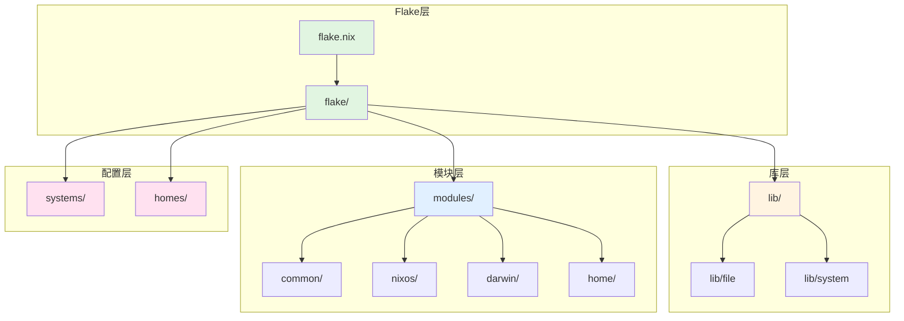
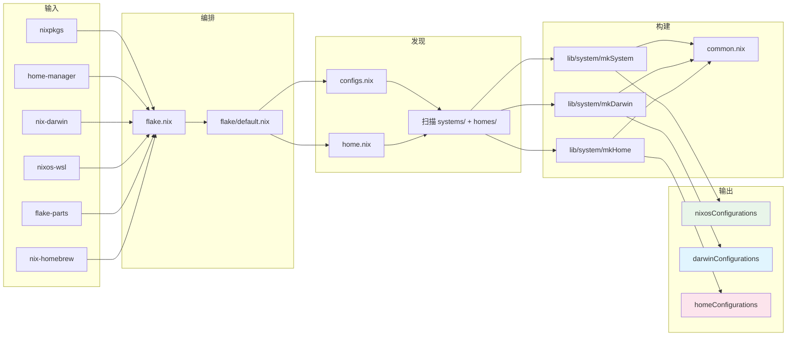

# 项目总览与设计哲学

## 1.1 项目目标

`nix_dotfiles` 是一个个人 Nix 配置仓库，致力于在所有支持 Nix 的平台上提供统一的声明式系统配置：

- **macOS** (aarch64-darwin, x86_64-darwin) 通过 nix-darwin
- **NixOS** (x86_64-linux, aarch64-linux) 桌面和服务器
- **非 NixOS Linux** 通过 Home Manager 独立运行
- **WSL2** 通过 nixos-wsl 集成

当前活跃目标：`mba`（MacBook Air, aarch64-darwin），用户 `arrake`。

## 1.2 核心设计原则

### Home-First（用户优先）

优先使用 Home Manager 模块 (`modules/home/`) 进行用户空间配置，而非系统模块。用户应用程序、点文件、shell 配置和个人偏好设置应放在 Home Manager 中。系统模块应处理硬件、网络、系统服务和平台特定的问题。

这一原则确保：

- 配置在 NixOS、Darwin 和独立 Home Manager 设置之间可移植
- 用户偏好与系统级问题保持隔离
- 当同一用户操作多台机器时可重用配置逻辑

### 命名空间 = 文件路径镜像

所有自定义 option 的路径是模块文件在 `modules/` 下的直接镜像。`modules/` 被替换为根命名空间 `dot`：

```nix
# 文件路径                                      → option 路径
modules/home/programs/terminal/tools/git/default.nix
                                                 → dot.home.programs.terminal.tools.git.enable

modules/darwin/tools/homebrew/default.nix
                                                 → dot.darwin.tools.homebrew.enable

modules/nixos/hardware/gpu/default.nix
                                                 → dot.nixos.hardware.gpu.enable
```

规则：去掉 `modules/` 前缀和 `/default.nix` 后缀，剩余路径段以 `.` 连接，根前缀为 `dot`。

### 模块化与可组合性

每个功能封装为独立的模块目录（含 `default.nix`）。套件 (Suites) 和原型 (Archetypes) 提供两级抽象：

- **套件** 捆绑相关模块，用 `mkDefault` 提供默认值
  - `dot.home.suites.common` — 基础用户配置
  - `dot.home.suites.development` — 开发工具
  - `dot.nixos.suites.desktop` — 桌面环境栈
- **原型** 定义系统角色，自动启用一组套件
  - `dot.nixos.archetypes.workstation`
  - `dot.nixos.archetypes.wsl`

### 显式导入

使用 `inherit (lib) ...` 或 `lib.<fn>` 引用库函数。避免块级 `with lib;`：

```nix
# 良好
inherit (lib) mkIf mkEnableOption;

# 良好
lib.mkIf condition { };

# 避免
with lib; { ... }
```

## 1.3 配置层级（5 层）

配置架构将代码组织在五个抽象级别中，从通用到具体：

**第 1 层：Flake 入口** (`flake.nix`)

- 声明所有外部输入（nixpkgs、home-manager、nix-darwin、nix-homebrew、nixos-wsl 等）
- 通过 flake-parts 将输出生成委托给 `flake/` 目录

**第 2 层：共享库** (`lib/`)

- 扩展 nixpkgs.lib 的自定义函数
- 系统构建器（mkSystem、mkDarwin、mkHome）
- 文件工具和模块发现函数

**第 3 层：系统模块** (`modules/common/`、`modules/nixos/`、`modules/darwin/`)

- 跨平台和平台特定的系统级配置
- NixOS：硬件、启动、服务、安全
- Darwin：nix-darwin 集成、Homebrew、macOS 系统设置

**第 4 层：用户模块与组合** (`modules/home/`、`modules/*/suites/`、`modules/*/archetypes/`)

- 用户空间配置（程序、shell、点文件）
- 套件：捆绑相关模块的默认配置
- 原型：定义系统角色，自动启用一组套件

**第 5 层：主机和用户配置** (`systems/`、`homes/`)

- 按架构和主机名的具体系统部署
- 按用户名和主机名的具体用户配置

## 1.4 flake-parts 设计哲学

本仓库使用 [flake-parts](https://github.com/hercules-ci/flake-parts) 进行模块化 flake 组织。

**主要优势：**

- **模块化输出**：每个 flake-part 模块处理特定的关注点
- **可组合性**：模块干净地导入和扩展彼此
- **分区 (Partitioning)**：开发输出（shell、格式化器、检查）将重型依赖与关键路径隔离

**结构：**

```
flake.nix
└── flake/default.nix (flake-parts 入口点)
    ├── ../lib          → flake.lib 导出
    ├── configs.nix     → nixosConfigurations, darwinConfigurations
    └── home.nix        → homeConfigurations, homeModules
```

## 1.5 仓库顶层结构



详细目录树：

```
nix_dotfiles/
├── flake.nix
├── flake.lock
│
├── flake/
│   ├── default.nix        # 主编排模块
│   ├── configs.nix        # 系统配置生成（NixOS + Darwin）
│   └── home.nix           # Home 配置生成
│
├── lib/
│   ├── default.nix        # 库导出
│   ├── file/default.nix   # 文件工具和模块发现
│   ├── module/default.nix # 模块创建助手
│   ├── overlay.nix        # 库覆盖层
│   └── system/
│       ├── default.nix    # 导出 mkSystem, mkDarwin, mkHome
│       ├── common.nix     # 共享构建逻辑
│       ├── mk-system.nix  # NixOS 配置构建器
│       ├── mk-darwin.nix  # Darwin 配置构建器
│       └── mk-home.nix    # 独立 Home Manager 配置构建器
│
├── modules/
│   ├── common/            # 跨平台系统模块
│   │   ├── nix/
│   │   └── suites/
│   ├── nixos/             # NixOS 系统模块
│   │   ├── archetypes/    # 系统原型（workstation, wsl, server）
│   │   ├── hardware/      # GPU、音频、输入设备
│   │   ├── security/      # sudo、防火墙
│   │   ├── services/      # systemd 服务
│   │   ├── suites/        # NixOS 功能捆绑
│   │   ├── system/boot/   # 启动加载器
│   │   └── user/
│   ├── darwin/            # macOS 系统模块
│   │   ├── home/          # HM 粘合层
│   │   ├── nix/
│   │   ├── suites/
│   │   ├── system/        # env、input、interface
│   │   ├── tools/         # homebrew
│   │   └── user/
│   └── home/              # Home Manager 用户模块
│       ├── host/
│       ├── programs/      # legacy-minimal, terminal/*
│       ├── roles/         # developer 等
│       ├── suites/        # common, development
│       └── user/
│
├── systems/
│   ├── aarch64-darwin/mba/
│   ├── x86_64-linux/<host>/
│   └── aarch64-linux/<host>/
│
└── homes/
    ├── aarch64-darwin/arrake@mba/
    └── x86_64-linux/<user>@<host>/
```

## 1.6 数据流



1. `flake.nix` 声明所有输入，通过 `mkFlake` 委托给 `flake/`
2. `flake/configs.nix` 发现 `systems/` 中所有主机 → 按平台过滤 → 调用 `mkSystem` / `mkDarwin`
3. `flake/home.nix` 发现 `homes/` 中所有用户 → 调用 `mkHome`
4. 三个构建器共享 `common.nix`：模块加载、home 匹配、specialArgs 组装
5. 最终生成 `nixosConfigurations`、`darwinConfigurations`、`homeConfigurations`

## 1.7 关键文件路径速查

| 路径 | 用途 |
|------|------|
| `flake.nix` | 入口点，输入声明 |
| `flake/default.nix` | flake-parts 编排模块 |
| `flake/configs.nix` | 系统配置生成 |
| `flake/home.nix` | Home 配置生成 + homeModules 导出 |
| `lib/default.nix` | 库导出入口 |
| `lib/file/default.nix` | 文件工具和模块发现 |
| `lib/module/default.nix` | 模块创建助手 |
| `lib/overlay.nix` | 库覆盖层 |
| `lib/system/common.nix` | 构建器共享逻辑 |
| `lib/system/mk-system.nix` | NixOS 配置构建器 |
| `lib/system/mk-darwin.nix` | Darwin 配置构建器 |
| `lib/system/mk-home.nix` | Home Manager 配置构建器 |
| `systems/<arch>/<hostname>/` | 主机特定配置 |
| `homes/<arch>/<user>@<host>/` | 用户特定配置 |
