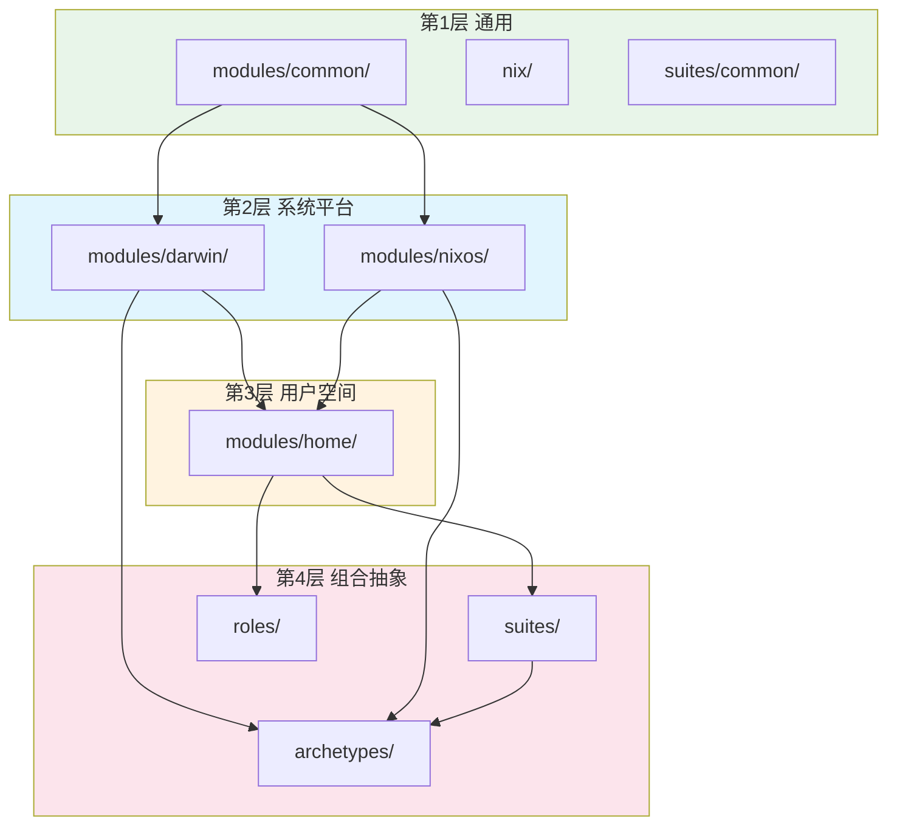
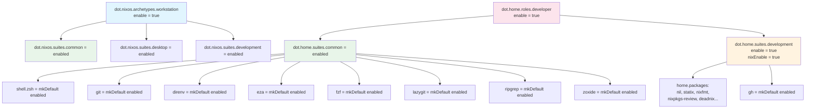

# 模块系统架构

## 2.1 模块分层



### 第 1 层：通用模块 (`modules/common/`)

NixOS 和 Darwin 之间共享的跨平台模块：

| 模块 | 内容 |
|------|------|
| `nix/` | Nix 守护进程设置、实验性特性、可信用户 |
| `suites/common/` | 共享系统包（coreutils, curl, fd, ripgrep, jq, yq 等） |

### 第 2 层：平台特定系统模块

**Darwin — macOS** (`modules/darwin/`)：

| 模块 | 内容 |
|------|------|
| `nix/` | Darwin Nix 模块（适配 Determinate Nix） |
| `home/` | 粘合层：桥接 `dot.home.*` 到 home-manager |
| `user/` | 用户账户选项（name, email, fullName, uid） |
| `system/env/` | 环境变量管理 |
| `system/input/` | 触控板和键盘输入默认值 |
| `system/interface/` | Finder、Dock、截图、NSGlobalDomain 默认值 |
| `suites/common/` | Darwin 通用套件（gnugrep、聚焦/时间机器排除） |
| `tools/homebrew/` | Homebrew 集成（nix-homebrew taps, brews, casks, mas） |

**NixOS — Linux** (`modules/nixos/`)：

| 模块 | 内容 |
|------|------|
| `archetypes/` | 系统原型（workstation, wsl, server, personal） |
| `hardware/` | GPU、音频、网络接口、输入设备 |
| `nix/` | Nix 守护进程和包设置 |
| `programs/` | 系统范围的程序安装 |
| `security/` | sudo、polkit、防火墙 |
| `services/` | systemd 服务单元 |
| `suites/` | NixOS 功能捆绑（common, desktop, development） |
| `system/boot/` | 启动加载器（systemd-boot, limine） |
| `user/` | 用户账户管理 |

### 第 3 层：Home Manager 模块 (`modules/home/`)

跨平台用户空间配置（所有平台共享）：

| 模块 | 内容 |
|------|------|
| `host/` | 主机名选项 |
| `user/` | 用户身份、shell 别名、XDG 目录 |
| `suites/common/` | 通用套件：基础包 + zsh + 终端工具 |
| `suites/development/` | 开发套件：gh, nil, statix, nixfmt 等 |
| `roles/developer/` | 开发者角色：激活 common + development |
| `programs/legacy-minimal/` | 传统 dotfile 符号链接 |
| `programs/terminal/shell/zsh/` | Zsh 配置 |
| `programs/terminal/tools/*/` | git, direnv, eza, fzf, gh, jq, lazygit, ripgrep, zoxide |

## 2.2 模块目录约定

每个模块是一个目录，包含 `default.nix`：

```
modules/home/programs/terminal/tools/git/
└── default.nix
```

`importModulesRecursive` 自动扫描收集所有含 `default.nix` 的目录。在每个构建器中被调用：

```nix
# mkSystem
++ (extendedLib.importModulesRecursive ../../modules/nixos)

# mkDarwin
++ (extendedLib.importModulesRecursive ../../modules/darwin)

# hmSharedModules (三个构建器共用)
++ (extendedLib.importModulesRecursive ../../modules/home)
```

## 2.3 标准模块模板

```nix
{ config, lib, pkgs, ... }:

let
  inherit (lib) mkIf mkEnableOption;
  cfg = config.dot.<path>;
in
{
  options.dot.<path>.enable = mkEnableOption "描述";

  config = mkIf cfg.enable {
    # 实现
  };
}
```

**Option 路径 = 文件路径镜像：**

```
modules/home/programs/terminal/tools/git/default.nix
  → dot.home.programs.terminal.tools.git.enable

modules/darwin/tools/homebrew/default.nix
  → dot.darwin.tools.homebrew.enable

modules/nixos/hardware/gpu/default.nix
  → dot.nixos.hardware.gpu.enable
```

### 实例：git 模块

文件：`modules/home/programs/terminal/tools/git/default.nix`

```nix
{ config, lib, ... }:

let
  cfg = config.dot.home.programs.terminal.tools.git;
  user = config.dot.home.user;
in
{
  options.dot.home.programs.terminal.tools.git.enable =
    lib.mkEnableOption "git";

  config = lib.mkIf cfg.enable {
    programs.git = {
      enable = true;
      settings = {
        user = {
          name = user.fullName;
          email = user.email;
        };
        init.defaultBranch = "main";
      };
    };
  };
}
```

## 2.4 命名空间结构

```
dot
├── common.*                          # 跨平台共享
│   ├── nix.*
│   └── suites.*
├── nixos.*                           # NixOS 系统
│   ├── archetypes.*                  # 系统角色
│   ├── hardware.*
│   ├── security.*
│   ├── services.*
│   ├── suites.*
│   ├── system.boot.*
│   └── user.*
├── darwin.*                          # macOS 系统
│   ├── home.*
│   ├── nix.*
│   ├── suites.*
│   ├── system.env.*
│   ├── system.input.*
│   ├── system.interface.*
│   ├── tools.homebrew.*
│   └── user.*
└── home.*                            # 用户空间（跨平台）
    ├── host.*
    ├── user.*
    ├── suites.*
    ├── roles.*
    └── programs.*
        ├── legacyMinimal.*
        ├── terminal.shell.zsh.*
        └── terminal.tools.*
```

## 2.5 套件、角色和原型

### 套件 (Suites)

将相关模块捆绑在一起，用 `mkDefault` 提供默认值。用户可直接覆盖：

```nix
# modules/home/suites/common/default.nix
# → dot.home.suites.common

config = mkIf cfg.enable {
  dot.home.programs.terminal = {
    shell.zsh = mkDefault enabled;
    tools = {
      direnv  = mkDefault enabled;
      eza     = mkDefault enabled;
      fzf     = mkDefault enabled;
      git     = mkDefault enabled;
      # ...
    };
  };
};
```

### 角色 (Roles)

Home Manager 级别的用户配置文件，启用一组套件：

```nix
# modules/home/roles/developer/default.nix
# → dot.home.roles.developer

config = lib.mkIf cfg.enable {
  dot.home.suites = {
    common = enabled;
    development = {
      enable = true;
      nixEnable = true;
    };
  };
};
```

### 原型 (Archetypes)

NixOS/Darwin 级别的系统角色标记，自动启用套件：

```nix
# modules/nixos/archetypes/workstation/default.nix
# → dot.nixos.archetypes.workstation

config = mkIf cfg.enable {
  dot.nixos.suites = {
    common = enabled;
    desktop = enabled;
    development = enabled;
  };
};
```

### 配置级联



### 何时使用哪种抽象

| 场景 | 抽象 | 示例 |
|------|------|------|
| "这是一台工作站" | 原型 | `dot.nixos.archetypes.workstation = enabled` |
| "这是 WSL 环境" | 原型 | `dot.nixos.archetypes.wsl = enabled` |
| "我需要桌面环境" | 套件 | `dot.nixos.suites.desktop = enabled` |
| "我需要开发工具" | 套件 | `dot.home.suites.development = enabled` |
| "我是开发者" | 角色 | `dot.home.roles.developer = enabled` |
| "启用特定工具" | 单独选项 | `dot.home.programs.terminal.tools.git.enable = true` |

## 2.6 homeModules.default 导出

`flake/home.nix` 将 `modules/home` 导出，允许外部 flake 重用本项目的 Home Manager 模块：

```nix
flake = {
  homeModules.default = ../modules/home;
  homeConfigurations = lib.mapAttrs' generateHomeConfiguration allHomes;
};
```
