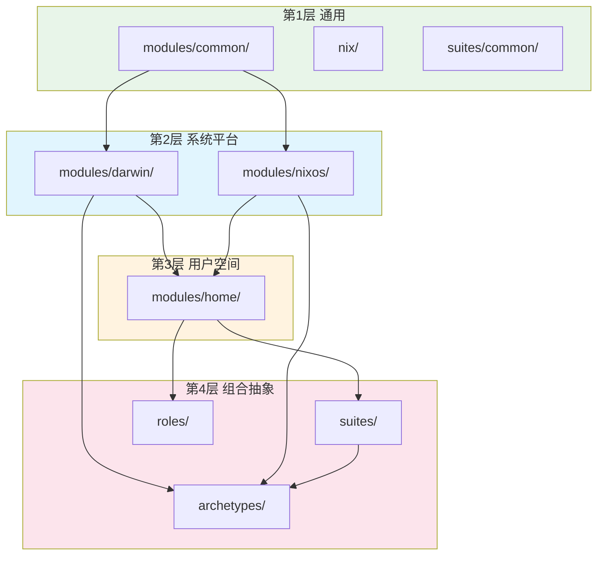
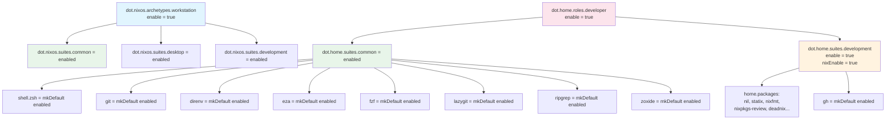

# 模块系统架构

## 2.1 模块分层



### 第 1 层：通用模块 (`modules/common/`)

NixOS 和 Darwin 之间共享的跨平台模块：

| 模块 | 内容 |
|------|------|
| `nix/` | Nix 守护进程设置、实验性特性、可信用户 |
| `suites/common/` | 共享系统包（coreutils, curl, fd, ripgrep, jq, yq 等） |

### 第 2 层：平台特定系统模块

**Darwin — macOS** (`modules/darwin/`)：

| 模块 | 内容 |
|------|------|
| `nix/` | Darwin Nix 模块（适配 Determinate Nix） |
| `home/` | 粘合层：桥接 `dot.home.*` 到 home-manager |
| `user/` | 用户账户选项（name, email, fullName, uid） |
| `system/env/` | 环境变量管理 |
| `system/input/` | 触控板和键盘输入默认值 |
| `system/interface/` | Finder、Dock、截图、NSGlobalDomain 默认值 |
| `suites/common/` | Darwin 通用套件（gnugrep、聚焦/时间机器排除） |
| `tools/homebrew/` | Homebrew 集成（nix-homebrew taps, brews, casks, mas） |

**NixOS — Linux** (`modules/nixos/`)：

| 模块 | 内容 |
|------|------|
| `archetypes/` | 系统原型（workstation, wsl, server, personal） |
| `hardware/` | GPU、音频、网络接口、输入设备 |
| `nix/` | Nix 守护进程和包设置 |
| `programs/` | 系统范围的程序安装 |
| `security/` | sudo、polkit、防火墙 |
| `services/` | systemd 服务单元 |
| `suites/` | NixOS 功能捆绑（common, desktop, development） |
| `system/boot/` | 启动加载器（systemd-boot, limine） |
| `user/` | 用户账户管理 |

### 第 3 层：Home Manager 模块 (`modules/home/`)

跨平台用户空间配置（所有平台共享）。**硬性约定：`modules/home/` 只放跨平台软件**（macOS / Linux 都能用）；macOS 专有软件（如 karabiner、输入法）必须放 `modules/darwin/`，NixOS 专有软件放 `modules/nixos/`：

| 模块 | 内容 |
|------|------|
| `host/` | 主机名选项 |
| `user/` | 用户身份、shell 别名、XDG 目录 |
| `suites/` | 功能捆绑，按场景组合相关配置 |
| `roles/` | 组合多个 suites 形成特定身份 |
| `programs/` | 各类程序的声明式配置（shell、终端工具、应用等） |
| 兼容层 | 对传统 dotfile 的渐进式迁移支持 |

## 2.2 模块目录约定

每个模块是一个目录，包含 `default.nix`：

```
modules/home/programs/terminal/tools/git/
└── default.nix
```

`importModulesRecursive` 自动扫描收集所有含 `default.nix` 的目录。在每个构建器中被调用：

```nix
# mkSystem
++ (extendedLib.importModulesRecursive ../../modules/nixos)

# mkDarwin
++ (extendedLib.importModulesRecursive ../../modules/darwin)

# hmSharedModules (三个构建器共用)
++ (extendedLib.importModulesRecursive ../../modules/home)
```

## 2.3 标准模块模板

```nix
{ config, lib, pkgs, ... }:

let
  inherit (lib) mkIf mkEnableOption;
  cfg = config.dot.<path>;
in
{
  options.dot.<path>.enable = mkEnableOption "描述";

  config = mkIf cfg.enable {
    # 实现
  };
}
```

**Option 路径 = 文件路径镜像：**

```
modules/home/programs/terminal/tools/git/default.nix
  → dot.home.programs.terminal.tools.git.enable

modules/darwin/tools/homebrew/default.nix
  → dot.darwin.tools.homebrew.enable

modules/nixos/hardware/gpu/default.nix
  → dot.nixos.hardware.gpu.enable
```

### 实例：git 模块

文件：`modules/home/programs/terminal/tools/git/default.nix`

```nix
{ config, lib, ... }:

let
  cfg = config.dot.home.programs.terminal.tools.git;
  user = config.dot.home.user;
in
{
  options.dot.home.programs.terminal.tools.git.enable =
    lib.mkEnableOption "git";

  config = lib.mkIf cfg.enable {
    programs.git = {
      enable = true;
      settings = {
        user = {
          name = user.fullName;
          email = user.email;
        };
        init.defaultBranch = "main";
      };
    };
  };
}
```

## 2.4 命名空间结构

```
dot
├── common.*                          # 跨平台共享
│   ├── nix.*
│   └── suites.*
├── nixos.*                           # NixOS 系统
│   ├── archetypes.*                  # 系统角色
│   ├── hardware.*
│   ├── security.*
│   ├── services.*
│   ├── suites.*
│   ├── system.boot.*
│   └── user.*
├── darwin.*                          # macOS 系统
│   ├── home.*
│   ├── nix.*
│   ├── suites.*
│   ├── system.env.*
│   ├── system.input.*
│   ├── system.interface.*
│   ├── tools.homebrew.*
│   └── user.*
└── home.*                            # 用户空间（跨平台）
    ├── host.*
    ├── user.*
    ├── suites.*
    ├── roles.*
    └── programs.*
        ├── legacyMinimal.*
        ├── terminal.shell.zsh.*
        └── terminal.tools.*
```

## 2.5 套件、角色和原型

### 套件 (Suites)

将相关模块捆绑在一起，用 `mkDefault` 提供默认值。用户可直接覆盖：

```nix
# modules/home/suites/common/default.nix
# → dot.home.suites.common

config = mkIf cfg.enable {
  dot.home.programs.terminal = {
    shell.zsh = mkDefault enabled;
    tools = {
      direnv  = mkDefault enabled;
      eza     = mkDefault enabled;
      fzf     = mkDefault enabled;
      git     = mkDefault enabled;
      # ...
    };
  };
};
```

suite 可以**聚合**其他 suite（`common` 聚合 `core` 即为此例），形成层级：聚合是"包含"语义，与 roles 的"身份"语义区分。依赖必须单向、无环（core 不反向引用 common）。

### 角色 (Roles)

Home Manager 级别的用户配置文件，启用一组套件：

```nix
# modules/home/roles/developer/default.nix
# → dot.home.roles.developer

config = lib.mkIf cfg.enable {
  dot.home.suites = {
    common = enabled;
    development = {
      enable = true;
      nixEnable = true;
    };
  };
};
```

### 原型 (Archetypes)

NixOS/Darwin 级别的系统角色标记，自动启用套件：

```nix
# modules/nixos/archetypes/workstation/default.nix
# → dot.nixos.archetypes.workstation

config = mkIf cfg.enable {
  dot.nixos.suites = {
    common = enabled;
    desktop = enabled;
    development = enabled;
  };
};
```

### 配置级联



### 何时使用哪种抽象

| 场景 | 抽象 | 示例 |
|------|------|------|
| "这是一台工作站" | 原型 | `dot.nixos.archetypes.workstation = enabled` |
| "这是 WSL 环境" | 原型 | `dot.nixos.archetypes.wsl = enabled` |
| "我需要桌面环境" | 套件 | `dot.nixos.suites.desktop = enabled` |
| "我需要开发工具" | 套件 | `dot.home.suites.development = enabled` |
| "我是开发者" | 角色 | `dot.home.roles.developer = enabled` |
| "启用特定工具" | 单独选项 | `dot.home.programs.terminal.tools.git.enable = true` |

## 2.6 homeModules.default 导出

`flake/home.nix` 将 `modules/home` 导出，允许外部 flake 重用本项目的 Home Manager 模块：

```nix
flake = {
  homeModules.default = ../modules/home;
  homeConfigurations = lib.mapAttrs' generateHomeConfiguration allHomes;
};
```

## 2.7 新增软件配置流程

新增一个软件、工具或应用配置时，先判断职责归属，再创建目录。

### 第零步：参考 khanelinix

在动手写任何新模块之前，先查阅本地 khanelinix clone 中的对应模块实现。

**本地路径**：`~/nix/khanelinix`

```bash
# 搜索相关模块
rg -l "<软件名>" ~/nix/khanelinix/modules/
# 阅读找到的模块
read ~/nix/khanelinix/modules/home/programs/.../default.nix
```

- 找到 khanelinix 中同类模块的实现模式。
- 注意命名空间适配：`khanelinix.*` → `dot.*`，`khaneliman` → `arrake`。
- 具体指引见 [docs/reference.md](../reference.md) 和 AGENTS.md 第 7 节。

### 第一步：判断放置位置

| 软件类型 | 放置位置 |
|----------|----------|
| 用户空间配置、dotfiles、CLI、编辑器、shell、git、开发工具 | `modules/home/` |
| macOS 系统设置、Homebrew、nix-darwin 集成 | `modules/darwin/` |
| NixOS 服务、硬件、网络、安全、systemd | `modules/nixos/` |
| Darwin 和 NixOS 共享的系统级能力 | `modules/common/` |
| 单台机器专属配置 | `systems/{arch}/{hostname}/default.nix` |
| 单个用户在单台机器上的专属配置 | `homes/{arch}/{user}@{host}/default.nix` |

默认优先 Home-First：只要是用户偏好、工具配置或 dotfile，就优先放入 `modules/home/`。

### 第二步：选择 Home 程序分类

`modules/home/programs/` 下按用途分类，不按安装来源分类：

| 类型 | 路径 |
|------|------|
| shell | `modules/home/programs/terminal/shell/<name>/` |
| 终端工具 | `modules/home/programs/terminal/tools/<name>/` |
| AI agent 工具 | `modules/home/programs/agent/<name>/` |
| 编辑器 | `modules/home/programs/editors/<name>/` |
| 开发语言工具链 | `modules/home/programs/development/languages/<name>/` |
| 开发平台工具 | `modules/home/programs/development/tools/<name>/` |
| 图形应用配置 | `modules/home/programs/apps/<name>/` |
| 文件管理 | `modules/home/programs/files/<name>/` |

如果没有合适分类，先复用最接近的已有目录；只有当多个模块都会受益时才新增分类目录。

### 第三步：命名

- 目录名使用 `kebab-case`。
- option 名使用 `camelCase`。
- 软件名称优先匹配项目既有命名；没有既有命名时使用清晰、短小、可读的名称。

示例：

| 软件 | 推荐目录 |
|------|----------|
| GitHub CLI | `gh` |
| lazygit | `lazygit` |
| Visual Studio Code | `vscode` |
| direnv | `direnv` |

### 第四步：决定启用层级

| 层级 | 用途 |
|------|------|
| 单个模块 | 一个软件或一项能力的最小配置单元 |
| suite | 一组常用模块的默认组合 |
| role | 用户身份组合，例如开发者 |
| archetype | 机器角色组合，例如工作站或服务器 |
| host/user 配置 | 具体机器或具体用户的最终选择 |

规则：

- 常见工具组放入 suite。
- 用户身份组合放入 role。
- 机器角色组合放入 archetype。
- 一次性偏好只放 host/user 配置，不要抽象。
- suite 中启用下游模块时应使用 `mkDefault`，让具体配置可以覆盖。

### 第五步：拆分安装和配置

同一个软件可能同时有安装来源和用户配置。按职责拆分：

- Homebrew 安装项归 `modules/darwin/`。
- 跨平台或可移植的用户配置归 `modules/home/`。
- 仅在 macOS 运行、且与系统安装强绑定的软件，模块可放在 `modules/darwin/`，通过 `home-manager.users.<name>` 部署用户文件（例如 Karabiner、Squirrel）。
- NixOS 系统服务归 `modules/nixos/`。

不要因为软件通过 Homebrew 安装，就把**跨平台**用户配置也塞进 Darwin 模块。

### 第六步：静态配置文件放 `config/`，不放 `modules/`

Nix 模块（`default.nix`、option、启用逻辑）和静态配置文件（json / toml / kdl / lua 等）分开存放。

| 内容 | 放置位置 | 反例 |
|------|----------|------|
| 模块逻辑 | `modules/**/<name>/default.nix` | 把大段 json 内嵌进 `default.nix` |
| 映射到 `$HOME` 的静态文件 | `config/home/`，目录结构镜像 home | `modules/**/karabiner.json` |
| 引用方式 | `lib.file.getFile "config/home/..."` + `mkOutOfStoreSymlink`（直接软链接，编辑即时生效） | `source = ./app.json` 与模块同目录 |

`config/home/` 镜像用户 home 布局：

```text
config/home/
├── .config/
│   ├── helix/config.toml
│   ├── karabiner/karabiner.json
│   ├── yazi/
│   └── zellij/config.kdl
├── .zshrc
└── ...
```

规则：

1. **模块目录只放 Nix 模块代码**（通常是 `default.nix`）。不要把应用的 json/toml/xml 等配置资产和 `default.nix` 放在同一目录。
2. **会部署到用户 home 的文件**一律放 `config/home/`，路径与目标 home 相对路径一致。  
   例：目标 `~/.config/karabiner/karabiner.json` → 仓库 `config/home/.config/karabiner/karabiner.json`。
3. **Home 模块**优先通过 `dot.home.programs.terminal.shell.zsh.sourceRoot`（即 `config/home`）+ `mkOutOfStoreSymlink` 引用，直接软链接到项目文件，编辑即时生效、无需 rebuild。
4. **Darwin / NixOS 模块**若需部署 home 文件，用 `home-manager.users.<name>`，在子模块里用 `config.lib.file.mkOutOfStoreSymlink (lib.file.getFile "config/home/...")`：

```nix
home-manager.users.${config.dot.darwin.user.name} = { config, ... }: {
  xdg.configFile."karabiner/karabiner.json".source =
    config.lib.file.mkOutOfStoreSymlink (lib.file.getFile "config/home/.config/karabiner/karabiner.json");
};
```

> **软链接机制**：`lib.file.getFile` 返回仓库真实路径（根路径唯一集中在 `lib/file/default.nix` 的 `repoRoot`），`mkOutOfStoreSymlink` 生成指向该路径的链接。纯求值下 Nix 无法自动得知仓库位置（`self` 是 store 快照、`builtins.getEnv` 纯求值为空），所以必须集中定义一次；换机器或移动仓库只改 `repoRoot` 一处。
>
> **不要**把 `lib.file.getFile` 的结果直接作为 `source`（Home Manager 会经 `builtins.path` 复制进 store，变成只读副本，编辑需 rebuild）。

5. 只有生成逻辑本身就是 Nix（小 attrset → `builtins.toJSON`）时，才可以不落静态文件；大映射表、上游导出的完整配置优先作为 `config/home/` 静态文件管理。
