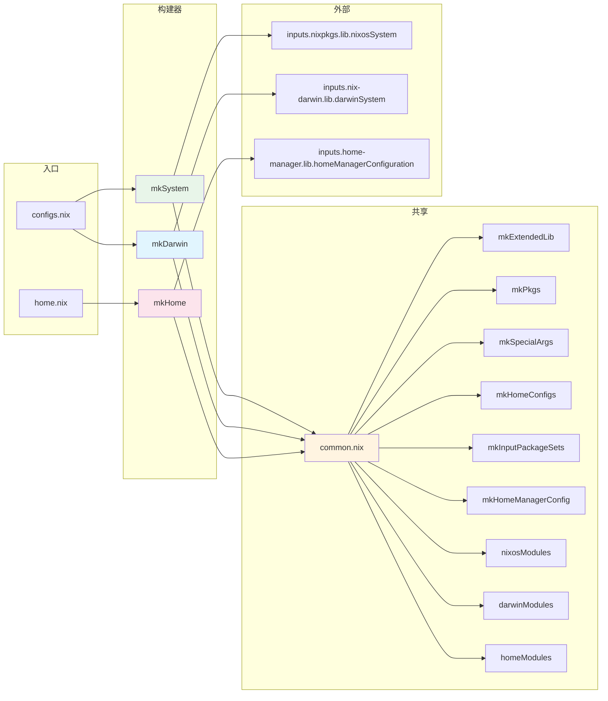
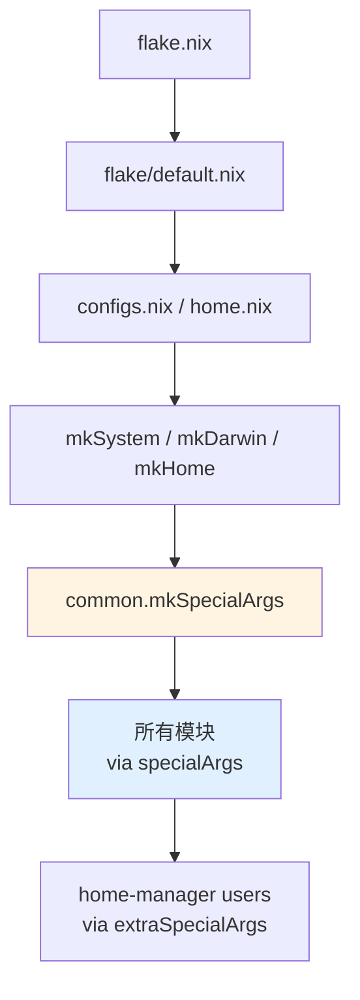

# 库层架构

## 3.1 概述

`lib/` 提供自定义库函数，通过 `nixpkgs.lib.extend` 合并到扩展的 `lib` 中，供所有模块和构建器使用。

```
lib/
├── default.nix        # 库导出入口
├── file/default.nix   # 文件系统工具和模块发现
├── module/default.nix # 模块创建助手
├── overlay.nix        # 库覆盖层
└── system/            # 系统构建器
    ├── default.nix    # 导出 mkSystem, mkDarwin, mkHome
    ├── common.nix     # 共享构建逻辑
    ├── mk-system.nix  # NixOS 配置构建器
    ├── mk-darwin.nix  # Darwin 配置构建器
    └── mk-home.nix    # 独立 Home Manager 配置构建器
```

## 3.2 lib/default.nix — 库导出

四个子库以 `flake.lib` 导出：

```nix
flake.lib = {
  file   = import ./file { inherit inputs self; };
  module = import ./module { inherit inputs; };
  overlay = import ./overlay.nix { inherit inputs self; };
  system = import ./system { inherit inputs self; };
};
```

## 3.3 lib/file/default.nix — 文件工具和模块发现

### 基础文件操作

| 函数 | 用途 |
|------|------|
| `getFile` | 解析相对于 flake 根的路径 |
| `pathExists` | 检查路径是否存在 |
| `safeImport` | 导入文件，缺失时返回默认值 |
| `listDir` | 列出目录内容 |
| `listNames` | 列出目录条目名称 |
| `listDirectories` | 仅列出子目录 |
| `getNixFiles` | 过滤 `.nix` 文件 |
| `mergeAttrs` | 合并属性集列表 |

### importModulesRecursive

递归扫描目录，收集所有包含 `default.nix` 的目录路径：

```nix
importModulesRecursive = dirPath:
  let
    walkDir = currentPath:
      let
        entries = builtins.readDir currentPath;
        entryNames = builtins.attrNames entries;
        directoriesWithDefault = lib.filter (
          name: entries.${name} == "directory"
            && builtins.pathExists (currentPath + "/${name}/default.nix")
        ) entryNames;
        allDirectories = builtins.filter
          (name: entries.${name} == "directory")
          entryNames;
      in
      map (name: currentPath + "/${name}") directoriesWithDefault
      ++ builtins.concatLists
        (map (dir: walkDir (currentPath + "/${dir}")) allDirectories);
  in
  walkDir dirPath;
```

### parseSystemConfigurations

两级扫描发现系统配置 (`systems/{arch}/{hostname}/`)：

```nix
parseSystemConfigurations = systemsPath:
  let
    entries = builtins.readDir systemsPath;
    systemArchs = lib.filter (name: entries.${name} == "directory")
                            (builtins.attrNames entries);
    generateSystemConfigs = system:
      let
        systemPath = systemsPath + "/${system}";
        hosts = builtins.attrNames (builtins.readDir systemPath);
      in
      genAttrs hosts (hostname: {
        inherit system hostname;
        path = systemPath + "/${hostname}";
      });
  in
  builtins.foldl' (acc: system: acc // generateSystemConfigs system) { } systemArchs;
```

### parseHomeConfigurations

两级扫描 + `username@hostname` 解析 (`homes/{arch}/{user}@{host}/`)：

```nix
parseHomeConfigurations = homesPath:
  let
    # ... 两级扫描同上
    parseUserAtHost = userAtHost:
      let
        parts = builtins.split "@" userAtHost;
        username = builtins.head parts;
        hostname = builtins.elemAt parts 2;
      in
      { inherit system username hostname userAtHost;
        path = systemPath + "/${userAtHost}"; };
  in
  # ...
```

### 平台过滤

```nix
filterNixOSSystems = systems:
  filterAttrs (_name: { system, ... }:
    hasPrefix "x86_64-linux" system || hasPrefix "aarch64-linux" system
  ) systems;

filterDarwinSystems = systems:
  filterAttrs (_name: { system, ... }:
    hasPrefix "aarch64-darwin" system || hasPrefix "x86_64-darwin" system
  ) systems;
```

## 3.4 lib/module/default.nix — 模块助手

| 函数 | 用途 |
|------|------|
| `mkOpt type default desc` | 创建带描述的选项 |
| `mkBoolOpt default desc` | 创建布尔选项 |
| `enabled` | `{ enable = true; }` 简写 |
| `disabled` | `{ enable = false; }` 简写 |
| `capitalize s` | 字符串首字母大写 |
| `boolToNum bool` | 布尔转 0/1 |
| `default-attrs` | 对 attrset 所有值应用 `mkDefault` |
| `nested-default-attrs` | 对嵌套 attrset 应用 `mkDefault` |

`enabled` 是套件、角色和原型系统的核心：

```nix
# 等价
dot.home.suites.common = enabled;
dot.home.suites.common.enable = true;
```

## 3.5 lib/overlay.nix — 库覆盖层

将所有子库函数合并到 `nixpkgs.lib`，通过 `nixpkgs.lib.extend` 应用：

```nix
_final: _prev:
{
  dot = moduleLib;       # 模块助手命名空间
  file = fileLib;        # 文件工具
  inherit (fileLib) getFile importModulesRecursive ...;
  inherit (moduleLib) enabled disabled mkOpt mkBoolOpt ...;
  inherit (inputs.home-manager.lib) hm;
}
```

## 3.6 lib/system/ — 系统构建器



### common.nix — 共享逻辑

| 函数 | 用途 |
|------|------|
| `mkPkgs` | 使用 flake 覆盖层导入 nixpkgs |
| `mkExtendedLib` | 用 flake 覆盖层扩展 nixpkgs.lib |
| `mkNixpkgsConfig` | 创建 nixpkgs 配置（allowUnfree + overlays） |
| `mkInputPackageSets` | 创建替代 nixpkgs 渠道（master, unstable） |
| `mkHomeConfigs` | 按 system + hostname 过滤匹配的 home 配置 |
| `mkHomeManagerConfig` | 为系统集成组装 home-manager 配置块 |
| `mkSpecialArgs` | 组装传入所有模块的特殊参数 |
| `nixosModules` | `importModulesRecursive ../../modules/nixos` |
| `darwinModules` | `importModulesRecursive ../../modules/darwin` |
| `homeModules` | `importModulesRecursive ../../modules/home` |

### mkSystem — NixOS 配置构建器

位于 `lib/system/mk-system.nix`，调用 `inputs.nixpkgs.lib.nixosSystem`：

```nix
{ system, hostname, username, modules ? [ ] }:

let
  common = import ./common.nix { inherit inputs self; };
  extendedLib = common.mkExtendedLib self;
  matchingHomes = common.mkHomeConfigs { inherit system hostname; };
  homeManagerConfig = common.mkHomeManagerConfig {
    inherit extendedLib inputs system hostname matchingHomes;
    isNixOS = true;
  };
  specialArgs = common.mkSpecialArgs { ... };
in
inputs.nixpkgs.lib.nixosSystem {
  inherit system specialArgs;
  modules =
    [
      { nixpkgs = common.mkNixpkgsConfig self; }
      inputs.home-manager.nixosModules.home-manager
      inputs.nixos-wsl.nixosModules.wsl
      homeManagerConfig
    ]
    ++ common.nixosModules
    ++ [ ../../systems/${system}/${hostname} ]
    ++ modules;
}
```

### mkDarwin — Darwin 配置构建器

位于 `lib/system/mk-darwin.nix`，调用 `inputs.nix-darwin.lib.darwinSystem`：

```nix
{ system, hostname, username, modules ? [ ] }:

let
  common = import ./common.nix { inherit inputs self; };
  extendedLib = common.mkExtendedLib self;
  matchingHomes = common.mkHomeConfigs { inherit system hostname; };
  specialArgs = common.mkSpecialArgs { ... };
in
inputs.nix-darwin.lib.darwinSystem {
  inherit system specialArgs;
  modules =
    [
      { nixpkgs = { hostPlatform = system; } // common.mkNixpkgsConfig self; }
      inputs.home-manager.darwinModules.home-manager
      inputs.nix-homebrew.darwinModules.nix-homebrew
      {
        home-manager = {
          useGlobalPkgs = true;
          useUserPackages = true;
          extraSpecialArgs = specialArgs;
          sharedModules = common.homeModules;
          users = /* 自动注入匹配 homes/ */;
        };
      }
    ]
    ++ common.darwinModules
    ++ [ ../../systems/${system}/${hostname} ]
    ++ modules;
}
```

**Darwin vs NixOS 构建差异：**

| 方面 | mkSystem | mkDarwin |
|------|----------|----------|
| 构建函数 | `nixosSystem` | `darwinSystem` |
| HM 模块 | `nixosModules.home-manager` | `darwinModules.home-manager` |
| 额外模块 | nixos-wsl, 启动, 安全 | nix-homebrew |
| Home 注入 | 通过 `homeManagerConfig` | 直接在模块中配置 `home-manager.users` |
| Home 目录 | `/home/<user>` | `/Users/<user>` |

### mkHome — 独立 Home Manager 构建器

位于 `lib/system/mk-home.nix`，不集成到任何系统中：

```nix
{ system, hostname, username, modules ? [ ] }:

let
  common = import ./common.nix { inherit inputs self; };
  extendedLib = common.mkExtendedLib self;
  specialArgs = common.mkSpecialArgs { ... };
in
inputs.home-manager.lib.homeManagerConfiguration {
  pkgs = common.mkPkgs system;
  extraSpecialArgs = specialArgs;
  modules = common.homeModules ++ modules;
}
```

mkHome 独立创建 pkgs，适用于非 NixOS Linux 或独立 Home Manager 场景。

### specialArgs 传输链



`mkSpecialArgs` 内容：

| 键 | 来源 | 用途 |
|----|------|------|
| `inputs` | flake.nix | 访问所有 flake 输入 |
| `self` | inputs.self | 对本 flake 输出的引用 |
| `hostname` | 目录名 | 当前主机名 |
| `username` | 构建器参数 | 主要用户名 |
| `system` | 构建器参数 | 架构 |
| `lib` | mkExtendedLib | 含 dot 扩展的 nixpkgs lib |
