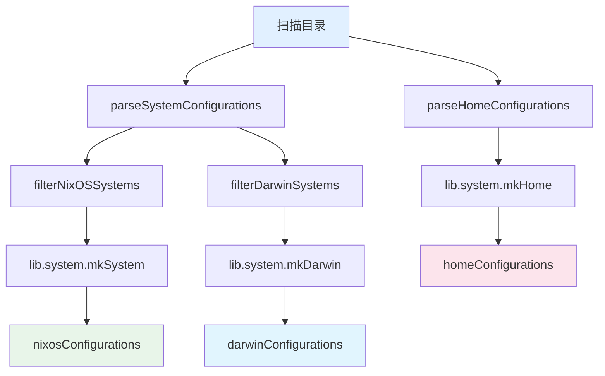

# 系统与 Home 配置

## 4.1 配置组织结构

### 系统配置 (`systems/`)

按架构和主机名组织：

```
systems/
├── aarch64-darwin/
│   └── mba/default.nix
├── x86_64-linux/
│   ├── <desktop>/default.nix
│   └── <laptop>/default.nix
└── aarch64-linux/
    └── <server>/default.nix
```

**路径模式**：`systems/{arch}/{hostname}/default.nix`

NixOS 主机通常还会拆分出辅助文件：

| 文件 | 用途 |
|------|------|
| `default.nix` | 主系统配置，导入其他文件 |
| `hardware.nix` | 硬件特定设置（CPU、GPU、内核模块） |
| `disks.nix` | 磁盘分区和文件系统（disko） |
| `network.nix` | 网络接口配置 |

### Home 配置 (`homes/`)

按架构和 `username@hostname` 组织：

```
homes/
├── aarch64-darwin/
│   └── arrake@mba/default.nix
├── x86_64-linux/
│   └── <user>@<host>/default.nix
└── aarch64-linux/
    └── <user>@<host>/default.nix
```

**路径模式**：`homes/{arch}/{username}@{hostname}/default.nix`

`@` 由 `parseHomeConfigurations` 通过 `builtins.split "@"` 解析为 username 和 hostname。

## 4.2 自动发现机制



**核心优势**：新增主机或用户只需在 `systems/` 或 `homes/` 下创建目录，无需修改 `flake.nix` 或任何 flake/ 模块。

### 系统发现 (`flake/configs.nix`)

```nix
let
  inherit (self.lib.file)
    parseSystemConfigurations
    filterNixOSSystems
    filterDarwinSystems;
  systemsPath = ../systems;
  allSystems = parseSystemConfigurations systemsPath;
in
{
  flake = {
    nixosConfigurations = lib.mapAttrs' (
      _name: { system, hostname, ... }:
      {
        name = hostname;
        value = self.lib.system.mkSystem {
          inherit inputs system hostname;
          username = "arrake";
        };
      }
    ) (filterNixOSSystems allSystems);

    darwinConfigurations = lib.mapAttrs' (
      _name: { system, hostname, ... }:
      {
        name = hostname;
        value = self.lib.system.mkDarwin {
          inherit inputs system hostname;
          username = "arrake";
        };
      }
    ) (filterDarwinSystems allSystems);
  };
}
```

### Home 发现 (`flake/home.nix`)

```nix
let
  inherit (self.lib.file) parseHomeConfigurations;
  homesPath = ../homes;
  allHomes = parseHomeConfigurations homesPath;
in
{
  imports = [ inputs.home-manager.flakeModules.home-manager ];

  flake = {
    homeModules.default = ../modules/home;
    homeConfigurations = lib.mapAttrs' generateHomeConfiguration allHomes;
  };
}
```

## 4.3 配置示例：NixOS 桌面

`systems/x86_64-linux/<host>/default.nix`：

```nix
{ lib, pkgs, ... }:

let
  inherit (lib) enabled;
in
{
  dot = {
    nixos = {
      archetypes = {
        workstation = enabled;
        personal = enabled;
      };

      suites.development = {
        enable = true;
        nixEnable = true;
      };
    };
  };

  networking.hostName = "<host>";

  boot.loader = {
    systemd-boot.enable = true;
    efi.canTouchEfiVariables = true;
  };

  system.stateVersion = "25.05";
}
```

用 `archetypes` 声明系统角色，自动启用对应套件。不需要逐个启用套件。

## 4.4 配置示例：Darwin (macOS)

`systems/aarch64-darwin/mba/default.nix`：

```nix
{ lib, pkgs, ... }:

let
  inherit (lib) enabled;
in
{
  dot = {
    darwin = {
      user = {
        name = "arrake";
        email = "arrake@163.com";
        fullName = "arrake";
        uid = 501;
      };

      suites.common = enabled;

      tools.homebrew = {
        enable = true;
        cleanup = "zap";
        masEnable = true;
      };
    };
  };

  networking = {
    computerName = "mba";
    hostName = "mba";
    localHostName = "mba";
  };

  system.stateVersion = 6;

  system.keyboard = {
    enableKeyMapping = true;
    remapCapsLockToEscape = true;
  };

  security.pam.services.sudo_local.touchIdAuth = true;

  homebrew = {
    taps = [ "anomalyco/tap" "homebrew/cask" "homebrew/core" ];
    brews = [ "codex" "mas" "opencode" ];
    casks = [ "google-chrome" "ghostty" "karabiner-elements" ... ];
  };
}
```

## 4.5 配置示例：Home

`homes/aarch64-darwin/arrake@mba/default.nix`：

```nix
{ lib, ... }:

let
  inherit (lib) enabled;
in
{
  dot.home = {
    user = {
      enable = true;
      name = "arrake";
      email = "arrake@163.com";
      fullName = "arrake";
    };

    roles.developer = enabled;

    programs = {
      legacyMinimal = enabled;
      terminal.shell.zsh.enable = false;
    };
  };

  home.stateVersion = "25.05";
}
```

## 4.6 系统 vs Home 配置对比

| 方面 | 系统配置 (`systems/`) | Home 配置 (`homes/`) |
|------|----------------------|---------------------|
| **范围** | 机器范围 | 用户特定 |
| **构建器** | `mkSystem` / `mkDarwin` | `mkHome`（独立）或自动注入 |
| **关键选项** | `dot.nixos.archetypes.*`、`dot.darwin.*` | `dot.home.roles.*`、`dot.home.programs.*` |
| **服务** | systemd / launchd 服务 | 用户级服务 |
| **硬件** | 启动配置、GPU、磁盘 | 无（或显示器设置） |
| **身份** | 主机名定义机器 | `dot.home.user` 定义用户 |

**Home-First 原则在实践中的体现**：系统配置处理启动、安全和系统服务，Home 配置处理应用程序和用户偏好。同一份 Home 配置可在多台机器上复用，甚至通过独立 Home Manager 在非 NixOS 系统上使用。

## 4.7 配置覆盖机制

套件用 `mkDefault` 设置默认值，用户可直接赋值覆盖：

```nix
# 套件默认（优先级低）
dot.home.programs.terminal.shell.zsh = mkDefault enabled;

# 用户覆盖（优先级高，直接赋值覆盖 mkDefault）
dot.home.programs.terminal.shell.zsh.enable = false;
```

## 4.8 约定

1. **Option 路径 = 文件路径镜像**：`modules/<path>/default.nix` → `dot.<path>`
2. **使用 `enabled` 简写**：`lib.enabled` 优于逐字 `{ enable = true; }`
3. **优先使用抽象**：原型 > 套件 > 单独选项
4. **stateVersion**：始终设置 `system.stateVersion` 和 `home.stateVersion`
5. **变量命名**：驼峰 (`camelCase`)
6. **文件命名**：短横线 (`kebab-case`)
7. **系统配置保持硬件分离**：将硬件设置放在 `hardware.nix` 等独立文件中
8. **Home 配置保持轻量**：主要通过角色和套件声明，最小化直接配置
