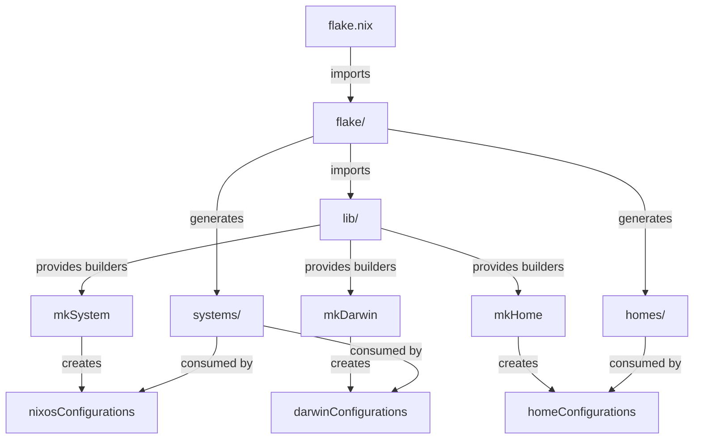
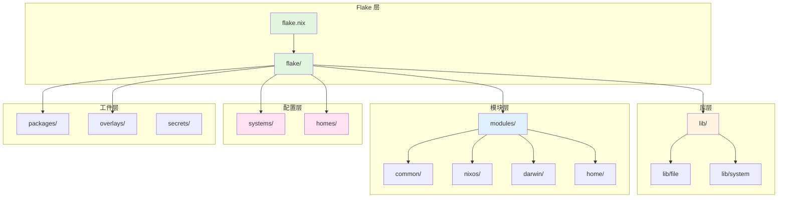
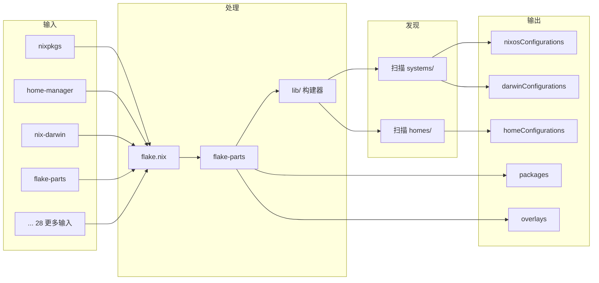
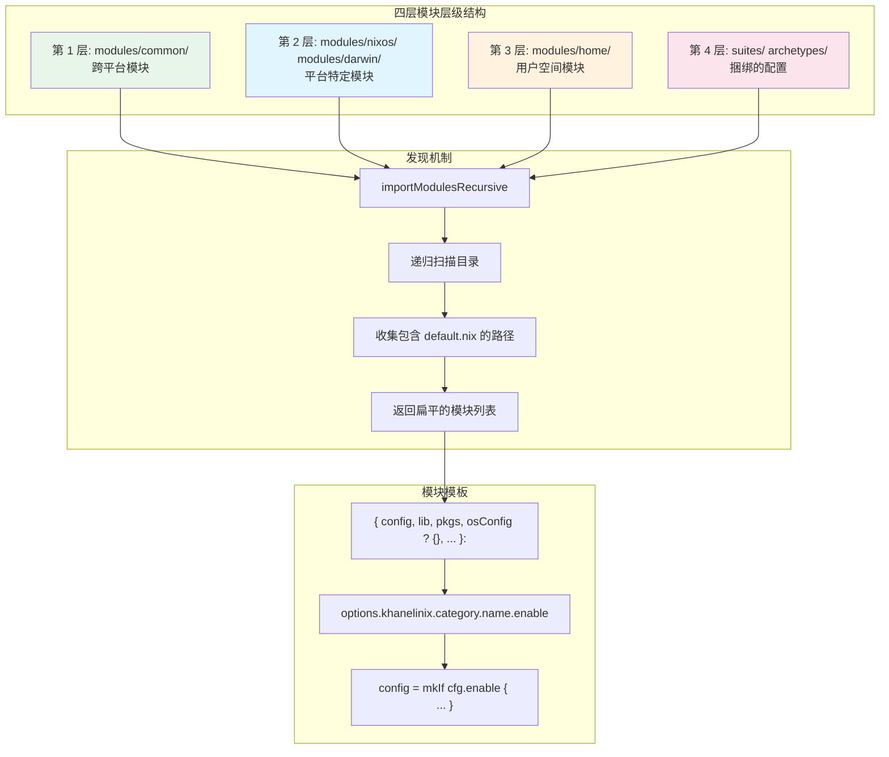

本文是 docs/architecture-deep.md 的中文翻译版本

# KhaneliNix 架构深度解析
用于理解和贡献 KhaneliNix 配置的完整技术参考文档。

---

## 第一章：概述与设计哲学
### 1.1 项目目标
KhaneliNix 是一个个人 Nix 配置仓库，用于管理 NixOS 系统、通过 nix-darwin 管理的 macOS 机器，以及独立的 Home Manager 配置。它为跨多个平台和架构的系统配置提供了一种统一的声明式方法。

本仓库支持：

+ **NixOS** (x86_64-linux, aarch64-linux) 用于桌面和服务器系统
+ **macOS** (aarch64-darwin) 通过 nix-darwin 用于 Apple Silicon Mac
+ **Home Manager** 用于任何支持平台上的用户级配置
+ **WSL** 环境通过 nixos-wsl 集成

### 1.2 核心设计原则
#### Home-First（用户优先）
优先使用 Home Manager 模块 (`modules/home/`) 进行用户空间配置，而非系统模块。用户应用程序、点文件、shell 配置和个人偏好设置应放在 Home Manager 中。系统模块应处理硬件、网络、系统服务和平台特定的问题。

这一原则确保：

+ 配置在 NixOS、Darwin 和独立 Home Manager 设置之间可移植
+ 用户偏好与系统级问题保持隔离
+ 当同一用户操作多台机器时可重用配置逻辑

#### 命名空间限定 (Namespace Scoping)
所有自定义选项都位于 `khanelinix.*` 命名空间下。这可以防止与外部模块冲突，并提供一致的接口来启用功能。

```plain
# 良好做法
khanelinix.programs.terminal.shells.zsh.enable = true;

# 避免 - 污染全局命名空间
programs.zsh.customConfig = { };
```

#### 模块化与可组合性
大型模块（超过 200 行）拆分为按目录组织的子模块。每个模块遵循标准结构，具有单独的选项声明和配置逻辑。这使得可以选择性启用功能，并建立清晰的依赖边界。

套件 (Suites) 为常见用例提供捆绑的默认配置：

+ `khanelinix.suites.common` - 所有系统的基础配置
+ `khanelinix.suites.desktop` - 桌面环境栈
+ `khanelinix.suites.development` - 开发工具和环境

#### 显式导入
单行 `with lib;` 和 `with pkgs;` 表达式是可接受的。避免跨越多行的块级 `with lib;`。在需要清晰度的较大作用域中，使用 `inherit (lib) ...` 或显式 `lib.<fn>`。

```plain
# 良好 - 单行
inherit (lib) mkIf mkEnableOption;

# 良好 - 显式
lib.mkIf condition { };

# 避免 - 块级 with 模糊作用域
with lib; {
  # 很多行，不清楚哪些来自 lib
}
```

### 1.3 配置层级（7 层）
配置架构将代码组织在七个抽象级别中：

**第 1 层：Flake 入口点** (`flake.nix`)

+ 定义所有外部输入（nixpkgs、home-manager、nix-darwin 等）
+ 通过 flake-parts 将输出生成委托给 `flake/` 目录

**第 2 层：共享库** (`lib/`)

+ 扩展 nixpkgs.lib 的自定义函数
+ 系统构建器（mkSystem、mkDarwin、mkHome）
+ 文件工具和模块发现助手

**第 3 层：通用模块** (`modules/common/`)

+ 跨平台系统级模块
+ NixOS 和 Darwin 配置共享的逻辑

**第 4 层：平台模块** (`modules/nixos/`、`modules/darwin/`)

+ NixOS 特定的系统配置
+ 通过 nix-darwin 进行 macOS 特定的系统配置

**第 5 层：Home 模块** (`modules/home/`)

+ 用户空间配置模块
+ Home Manager 集成点

**第 6 层：套件和原型** (`modules/*/suites/`、`modules/*/archetypes/`)

+ 组合多个模块的捆绑默认配置
+ 针对常见用例的意见式栈

**第 7 层：主机和用户配置** (`systems/`、`homes/`)

+ 按架构和主机名的具体系统部署
+ 按用户名和主机名的具体用户配置

### 1.4 flake-parts 设计哲学
本仓库使用 [flake-parts](https://github.com/hercules-ci/flake-parts) 进行模块化 flake 组织，而不是单一的输出定义。

**主要优势：**

+ **模块化输出**：每个 flake-part 模块处理特定的关注点（包、配置、应用程序等）
+ **可组合性**：模块干净地导入和扩展彼此
+ **分区 (Partitioning)**：开发特定的输出（shell、格式化器、检查）将重型依赖与关键路径隔离

**结构：**

```plain
flake.nix
└── flake/default.nix (flake-parts 入口点)
    ├── lib/           → flake.lib 导出
    ├── overlays.nix   → flake.overlays
    ├── packages.nix   → flake.packages
    ├── configs.nix    → nixosConfigurations, darwinConfigurations
    ├── home.nix       → homeConfigurations, homeModules
    ├── apps.nix       → flake.apps
    └── docs.nix       → 文档包
```

**分区策略：**  
开发输出（checks、devShells、formatter、templates）位于独立的分区 (`flake/dev/`) 中，拥有自己的额外输入。这可以防止开发依赖影响系统配置的评估。

---

**AI 上下文摘要**：KhaneliNix 是一个使用 flake-parts 进行模块化组织的个人多平台 Nix 配置。核心原则强调使用 Home Manager 进行用户配置、`khanelinix.*` 命名空间，以及从 flake 输入到具体主机部署的 7 层层级结构。

---

## 第二章：仓库顶层结构
### 2.1 目录树
```plain
khanelinix/
├── flake.nix              # Flake 入口点 - 输入和输出
├── flake.lock             # 固定的输入版本
│
├── flake/                 # 用于输出组织的 flake-parts 模块
│   ├── default.nix        # 主 flake-parts 模块，导入所有其他模块
│   ├── apps.nix           # flake.apps 定义
│   ├── apps/              # 应用特定的工件
│   ├── configs.nix        # nixosConfigurations 和 darwinConfigurations
│   ├── dev/               # 开发分区（shell、检查、格式化器）
│   ├── docs.nix           # 文档包
│   ├── home.nix           # homeConfigurations 和 homeModules 导出
│   ├── overlays.nix       # flake.overlays 定义
│   └── packages.nix       # flake.packages 定义
│
├── lib/                   # 自定义库函数
│   ├── default.nix        # 库导出
│   ├── base64/            # Base64 编码工具
│   ├── file/              # 文件系统工具和解析器
│   ├── module/            # 模块创建助手
│   ├── overlay.nix        # 用于扩展 nixpkgs.lib 的库覆盖层
│   ├── system/            # 系统构建器（mkSystem、mkDarwin、mkHome）
│   └── theme/             # 主题和配色方案工具
│
├── modules/               # 配置模块
│   ├── common/            # 跨平台系统模块
│   ├── darwin/            # macOS 特定的系统模块
│   ├── home/              # Home Manager 用户模块
│   └── nixos/             # NixOS 特定的系统模块
│
├── systems/               # 主机特定的系统配置
│   ├── aarch64-darwin/    # Apple Silicon Mac 配置
│   ├── aarch64-linux/     # ARM64 Linux 配置
│   ├── x86_64-linux/      # x86_64 Linux 配置
│   ├── x86_64-iso/        # 安装 ISO 配置
│   └── x86_64-install-iso/ # 替代 ISO 配置
│
├── homes/                 # 用户特定的 Home Manager 配置
│   ├── aarch64-darwin/    # macOS 用户配置（用户名@主机名）
│   └── x86_64-linux/      # Linux 用户配置（用户名@主机名）
│
├── packages/              # 本 flake 导出的自定义包
│   └── ...                # 26+ 个自定义包
│
├── overlays/              # Nixpkgs 覆盖层
│   └── ...                # 7 个用于包修改的覆盖层
│
├── config/                # 外部工具配置
│   └── khanelinix/        # KhaneliNix 特定的配置
│
├── secrets/               # sops-nix 加密的机密
│   ├── CORE/              # 核心基础设施机密
│   ├── khanelilab/        # Lab 主机机密
│   ├── khanelimac/        # Mac 主机机密
│   ├── khaneliman/        # 用户特定的机密
│   └── khanelinix/        # 通用机密
│
├── docs/                  # 文档源
│   ├── architecture.md    # 高级架构概述
│   ├── start-here.md      # 快速入门指南
│   ├── glossary.md        # 术语定义
│   ├── book.toml          # mdBook 配置
│   └── ...                # 其他文档
│
├── templates/             # flake 模板输出
├── notes/                 # 开发笔记和草稿空间
├── shell.nix              # 旧版 shell 入口点
├── default.nix            # 兼容性垫片
└── ...                    # 配置文件（.sops.yaml、statix.toml 等）
```

### 2.2 数据流概览
配置从 flake 输入通过库函数流向具体的系统和 Home 配置。



**流程描述：**

1. **flake.nix** 声明所有输入并委托给 `flake/default.nix`
2. **flake/** 模块按关注点组织输出（配置、home、包等）
3. **lib/** 提供 flake 模块使用的构建器函数和工具
4. **flake/configs.nix** 发现 `systems/` 中的系统配置并调用 `lib.system.mkSystem` 或 `lib.system.mkDarwin`
5. **flake/home.nix** 发现 `homes/` 中的 home 配置并调用 `lib.system.mkHome`
6. **systems/** 和 **homes/** 包含构建器使用的具体配置值

### 2.3 关键文件路径快速参考
| 路径 | 用途 |
| --- | --- |
| `flake.nix` | 入口点，输入声明 |
| `flake/default.nix` | flake-parts 编排模块 |
| `flake/configs.nix` | 系统配置生成 |
| `flake/home.nix` | Home 配置生成 |
| `lib/default.nix` | 库导出 |
| `lib/system/mk-system.nix` | NixOS 配置构建器 |
| `lib/system/mk-darwin.nix` | Darwin 配置构建器 |
| `lib/system/mk-home.nix` | Home Manager 配置构建器 |
| `lib/file/default.nix` | 文件工具和解析器 |
| `modules/home/default.nix` | Home 模块聚合 |
| `modules/nixos/default.nix` | NixOS 模块聚合 |
| `modules/darwin/default.nix` | Darwin 模块聚合 |
| `systems/<arch>/<hostname>/` | 主机特定的配置目录 |
| `homes/<arch>/<user>@<host>/` | 用户特定的配置目录 |
| `packages/<name>/` | 自定义包定义 |
| `overlays/<name>/` | Nixpkgs 覆盖层定义 |
| `secrets/<host>/` | 每个主机的 sops-nix 加密机密 |


### 2.4 仓库结构图


### 2.5 数据流方向


---

**AI 上下文摘要**：仓库将代码组织成四层：Flake（入口和编排）、库（构建器和工具）、模块（配置逻辑）和配置（具体主机/用户配置）。数据从 flake 输入通过库构建器流动，生成 nixosConfigurations、darwinConfigurations 和 homeConfigurations。

---

## 第三章：Flake 入口和 flake-parts 模块化架构
本章介绍配置的入口点、flake-parts 如何构建输出，以及使 khanelinix 可大规模维护的模块化架构。

---

### 3.1 flake.nix
`flake.nix` 文件充当整个配置的入口点。它声明所有外部依赖（输入）并将输出生成委托给 flake-parts。

#### 输入组织
该 flake 声明了 **33 个输入**，分为三个逻辑类别：

**核心 Nix 生态系统（6 个输入）**

```plain
# 核心 Nix 生态系统
nixpkgs.url = "github:nixos/nixpkgs/nixos-unstable";
nixpkgs-unstable.url = "github:nixos/nixpkgs/nixpkgs-unstable";
nixpkgs-master.url = "github:nixos/nixpkgs";
flake-compat.url = "https://flakehub.com/f/edolstra/flake-compat/1.tar.gz";
flake-parts = {
  url = "github:hercules-ci/flake-parts";
  inputs.nixpkgs-lib.follows = "nixpkgs";
};
rust-overlay = {
  url = "github:oxalica/rust-overlay";
  inputs.nixpkgs.follows = "nixpkgs";
};
```

**系统管理（7 个输入）**

```plain
# 系统管理
disko = {
  url = "github:nix-community/disko/latest";
  inputs.nixpkgs.follows = "nixpkgs-unstable";
};
home-manager = {
  url = "github:nix-community/home-manager";
  inputs.nixpkgs.follows = "nixpkgs-unstable";
};
lanzaboote = {
  url = "github:nix-community/lanzaboote/v1.0.0";
  inputs = {
    nixpkgs.follows = "nixpkgs";
    pre-commit.follows = "";
  };
};
nix-darwin = {
  url = "github:nix-darwin/nix-darwin";
  inputs.nixpkgs.follows = "nixpkgs-unstable";
};
nix-rosetta-builder = {
  url = "github:cpick/nix-rosetta-builder";
  inputs.nixpkgs.follows = "nixpkgs-unstable";
};
nixos-wsl = {
  url = "github:nix-community/nixos-wsl";
  inputs = {
    nixpkgs.follows = "nixpkgs";
    flake-compat.follows = "flake-compat";
  };
};
sops-nix = {
  url = "github:Mic92/sops-nix";
  inputs.nixpkgs.follows = "nixpkgs-unstable";
};
```

**应用程序和包（20+ 输入）**

该组包括主题（catppuccin、stylix、tokyonight）、桌面环境（hyprland、niri、waybar）、自定义 Neovim 发行版（khanelivim）和各种工具（nh、nix-flatpak、nix-index-database）。

#### 输出委托
outputs 函数设计为最小化。它将所有输出构建委托给 flake-parts：

```plain
outputs =
  inputs:
  inputs.flake-parts.lib.mkFlake { inherit inputs; } {
    systems = [
      "x86_64-linux"
      "aarch64-darwin"
    ];
    imports = [
      ./flake
    ];
  };
```

**关键模式：**

+ `inputs.flake-parts.lib.mkFlake` 使用 flake-parts 框架构建 flake 输出
+ `systems` 声明支持的架构：`x86_64-linux`（主要）和 `aarch64-darwin`（macOS）
+ `imports = [ ./flake ]` 将模块化输出组织委托给 `flake/` 目录

---

### 3.2 flake/default.nix
`flake/default.nix` 文件充当所有 flake 输出的中央编排器。它导入并协调各种 flake-parts 模块。

#### 模块导入
```plain
{ inputs, ... }:
let
  inherit (inputs.nixpkgs) lib;
in
{
  imports = [
    ../lib              # 自定义库扩展
    ./overlays.nix      # 包覆盖层
    ./packages.nix      # 自定义包定义
    ./configs.nix       # 系统配置
    ./home.nix          # Home Manager 配置
    ./apps.nix          # 可运行的应用程序
    ./docs.nix          # 文档生成
    inputs.flake-parts.flakeModules.partitions  # 分区支持
  ];

  # ... 分区配置
}
```

**8 个导入服务于不同的目的：**

| 导入 | 用途 |
| --- | --- |
| `../lib` | 导出整个 flake 使用的自定义库 (`self.lib`) |
| `./overlays.nix` | 定义修改和扩展 nixpkgs 的覆盖层 |
| `./packages.nix` | 从 `packages/` 目录构建自定义包 |
| `./configs.nix` | 生成 `nixosConfigurations` 和 `darwinConfigurations` |
| `./home.nix` | 生成 `homeConfigurations` 并导出 `homeModules` |
| `./apps.nix` | 定义通过 `nix run` 运行的应用程序 |
| `./docs.nix` | 生成 HTML 文档并导出模块定义 |
| `partitions` | 启用分区系统以进行开发隔离 |


#### 分区概念
分区将**开发相关输出**与主 flake 隔离。这可以防止开发依赖污染生产闭包。

```plain
partitions.dev = {
  module = ./dev;           # 开发分区模块
  extraInputsFlake = ./dev; # 开发输入的独立 flake.nix
};

partitionedAttrs = lib.genAttrs [
  "checks"
  "devShells"
  "formatter"
  "templates"
] (_: "dev");
```

**分区工作原理：**

+ `partitions.dev` 定义名为 "dev" 的分区，拥有自己的模块和输入
+ `partitionedAttrs` 将特定输出类型路由到开发分区
+ `checks`、`devShells`、`formatter` 和 `templates` 在隔离环境中计算
+ 主 flake 不依赖于开发分区的输入

---

### 3.3 flake-parts 模块清单
khanelinix flake 由 **6 个 flake-parts 模块**组成，每个模块负责特定的输出类型。

#### 3.3.1 configs.nix
**目的：** 为 NixOS 和 Darwin 生成系统配置。

**产生的输出：**

+ `flake.nixosConfigurations` — NixOS 系统配置
+ `flake.darwinConfigurations` — macOS 系统配置

#### 3.3.2 home.nix
**目的：** 生成独立的 Home Manager 配置并导出 Home Manager 模块。

**产生的输出：**

+ `flake.homeModules.default` — 指向 `modules/home` 的路径
+ `flake.homeConfigurations` — 独立的 home 配置

#### 3.3.3 packages.nix
**目的：** 从 `packages/` 目录构建自定义包。

**产生的输出：**

+ `perSystem.packages` — 可通过 `nix build .#<name>` 使用的自定义包

#### 3.3.4 overlays.nix
**目的：** 定义修改和扩展 nixpkgs 包集的覆盖层。

**产生的输出：**

+ `flake.overlays` — 包括动态和内置覆盖层的所有覆盖层

#### 3.3.5 apps.nix
**目的：** 定义可通过 `nix run` 访问的可运行应用程序。

**产生的输出：**

+ `perSystem.apps` — 按类别分组的应用程序和实用程序应用程序

#### 3.3.6 docs.nix
**目的：** 生成文档并导出模块定义。

**产生的输出：**

+ `flake.nixosModules.default` — 指向 `modules/nixos` 的路径
+ `flake.darwinModules.default` — 指向 `modules/darwin` 的路径
+ `flake.homeManagerModules.default` — 指向 `modules/home` 的路径
+ `perSystem.packages.docs-html` — 生成的 HTML 文档
+ `perSystem.apps.docs` — 在浏览器中打开文档

---

### AI 上下文摘要
对于使用此代码库的 AI 代理，以下是记住的关键架构模式：

**入口点模式：**

+ `flake.nix` 是声明式的，委托给 `flake-parts.lib.mkFlake`
+ 实际输出逻辑位于 `flake/` 目录模块中
+ 显式声明系统：`x86_64-linux` 和 `aarch64-darwin`

**模块组织：**

+ 每个 flake-parts 模块处理一个关注点（configs、home、packages 等）
+ 模块使用 `flake` 作为系统范围输出，使用 `perSystem` 作为架构特定输出
+ `perSystem` 自动从 flake-parts 接收 `{ pkgs, system, ... }`

**发现优于声明：**

+ `configs.nix` 从 `systems/` 目录发现系统
+ `home.nix` 从 `homes/` 目录发现 home 配置
+ `packages.nix` 和 `overlays.nix` 从 `packages/` 和 `overlays/` 目录发现
+ 这允许在不修改 flake.nix 的情况下添加新系统

**分区隔离：**

+ 开发输出（`checks`、`devShells`、`formatter`、`templates`）在分区中隔离
+ 分区有自己的输入（单独的 flake.nix）
+ 这保持主 flake 闭包更小

**库扩展：**

+ 自定义库函数位于 `lib/` 中，作为 `../lib` 导入
+ 通过 `nixpkgs.lib.extend` 扩展以创建 `self.lib`
+ 所有模块都可以访问 `self.lib` 以获取助手

**系统构建器：**

+ `self.lib.system.mkSystem` — 创建 NixOS 配置
+ `self.lib.system.mkDarwin` — 创建 Darwin 配置
+ `self.lib.system.mkHome` — 创建独立的 Home Manager 配置
+ 这些是所有系统类型的主要构造器

---

## 第四章：自动发现机制
自动发现机制是 KhaneliNix 的核心特性，它消除了手动注册系统和 home 配置的需要。与其在 flake 中维护主机和用户列表，不如让系统在评估时扫描目录并自动构建配置输出。

### 4.1 核心文件工具 (`lib/file/default.nix`)
`lib/file` 模块为文件系统操作和目录扫描提供基础工具。这些函数通过启用安全文件访问、目录遍历和批量导入来支持自动发现机制。

#### 基本文件操作
| 函数 | 用途 |
| --- | --- |
| `readFile` | 将文件内容读取为字符串 |
| `pathExists` | 检查路径是否存在（安全检查） |
| `safeImport` | 导入文件，如果缺失则使用默认回退 |
| `scanDir` | 列出目录中的所有条目 |
| `getFile` | 解析相对于 flake 根的路径 |
| `getNixFiles` | 过滤目录条目仅保留 .nix 文件 |


```plain
# 带有回退的安全文件读取
readFile = filePath: builtins.readFile filePath;

# 操作前检查存在性
pathExists = filePath: builtins.pathExists filePath;

# 为可选配置导入带有默认回退
safeImport = filePath: default: 
  if builtins.pathExists filePath 
  then import filePath 
  else default;
```

#### 导入工具
| 函数 | 用途 |
| --- | --- |
| `importFiles` | 从目录导入所有 .nix 文件（返回列表） |
| `importDir` | 导入并合并所有 .nix 文件（返回合并的 attrs） |
| `importDirPlain` | 不传递参数导入（用于纯 attr 集合） |
| `importSubdirs` | 从所有子目录导入并合并 |


### 4.2 parseSystemConfigurations
`parseSystemConfigurations` 函数实现了一个两级目录扫描算法，自动发现 NixOS 和 Darwin 系统配置。

#### 目录结构约定
系统按 `systems/{arch}/{hostname}/` 组织：

```plain
systems/
├── x86_64-linux/
│   ├── desktop/
│   │   └── default.nix
│   └── laptop/
│       └── default.nix
└── aarch64-darwin/
    └── macbook/
        └── default.nix
```

#### 两级扫描算法
```plain
parseSystemConfigurations = systemsPath:
  let
    # 第 1 级：发现架构目录
    entries = builtins.readDir systemsPath;
    systemArchs = lib.filter (name: entries.${name} == "directory") 
                            (builtins.attrNames entries);

    # 第 2 级：对于每个架构，发现主机目录
    generateSystemConfigs = system:
      let
        systemPath = systemsPath + "/${system}";
        hosts = builtins.attrNames (builtins.readDir systemPath);
      in
      # 创建属性集：hostname -> { system, hostname, path }
      genAttrs hosts (hostname: {
        inherit system hostname;
        path = systemPath + "/${hostname}";
      });

  in
  # 将所有架构组合并为单个属性集
  builtins.foldl' (acc: system: acc // generateSystemConfigs system) { } systemArchs;
```

### 4.3 parseHomeConfigurations
`parseHomeConfigurations` 函数使用类似的两级扫描发现 Home Manager 配置，但对目录名进行 username@hostname 解析。

#### 目录结构约定
Home 配置遵循 `homes/{arch}/{username}@{hostname}/`：

```plain
homes/
├── x86_64-linux/
│   ├── khaneliman@desktop/
│   │   └── default.nix
│   └── khaneliman@laptop/
│       └── default.nix
└── aarch64-darwin/
    └── khaneliman@macbook/
        └── default.nix
```

#### Username@Hostname 解析
```plain
parseHomeConfigurations = homesPath:
  let
    entries = builtins.readDir homesPath;
    systemArchs = lib.filter (name: entries.${name} == "directory") 
                            (builtins.attrNames entries);

    generateHomeConfigs = system:
      let
        systemPath = homesPath + "/${system}";
        userAtHosts = builtins.attrNames (builtins.readDir systemPath);

        # 使用 builtins.split 解析 "username@hostname"
        parseUserAtHost = userAtHost:
          let
            # Split 返回：[username, "@", hostname]
            parts = builtins.split "@" userAtHost;
            username = builtins.head parts;
            hostname = builtins.elemAt parts 2;
          in
          {
            inherit system username hostname userAtHost;
            path = systemPath + "/${userAtHost}";
          };

      in
      genAttrs userAtHosts parseUserAtHost;

  in
  builtins.foldl' (acc: system: acc // generateHomeConfigs system) { } systemArchs;
```

### 4.4 平台过滤
解析所有系统后，平台特定的过滤函数将 NixOS（Linux）与 Darwin（macOS）配置分开。

#### filterNixOSSystems
```plain
filterNixOSSystems = systems:
  filterAttrs (
    _name: { system, ... }: 
      hasPrefix "x86_64-linux" system || hasPrefix "aarch64-linux" system
  ) systems;
```

#### filterDarwinSystems
```plain
filterDarwinSystems = systems:
  filterAttrs (
    _name: { system, ... }: 
      hasPrefix "aarch64-darwin" system || hasPrefix "x86_64-darwin" system
  ) systems;
```

### 4.5 importModulesRecursive
`importModulesRecursive` 函数执行递归目录遍历来发现包含 `default.nix` 文件的 Nix 模块。这为 `modules/nixos/`、`modules/darwin/` 和 `modules/home/` 提供自动模块加载。

#### 递归遍历算法
```plain
importModulesRecursive = dirPath:
  let
    # 内部递归助手
    walkDir = currentPath:
      let
        currentEntries = builtins.readDir currentPath;
        entryNames = builtins.attrNames currentEntries;

        # 查找包含 default.nix 的目录（这些是模块）
        directoriesWithDefault = lib.filter (
          name:
          currentEntries.${name} == "directory" && 
          builtins.pathExists (currentPath + "/${name}/default.nix")
        ) entryNames;

        # 查找所有要递归的目录
        allDirectories = builtins.filter 
          (name: currentEntries.${name} == "directory") 
          entryNames;

        # 收集包含 default.nix 的目录的路径
        directoryImports = map (name: currentPath + "/${name}") directoriesWithDefault;

        # 递归遍历所有子目录
        subDirImports = builtins.concatLists (
          map (dir: walkDir (currentPath + "/${dir}")) allDirectories
        );

      in
      # 将当前级别导入与递归结果合并
      directoryImports ++ subDirImports;

  in
  walkDir dirPath;
```

### 发现流程
```mermaid
flowchart TD
    A[flake/configs.nix] --> B[parseSystemConfigurations]
    B --> C[扫描 systems/ 目录]
    C --> D[第 1 级：查找架构目录]
    D --> E[第 2 级：查找主机名目录]
    E --> F[生成 {hostname: {system, hostname, path}}]
    F --> G[filterNixOSSystems]
    F --> H[filterDarwinSystems]
    G --> I[nixosConfigurations 输出]
    H --> J[darwinConfigurations 输出]
```

自动发现机制消除了手动注册，同时保持清晰、可发现的目录结构，可随新主机和用户扩展。

---

**AI 上下文摘要**

本章记录了位于 `lib/file/default.nix` 的 KhaneliNix 自动发现系统。关键函数包括：

+ **文件工具**：`readFile`、`pathExists`、`safeImport`、`scanDir`、`getFile`、`getNixFiles` 用于安全文件操作
+ **导入助手**：`importFiles`、`importDir`、`importDirPlain`、`importSubdirs` 用于批量导入
+ **系统发现**：`parseSystemConfigurations` 使用 `foldl'` 进行两级扫描（架构 → 主机名）以合并结果
+ **Home 发现**：`parseHomeConfigurations` 使用 `builtins.split "@"` 从目录名解析 username@hostname
+ **平台过滤**：`filterNixOSSystems` 和 `filterDarwinSystems` 在系统字符串上使用 `hasPrefix`
+ **递归模块**：`importModulesRecursive` 递归遍历目录，收集包含 `default.nix` 的路径

该模式严重依赖 `builtins.readDir`、`builtins.attrNames`、`lib.filter`、`genAttrs` 和 `builtins.foldl'` 在纯 Nix 中进行函数式目录遍历。

---

_第五章介绍系统构建器及其如何组装配置。_

---

## 第五章：系统构建器：mkSystem / mkDarwin / mkHome
系统构建器是 khanelinix 配置的核心编排器。它们将声明式规范转换为具体的 NixOS、macOS 和 Home Manager 配置。所有三个构建器共享在 `common.nix` 中定义的基础，同时实现平台特定的组装逻辑。

### 5.1 mkSystem：完整的 NixOS 组装
`mkSystem` 通过多阶段组装过程创建 NixOS 系统配置。它位于 `lib/system/mk-system.nix`。

#### 组装流程
函数签名接受 `system`（架构）、`hostname`、可选的 `username`（默认为 "khaneliman"）和可选的附加 `modules`：

```plain
{
  system,
  hostname,
  username ? "khaneliman",
  modules ? [ ],
  ...
}:
```

**第 1 阶段：创建 extendedLib**

构建器首先通过将 flake 的覆盖层应用到 nixpkgs 来创建扩展库：

```plain
extendedLib = common.mkExtendedLib flake inputs.nixpkgs;
```

这使用自定义助手如 `importModulesRecursive` 和 `khanelinix` 命名空间工具扩展 nixpkgs 的 lib。

**第 2 阶段：构建 inputPackageSets**

构建用于从不同的 nixpkgs 渠道访问包的替代包集：

```plain
inputPackageSets = common.mkInputPackageSets { inherit flake system; };
# 返回：{ pkgsMaster, pkgsUnstable }
```

这些提供 `pkgsMaster`（来自 nixpkgs-master 的领先版本）和 `pkgsUnstable`（比基础版本更新），无需自定义覆盖层。

**第 3 阶段：匹配 Homes 发现**

构建器扫描与当前系统架构和主机名匹配的 home 配置：

```plain
matchingHomes = common.mkHomeConfigs { inherit flake system hostname; };
# 返回来自 parseHomeConfigurations 的过滤子集
```

**第 4 阶段：homeManagerConfig 生成**

为 NixOS 集成生成 Home Manager 配置：

```plain
homeManagerConfig = common.mkHomeManagerConfig {
  inherit extendedLib inputs system hostname matchingHomes inputPackageSets;
  isNixOS = true;
};
```

**第 5 阶段：specialArgs 组装**

组装特殊参数以传递给所有模块：

```plain
specialArgs = common.mkSpecialArgs {
  inherit inputs hostname username extendedLib inputPackageSets;
};
# 返回：{ inputs, hostname, username, self, lib, flake-parts-lib,
#            format = "system", pkgsMaster, pkgsUnstable }
```

**第 6 阶段：模块列表构建**

最终的模块列表组合多个来源：

```plain
modules = [
  # nixpkgs 配置（系统 + 覆盖层 + 配置）
  {
    nixpkgs = {
      inherit system;
    } // common.mkNixpkgsConfig flake;
  }

  # 外部 NixOS 模块
  inputs.home-manager.nixosModules.home-manager
  inputs.lanzaboote.nixosModules.lanzaboote
  inputs.sops-nix.nixosModules.sops
  inputs.disko.nixosModules.disko
  inputs.stylix.nixosModules.stylix
  inputs.catppuccin.nixosModules.catppuccin
  inputs.nix-index-database.nixosModules.nix-index
  inputs.nix-flatpak.nixosModules.nix-flatpak

  # 自动注入的 home 配置
  homeManagerConfig
]
# 递归发现的 NixOS 模块
++ (extendedLib.importModulesRecursive ../../modules/nixos)
# 主机特定配置
++ [ ../../systems/${system}/${hostname} ]
# 用户提供的附加模块
++ modules;
```

### 5.2 mkDarwin：macOS 系统组装
`mkDarwin` 使用 `nix-darwin` 创建 macOS（Darwin）系统配置。它位于 `lib/system/mk-darwin.nix`。

#### 与 mkSystem 的关键差异
1. **不同的 nixpkgs 源用于 extendedLib**：使用 `inputs.nixpkgs-unstable` 而非 `inputs.nixpkgs`：

```plain
extendedLib = common.mkExtendedLib flake inputs.nixpkgs-unstable;
```

2. **不同的构建器**：使用 `inputs.nix-darwin.lib.darwinSystem`：

```plain
inputs.nix-darwin.lib.darwinSystem { inherit system specialArgs modules; }
```

3. **不同的 Home Manager 模块**：使用 Darwin 特定的 HM 模块：

```plain
inputs.home-manager.darwinModules.home-manager
```

4. **包含 Rosetta 构建器**：用于在 Apple Silicon 上运行 x86_64 二进制文件：

```plain
inputs.nix-rosetta-builder.darwinModules.default
```

5. **减少的外部模块**：不包括 lanzaboote、disko、catppuccin NixOS 模块和 nix-flatpak（不适用于 macOS）。
6. **不同的模块路径**：从 `../../modules/darwin` 而非 `../../modules/nixos` 发现。
7. **isNixOS = false**：传递给 `mkHomeManagerConfig` 以使用正确的 home 目录路径（`/Users/` 与 `/home/`）。

### 5.3 mkHome：独立的 Home Manager
`mkHome` 创建不集成到 NixOS 或 Darwin 中的独立 Home Manager 配置。它位于 `lib/system/mk-home.nix`。

#### 关键特性
1. **不同的入口点**：使用 `inputs.home-manager.lib.homeManagerConfiguration`：

```plain
inputs.home-manager.lib.homeManagerConfiguration { pkgs extraSpecialArgs modules; }
```

2. **创建自己的 pkgs**：直接使用覆盖层导入 nixpkgs-unstable：

```plain
pkgs = import inputs.nixpkgs-unstable {
  inherit system;
  inherit ((common.mkNixpkgsConfig flake)) config overlays;
};
```

3. **使用 extraSpecialArgs**：而非 `specialArgs`：

```plain
extraSpecialArgs = {
  inherit inputs hostname username system;
  inherit (inputs) self;
  lib = extendedLib;
  flake-parts-lib = inputs.flake-parts.lib;
} // inputPackageSets;
```

4. **使用 hmSharedModules**：为共享模块调用 `common.hmSharedModules extendedLib`：

```plain
modules = (common.hmSharedModules extendedLib) ++ modules;
```

5. **无自动注入**：不自动发现或注入 home 配置。调用者必须显式提供 home 配置模块路径。

### 5.4 common.nix：共享构建器基础
`common.nix` 包含所有三个构建器使用的共享逻辑。它导出七个构成系统组装基础的函数。

#### mkExtendedLib：库扩展
使用 flake 的自定义覆盖层扩展 nixpkgs lib：

```plain
mkExtendedLib = flake: nixpkgs: nixpkgs.lib.extend flake.lib.overlay;
```

#### mkNixpkgsConfig：包集配置
创建带有覆盖层和非自由包的 nixpkgs 配置：

```plain
mkNixpkgsConfig = flake: {
  overlays = builtins.attrValues flake.overlays;
  config = {
    allowAliases = false;
    allowUnfree = true;
    permittedInsecurePackages = [
      "libxml2-2.13.8"
      "libsoup-2.74.3"
      "freeimage-3.18.0-unstable-2024-04-18"
      # ... 更多包
    ];
  };
};
```

#### mkInputPackageSets：替代包渠道
从替代 nixpkgs 输入创建包集：

```plain
mkInputPackageSets = { flake, system }:
let nixpkgsConfig = mkNixpkgsConfig flake;
in {
  pkgsMaster = import inputs.nixpkgs-master {
    inherit system;
    inherit (nixpkgsConfig) config;
    overlays = [ ];  # 无自定义覆盖层
  };
  pkgsUnstable = import inputs.nixpkgs-unstable {
    inherit system;
    inherit (nixpkgsConfig) config;
    overlays = [ ];
  };
};
```

#### mkHomeConfigs：Home 发现
按系统和主机名过滤 home 配置：

```plain
mkHomeConfigs = { flake, system, hostname }:
let
  inherit (flake.lib.file) parseHomeConfigurations;
  allHomes = parseHomeConfigurations ../../homes;
in
filterAttrs (
  _name: homeConfig: homeConfig.system == system && homeConfig.hostname == hostname
) allHomes;
```

#### mkHomeManagerConfig：集成的 HM 组装
为 NixOS/Darwin 集成创建 Home Manager 配置：

```plain
mkHomeManagerConfig = { extendedLib, inputs, system, hostname, matchingHomes, inputPackageSets, isNixOS ? true }:
if matchingHomes != { } then { config, ... }:
  let
    stylixHomeModule = if inputs.stylix ? homeModules && inputs.stylix.homeModules ? stylix
                       then inputs.stylix.homeModules.stylix else null;
    enableStylixHomeModule = stylixHomeModule != null && !(config.stylix.enable or false);
  in {
    home-manager = {
      useGlobalPkgs = true;
      useUserPackages = true;
      extraSpecialArgs = { inherit inputs system hostname;
                           inherit (inputs) self;
                           lib = extendedLib; flake-parts-lib = inputs.flake-parts.lib; }
                          // inputPackageSets;
      sharedModules = hmSharedModules extendedLib
                      ++ extendedLib.optional enableStylixHomeModule stylixHomeModule
                      ++ extendedLib.optional enableStylixHomeModule { stylix.overlays.enable = false; };
      users = mapAttrs' (_name: homeConfig: {
        name = homeConfig.username;
        value = {
          imports = [ homeConfig.path ];
          home = {
            inherit (homeConfig) username;
            homeDirectory = inputs.nixpkgs.lib.mkDefault (
              if isNixOS then "/home/${homeConfig.username}"
              else "/Users/${homeConfig.username}"
            );
          };
        } // (if isNixOS then { _module.args.username = homeConfig.username; } else { });
      }) matchingHomes;
    };
  }
else { };
```

#### mkSpecialArgs：模块参数
创建传递给所有系统模块的特殊参数：

```plain
mkSpecialArgs = { inputs, hostname, username, extendedLib, inputPackageSets }:
{
  inherit inputs hostname username;
  inherit (inputs) self;
  lib = extendedLib;
  flake-parts-lib = inputs.flake-parts.lib;
  format = "system";
} // inputPackageSets;
```

#### hmSharedModules：共享的 Home Manager 模块
在集成（mkSystem/mkDarwin）和独立（mkHome）路径之间共享的模块：

```plain
hmSharedModules = extendedLib: [
  inputs.catppuccin.homeModules.catppuccin
  inputs.hypr-socket-watch.homeManagerModules.default
  inputs.nix-index-database.homeModules.nix-index
  inputs.sops-nix.homeManagerModules.sops
] ++ (extendedLib.importModulesRecursive ../../modules/home);
```

---

**AI 上下文摘要**：对于使用此代码库的 AI 助手：

1. **三个入口点**：`mkSystem` (NixOS)、`mkDarwin` (macOS)、`mkHome` (独立 HM)
2. **所有构建器使用 common.nix**：共享逻辑用于库扩展、包集、home 发现和参数组装
3. **NixOS 与 Darwin 差异**：
    - mkSystem 使用 `nixpkgs`，mkDarwin 使用 `nixpkgs-unstable` 作为 extendedLib
    - mkSystem 使用 `nixosSystem`，mkDarwin 使用 `darwinSystem`
    - mkSystem 包括 8 个外部模块，mkDarwin 包括 4 个
    - mkDarwin 添加 `nix-rosetta-builder`
4. **mkHome 是独立的**：创建自己的 pkgs，使用 `extraSpecialArgs`，使用 `hmSharedModules`，无自动注入
5. **Home Manager 集成**：mkSystem 和 mkDarwin 根据系统+主机名匹配自动注入在 `homes/` 目录中找到的匹配 home 配置
6. **关键 specialArgs**：所有模块接收 `inputs`、`hostname`、`username`、`self`、扩展的 `lib`、`flake-parts-lib`、`format`、`pkgsMaster`、`pkgsUnstable`
7. **模块发现**：使用 `extendedLib.importModulesRecursive` 发现 `modules/nixos`、`modules/darwin` 或 `modules/home` 中的所有 `.nix` 文件
8. **Home 目录逻辑**：NixOS 使用 `/home/username`，Darwin 使用 `/Users/username`

---

## 第六章：模块系统架构
模块系统是 KhaneliNix 的支柱，提供一种结构化、可组合的方式来组织配置逻辑。本章探讨四层模块层级结构、目录组织、自动模块发现和整个过程中使用的标准模式。

---

### 6.1 模块分层：四层层级结构
KhaneliNix 将模块组织成四个不同的层，每层服务于特定的范围：

#### 第 1 层：通用模块 (`modules/common/`)
在 NixOS 和 Darwin 之间共享的跨平台模块。这些定义在两种平台上相同工作的配置逻辑。

**用例：**

+ 字体安装和配置
+ Nix 守护进程设置（nix 命令行工具配置）
+ 所有平台上可用的基本程序安装
+ 跨平台套件和原型

**关键特性：** 这些模块导入到 `mkSystem` 和 `mkDarwin` 构建器中。

#### 第 2 层：平台特定的系统模块 (`modules/nixos/`、`modules/darwin/`)
NixOS 和 Darwin 各自有自己的模块目录，用于平台特定的系统配置。

**NixOS 模块处理：**

+ 硬件配置（GPU、网络、输入设备）
+ 显示管理器（GDM、SDDM 等）
+ 系统服务（systemd 单元、网络）
+ 安全策略（sudo、polkit、防火墙）
+ 虚拟化（libvirt、容器）

**Darwin 模块处理：**

+ macOS 特定的服务（launchd、defaults 系统）
+ 桌面环境（Aqua、Dock、Finder 设置）
+ 开发工具（Xcode 命令行工具）
+ macOS 特定的工具和实用程序

#### 第 3 层：Home Manager 模块 (`modules/home/`)
由 Home Manager 管理的用户空间配置。无论 Home Manager 作为独立运行还是集成到 NixOS/Darwin 中，这些都适用。

**用例：**

+ Shell 配置（zsh、bash、fish）
+ 应用程序点文件（git、ssh、kitty）
+ 用户程序（编辑器、CLI 工具）
+ 用户服务（用户 systemd 单元）
+ 用户级别的主题和外观

**设计原则：** 优先使用 Home Manager 而非系统模块进行面向用户的配置。

#### 第 4 层：套件和原型（每层内）
为常见用例组合多个模块的高级捆绑包。

**套件** (`modules/*/suites/`)：针对特定目的的意见式模块集合

+ `common`：所有系统的基础配置
+ `desktop`：桌面环境栈
+ `development`：开发工具和环境

**原型** (`modules/*/archetypes/`)：预定义的系统角色

+ `wsl`：WSL 特定配置
+ `personal`：个人工作站设置
+ `workstation`：开发者工作站默认配置

---

### 6.2 目录结构
每个模块层遵循一致的子目录组织：

#### modules/nixos/ 结构（14 个子目录）
```plain
modules/nixos/
├── archetypes/          # 系统原型定义（WSL、workstation）
├── display-managers/    # 显示管理器（GDM、SDDM 等）
├── environments/        # 桌面环境（GNOME、KDE、Hyprland）
├── hardware/            # 硬件特定配置（GPU、音频、输入）
├── home/                # Home 相关的系统设置
├── nix/                 # Nix 守护进程和包设置
├── programs/            # 系统范围的程序安装
├── security/            # 安全策略（sudo、防火墙）
├── services/            # 系统服务（systemd 单元）
├── suites/              # 捆绑的模块集合
├── system/              # 核心系统配置
├── theme/               # 系统范围的主题
├── user/                # 用户账户管理
└── virtualisation/      # VM 和容器支持
```

#### modules/darwin/ 结构（12 个子目录）
```plain
modules/darwin/
├── archetypes/          # macOS 系统原型
├── desktop/             # macOS 桌面配置
├── environments/        # 开发环境
├── home/                # Home 目录设置
├── nix/                 # Nix 守护进程配置
├── programs/            # macOS 特定的程序
├── security/            # macOS 安全设置
├── services/            # macOS 服务（launchd）
├── suites/              # 捆绑的模块集合
├── system/              # 核心 macOS 系统设置
├── tools/               # 开发工具
└── user/                # 用户配置
```

#### modules/home/ 结构（9 个子目录）
```plain
modules/home/
├── environments/        # 开发环境设置
├── host/                # 主机特定的用户设置
├── programs/            # 用户程序配置
├── roles/               # 用户角色定义
├── services/            # 用户服务（用户 systemd）
├── suites/              # 捆绑的 home 配置
├── system/              # Home 级别的系统集成
├── theme/               # 用户主题
└── user/                # 用户身份配置
```

#### modules/common/ 结构（6 个子目录）
```plain
modules/common/
├── ai-tools/            # AI 助手配置
├── fonts/               # 字体安装
├── nix/                 # 共享的 Nix 设置
├── programs/            # 跨平台程序
├── suites/              # 跨平台套件
└── system/              # 共享的系统设置
```

---

### 6.3 importModulesRecursive 发现
`importModulesRecursive` 函数（在 `lib/file/default.nix` 中定义）为自动模块加载提供动力。它递归扫描模块目录并收集要包含的模块路径。

#### 发现算法
```plain
importModulesRecursive = dirPath:
  let
    # 内部递归助手
    walkDir = currentPath:
      let
        currentEntries = builtins.readDir currentPath;
        entryNames = builtins.attrNames currentEntries;

        # 查找包含 default.nix 的目录（这些是模块）
        directoriesWithDefault = lib.filter (
          name:
          currentEntries.${name} == "directory" && 
          builtins.pathExists (currentPath + "/${name}/default.nix")
        ) entryNames;

        # 查找所有要递归的目录
        allDirectories = builtins.filter 
          (name: currentEntries.${name} == "directory") 
          entryNames;

        # 收集包含 default.nix 的目录的路径
        directoryImports = map (name: currentPath + "/${name}") directoriesWithDefault;

        # 递归遍历所有子目录
        subDirImports = builtins.concatLists (
          map (dir: walkDir (currentPath + "/${dir}")) allDirectories
        );

      in
      # 将当前级别导入与递归结果合并
      directoryImports ++ subDirImports;

  in
  walkDir dirPath;
```

#### 模块发现工作原理
1. **从模块根开始**（例如 `modules/nixos/`）
2. **读取目录**以查找所有条目
3. **识别可导入模块**：包含 `default.nix` 文件的目录
4. **收集模块路径**用于包含 `default.nix` 的目录
5. **递归到所有子目录**以查找嵌套模块
6. **组合所有级别的结果**为单个扁平列表

#### 按构建器发现
每个构建器在其各自的模块目录上调用 `importModulesRecursive`：

```plain
# 在 mkSystem 中
modules = [
  # ... 其他模块
] ++ (extendedLib.importModulesRecursive ../../modules/nixos)

# 在 mkDarwin 中
modules = [
  # ... 其他模块
] ++ (extendedLib.importModulesRecursive ../../modules/darwin)

# 在 hmSharedModules 中（由所有三个构建器使用）
hmSharedModules = extendedLib: [
  # ... 外部模块
] ++ (extendedLib.importModulesRecursive ../../modules/home)
```

---

### 6.4 模块模板
所有 KhaneliNix 模块遵循 AGENTS.md 中定义的标准模板。这确保整个代码库的一致性。

#### 标准模块结构
```plain
{ config, lib, pkgs, osConfig ? {}, ... }:
let
  inherit (lib) mkIf mkEnableOption;
  cfg = config.khanelinix.category.name;
in {
  options.khanelinix.category.name.enable = mkEnableOption "Description";
  config = mkIf cfg.enable {
    # 实现
  };
}
```

#### 模板分解
**函数参数：**

+ `config`：完整的配置树（用于读取其他选项）
+ `lib`：带有 KhaneliNix 扩展的 nixpkgs 库
+ `pkgs`：nixpkgs 包集
+ `osConfig ? {}`：主机系统配置（可选，供 HM 模块访问 NixOS/Darwin 设置）

**Let 块：**

+ `inherit (lib) mkIf mkEnableOption`：导入常用函数
+ `cfg = config.khanelinix.category.name`：缓存模块的配置子树

**选项部分：**

+ 在 `khanelinix.*` 命名空间下声明模块的选项
+ `mkEnableOption "Description"` 创建具有给定描述的布尔 `enable` 选项

**配置部分：**

+ 包装在 `mkIf cfg.enable` 中，因此配置仅在启用模块时应用
+ 包含实际实现（包安装、服务配置、文件内容）

#### 示例：简单模块
```plain
{ config, lib, pkgs, ... }:
let
  inherit (lib) mkIf mkEnableOption;
  cfg = config.khanelinix.programs.cli.fzf;
in {
  options.khanelinix.programs.cli.fzf.enable = mkEnableOption "fuzzy finder";
  
  config = mkIf cfg.enable {
    programs.fzf = {
      enable = true;
      defaultOptions = [ "--height 40%" "--layout=reverse" ];
    };
  };
}
```

#### 带系统访问的 Home Manager
对于需要读取系统配置的 Home Manager 模块：

```plain
{ config, lib, pkgs, osConfig ? {}, ... }:
let
  inherit (lib) mkIf mkEnableOption;
  cfg = config.khanelinix.programs.terminal.kitty;
in {
  options.khanelinix.programs.terminal.kitty.enable = 
    mkEnableOption "GPU-accelerated terminal emulator";
  
  config = mkIf cfg.enable {
    # 可以读取 osConfig 以适应系统设置
    programs.kitty = {
      enable = true;
      settings = {
        font_size = if osConfig.khanelinix.system.display.hidpi or false 
                    then 14 
                    else 12;
      };
    };
  };
}
```

---

### 6.5 khanelinix.* 命名空间约定
所有自定义选项必须位于 `khanelinix.*` 命名空间下。这可以防止与外部模块和 nixpkgs 选项冲突。

#### 命名空间结构
```plain
khanelinix
├── archetypes.*          # 系统原型选项
├── programs
│   ├── cli.*            # CLI 程序配置
│   ├── terminal.*       # 终端模拟器
│   └── graphical.*      # GUI 应用程序
├── services.*           # 服务配置
├── suites.*             # 套件启用
├── system.*             # 系统级设置
└── user.*               # 用户配置
```

#### 选项路径约定
```plain
# 良好：在 khanelinix 命名空间下
khanelinix.programs.cli.git.enable = true;
khanelinix.programs.terminal.kitty.fontSize = 12;
khanelinix.suites.desktop.enable = true;

# 避免：污染全局命名空间
programs.kitty.myCustomOption = true;
services.myService.enable = true;
```

#### 优势
1. **冲突预防**：外部模块不能与 KhaneliNix 选项冲突
2. **可发现性**：所有自定义选项都分组在一个命名空间下
3. **文档**：更容易生成和导航选项文档
4. **重构安全**：对 KhaneliNix 选项的更改不会影响标准 nixpkgs 选项

---

### 6.6 homeModules.default 导出
flake 将 `modules/home` 导出为 `homeModules.default`，允许其他 flakes 导入和重用 KhaneliNix 的 Home Manager 模块。

#### 在 flake/home.nix 中导出
```plain
{ inputs, self, lib, ... }:
let
  # ... 配置发现
in {
  imports = [ inputs.home-manager.flakeModules.home-manager ];

  flake = {
    homeModules = {
      default = ../modules/home;
    };

    homeConfigurations = lib.mapAttrs' generateHomeConfiguration allHomes;
  };
}
```

#### 导出内容
`modules/home` 目录包含：

1. 一个导入所有子目录的 `default.nix`
2. 由 `importModulesRecursive` 发现的所有模块文件
3. 整个 KhaneliNix 使用的标准模块结构

#### 其他 Flakes 的使用
```plain
# 另一个导入 KhaneliNix 模块的 flake
{
  inputs.khanelinix.url = "github:khaneliman/khanelinix";

  outputs = { self, nixpkgs, home-manager, khanelinix, ... }: {
    homeConfigurations.username = home-manager.lib.homeManagerConfiguration {
      pkgs = nixpkgs.legacyPackages.x86_64-linux;
      modules = [
        # 导入 KhaneliNix 模块
        khanelinix.homeModules.default
        
        # 使用 KhaneliNix 选项
        {
          khanelinix.programs.cli.fzf.enable = true;
          khanelinix.programs.terminal.kitty.enable = true;
        }
      ];
    };
  };
}
```

---

### 模块系统摘要


---

**AI 上下文摘要**

对于使用 KhaneliNix 模块的 AI 助手：

1. **四层层级结构**：common（跨平台）→ nixos/darwin（系统）→ home（用户）→ suites/archetypes（捆绑包）
2. **目录结构**：
    - `modules/nixos/`：14 个子目录（archetypes、display-managers、environments、hardware、home、nix、programs、security、services、suites、system、theme、user、virtualisation）
    - `modules/darwin/`：12 个子目录（archetypes、desktop、environments、home、nix、programs、security、services、suites、system、tools、user）
    - `modules/home/`：9 个子目录（environments、host、programs、roles、services、suites、system、theme、user）
    - `modules/common/`：6 个子目录（ai-tools、fonts、nix、programs、suites、system）
3. **模块发现**：`importModulesRecursive` 递归遍历目录，收集包含 `default.nix` 的路径
4. **模块模板**：标准结构，参数为 `{ config, lib, pkgs, osConfig ? {}, ... }`，启用开关使用 `mkEnableOption`，配置包装在 `mkIf cfg.enable` 中
5. **命名空间要求**：所有自定义选项必须在 `khanelinix.*` 下以避免冲突
6. **导出**：`flake/home.nix` 将 `modules/home` 导出为 `homeModules.default` 供其他 flakes 导入
7. **模式偏好**：对单行导入使用 `inherit (lib) mkIf mkEnableOption`，避免块级 `with lib;`

---

## 第七章：套件和原型
KhaneliNix 使用两种互补的抽象机制来简化配置：**套件 (Suites)** 将相关模块捆绑在一起，而**原型 (Archetypes)** 声明通过模块层级级联配置决策的高级系统角色。

### 7.1 配置级联
配置通过三级层级流动：

```plain
原型（系统角色）
    ↓
套件（功能捆绑）
    ↓
单个模块选项（特定功能）
```

**原型** 回答这个问题："这是什么类型的系统？"（游戏 PC、个人笔记本、工作站）。它们在 `modules/nixos/archetypes/` 中定义，并声明应启用哪些套件。

**套件** 回答这个问题："我需要哪些功能集？"（桌面环境、开发工具、游戏）。它们在 `modules/nixos/suites/` 和 `modules/home/suites/` 中定义，并声明应启用哪些单个模块。

**单个模块选项** 回答这个问题："应配置哪些特定功能？" 这些是安装包、设置选项和写入配置文件的叶节点。

### 7.2 原型：系统角色标记
原型位于 `modules/nixos/archetypes/` 中，定义跨领域的系统角色。每个原型是一个模块，声明一个启用选项，启用时激活相关套件。

#### 可用原型
| 原型 | 用途 | 位置 |
| --- | --- | --- |
| `gaming` | 游戏焦点系统配置 | `modules/nixos/archetypes/gaming/` |
| `personal` | 个人/家庭使用系统 | `modules/nixos/archetypes/personal/` |
| `workstation` | 开发工作站 | `modules/nixos/archetypes/workstation/` |
| `server` | 服务器/无头配置 | `modules/nixos/archetypes/server/` |
| `vm` | 虚拟机客户机 | `modules/nixos/archetypes/vm/` |
| `wsl` | Windows Subsystem for Linux | `modules/nixos/archetypes/wsl/` |


#### 原型实现模式
原型是一个标准的 NixOS 模块，具有特定目的：基于系统角色启用套件。

```plain
# modules/nixos/archetypes/workstation/default.nix
{
  config,
  lib,
  pkgs,
  ...
}:
let
  inherit (lib) mkIf;
  inherit (lib.khanelinix) enabled;

  cfg = config.khanelinix.archetypes.workstation;
in
{
  options.khanelinix.archetypes.workstation = {
    enable = lib.mkEnableOption "the workstation archetype";
  };

  config = mkIf cfg.enable {
    environment.systemPackages = [
      pkgs.deskflow
    ];

    khanelinix = {
      suites = {
        common = enabled;
        desktop = enabled;
        development = enabled;
      };
    };
  };
}
```

`gaming` 原型遵循相同的模式，但启用 `games` 套件而非 `development`：

```plain
# modules/nixos/archetypes/gaming/default.nix
{
  config = mkIf cfg.enable {
    khanelinix.suites = {
      common = enabled;
      desktop = enabled;
      games = enabled;
    };
  };
}
```

#### 在系统配置中使用原型
原型在主机配置文件中启用：

```plain
# systems/x86_64-linux/khanelinix/default.nix
{
  khanelinix = {
    archetypes = {
      gaming = enabled;
      personal = enabled;
      workstation = enabled;
    };
  };
}
```

可以同时启用多个原型。上面的示例显示了一个同时作为游戏设备和工作站的系统，具有个人配置偏好。

### 7.3 套件：功能捆绑
套件是预定义的配置捆绑，将相关模块组合在一起。它们存在于 NixOS 级别（`modules/nixos/suites/`）和 Home Manager 级别（`modules/home/suites/`）。

#### NixOS 套件
| 套件 | 用途 | 主要特性 |
| --- | --- | --- |
| `common` | 基础系统配置 | 核心工具、安全、服务 |
| `desktop` | 桌面环境栈 | 显示管理器、图形应用程序 |
| `development` | 开发环境 | AI 工具、Docker、SQL 工具 |
| `games` | 游戏支持 | Steam、模拟器、游戏工具 |
| `vm` | 虚拟机工具 | QEMU、virt-manager |
| `wlroots` | Wayland 合成器栈 | Hyprland、Sway 支持 |


#### Home Manager 套件
| 套件 | 用途 |
| --- | --- |
| `common` | 基础用户配置 |
| `desktop` | 桌面环境应用程序 |
| `development` | 开发者工具和编辑器 |
| `art` | 创意/艺术应用程序 |
| `business` | 办公和生产力 |
| `games` | 游戏应用程序 |
| `music` | 音乐制作工具 |
| `networking` | 网络工具 |
| `photo` | 照片编辑工具 |
| `social` | 通信应用程序 |
| `video` | 视频编辑工具 |


#### 套件实现模式
套件模块声明一个启用选项，启用时启用多个单个模块。

**NixOS 套件示例：**

```plain
# modules/nixos/suites/development/default.nix
{
  config,
  lib,
  ...
}:
let
  cfg = config.khanelinix.suites.development;
in
{
  options.khanelinix.suites.development = {
    enable = lib.mkEnableOption "common development configuration";
    aiEnable = lib.mkEnableOption "ai development configuration";
    dockerEnable = lib.mkEnableOption "docker development configuration";
    sqlEnable = lib.mkEnableOption "sql development configuration";
  };

  config = lib.mkIf cfg.enable {
    networking.firewall.allowedTCPPorts = [
      12345 3000 3001 8080 8081
    ];

    khanelinix = {
      services = {
        ollama.enable = lib.mkDefault cfg.aiEnable;
        ollama-ui.enable = lib.mkDefault cfg.aiEnable;
      };

      virtualisation = {
        podman.enable = cfg.dockerEnable;
      };
    };
  };
}
```

**Home Manager 套件示例：**

```plain
# modules/home/suites/development/default.nix
{
  config,
  lib,
  osConfig ? { },
  pkgs,
  ...
}:
let
  inherit (lib) mkIf mkDefault;
  inherit (lib.khanelinix) enabled;

  cfg = config.khanelinix.suites.development;
in
{
  options.khanelinix.suites.development = {
    enable = lib.mkEnableOption "common development configuration";
    aiEnable = lib.mkEnableOption "ai development configuration";
    dockerEnable = lib.mkEnableOption "docker development configuration";
    gameEnable = lib.mkEnableOption "game development configuration";
    kubernetesEnable = lib.mkEnableOption "kubernetes development configuration";
    nixEnable = lib.mkEnableOption "nix development configuration";
    sqlEnable = lib.mkEnableOption "sql development configuration";
  };

  config = mkIf cfg.enable {
    home.packages = with pkgs; [
      cutter
      jqp
      onefetch
      tree-sitter
    ]
    ++ lib.optionals cfg.dockerEnable [
      podman
      podman-desktop
      podman-tui
    ]
    ++ lib.optionals cfg.nixEnable [
      hydra-check
      nix-bisect
      nix-diff
      nix-update
      nixpkgs-review
    ]
    ++ lib.optionals cfg.sqlEnable [
      dbeaver-bin
    ];

    khanelinix.programs.terminal = {
      editors.neovim = {
        enable = mkDefault true;
        default = mkDefault true;
      };

      tools = {
        gh = mkDefault enabled;
        git = mkDefault enabled;
        lazygit = mkDefault enabled;
      };
    };
  };
}
```

套件通常暴露子选项（如 `aiEnable`、`dockerEnable`），允许细粒度控制而无需禁用整个套件。

#### `lib.khanelinix.enabled` 助手
注意套件配置中使用 `lib.khanelinix.enabled`。此助手为 `enable = true` 提供简写：

```plain
# 这些等价
khanelinix.suites.common = lib.khanelinix.enabled;
khanelinix.suites.common.enable = true;
```

该助手在自定义库覆盖层中定义，简化了启用级联语法。

### 7.4 角色：用户级原型
Home Manager 使用**角色**（`modules/home/roles/`）作为原型的用户级等效物。虽然原型定义系统角色，但角色定义用户配置文件。

#### 可用角色
| 角色 | 用途 | 启用的套件 |
| --- | --- | --- |
| `desktop` | 桌面用户 | common、desktop、business、social、music、video、photo |
| `developer` | 开发者 | development、networking |
| `creator` | 内容创作者 | （创意工作套件） |
| `gamer` | 游戏用户 | （游戏套件） |
| `work` | 工作配置文件 | （业务焦点套件） |


#### 角色实现
角色遵循与原型相同的模式，但存在于 Home Manager 中：

```plain
# modules/home/roles/desktop/default.nix
{
  config = mkIf cfg.enable {
    khanelinix.suites = {
      common = enabled;
      desktop = {
        enable = true;
        remoteDesktopEnable = true;
        fileManagementEnable = true;
      };
      business = {
        enable = true;
        officeEnable = true;
        pimEnable = true;
      };
      social = { enable = true; };
      music = { enable = true; managementEnable = true; };
      video = { enable = true; };
      photo = { enable = true; };
    };
  };
}
```

`developer` 角色启用具有特定选项的 development 套件：

```plain
# modules/home/roles/developer/default.nix
{
  config = mkIf cfg.enable {
    khanelinix.suites = {
      development = {
        enable = true;
        aiEnable = true;
        nixEnable = true;
      };
      networking = enabled;
    };
  };
}
```

### 7.5 实际使用示例
#### 带原型和套件的系统配置
来自 `systems/x86_64-linux/khanelinix/default.nix`：

```plain
{
  khanelinix = {
    # 为此系统启用原型
    archetypes = {
      gaming = enabled;
      personal = enabled;
      workstation = enabled;
    };

    # 直接套件配置（补充原型启用的套件）
    suites.development = {
      enable = true;
      aiEnable = true;
      dockerEnable = true;
      sqlEnable = true;
    };
  };
}
```

此配置：

1. 声明系统是 `gaming`、`personal` 和 `workstation` 机器
2. `workstation` 原型自动启用 `common`、`desktop` 和 `development` 套件
3. `gaming` 原型启用 `common`、`desktop` 和 `games` 套件
4. 显式配置进一步自定义具有特定功能的 `development` 套件

#### 带角色和套件的 Home 配置
来自 `homes/x86_64-linux/khaneliman@khanelinix/default.nix`：

```plain
{
  khanelinix = {
    # 启用用户角色
    roles = {
      desktop = enabled;
      developer = enabled;
      creator = enabled;
      gamer = enabled;
    };

    # 直接套件配置
    suites.development = {
      dockerEnable = true;
      gameEnable = true;
      kubernetesEnable = true;
      sqlEnable = true;
    };
  };
}
```

此配置：

1. 声明用户具有 `desktop`、`developer`、`creator` 和 `gamer` 角色
2. `desktop` 角色启用桌面应用、业务工具、社交应用、媒体的套件
3. `developer` 角色启用具有 AI 和 Nix 工具的 development 套件
4. 直接套件配置添加 Docker、游戏开发、Kubernetes 和 SQL 支持

### 7.6 启用级联实战
以下是工作站系统的完整级联：

```plain
# 1. 原型声明系统角色
khanelinix.archetypes.workstation.enable = true;

# 2. 原型启用套件
khanelinix.suites.common = enabled;      # 基础系统
khanelinix.suites.desktop = enabled;     # 桌面环境
khanelinix.suites.development = enabled; # 开发工具

# 3. 套件启用单个模块
# （来自 common 套件）
khanelinix.nix.enable = true;
khanelinix.security.gpg.enable = true;
khanelinix.services.openssh.enable = true;

# （来自 desktop 套件）
khanelinix.programs.graphical.apps._1password.enable = true;
khanelinix.services.flatpak.enable = true;

# （来自 development 套件）
khanelinix.services.ollama.enable = true;
khanelinix.virtualisation.podman.enable = true;
```

相同的级联在用户级别使用角色而非原型工作。

### 7.7 何时使用每种抽象
| 用例 | 抽象 | 示例 |
| --- | --- | --- |
| "这是一台游戏 PC" | 原型 | `archetypes.gaming = enabled` |
| "这是一台开发工作站" | 原型 | `archetypes.workstation = enabled` |
| "我需要桌面应用" | 套件 | `suites.desktop = enabled` |
| "我需要开发工具" | 套件 | `suites.development = enabled` |
| "我是开发者" | 角色 | `roles.developer = enabled` |
| "我想要 Neovim" | 单个选项 | `programs.terminal.editors.neovim.enable = true` |
| "我想要特定的开发功能" | 套件子选项 | `suites.development.aiEnable = true` |


### 7.8 目录结构参考
```plain
modules/
├── nixos/
│   ├── archetypes/          # 系统角色定义
│   │   ├── gaming/
│   │   ├── personal/
│   │   ├── server/
│   │   ├── vm/
│   │   ├── workstation/
│   │   └── wsl/
│   └── suites/              # NixOS 功能捆绑
│       ├── common/
│       ├── desktop/
│       ├── development/
│       ├── games/
│       ├── vm/
│       └── wlroots/
├── home/
│   ├── roles/               # 用户角色定义
│   │   ├── creator/
│   │   ├── desktop/
│   │   ├── developer/
│   │   ├── gamer/
│   │   └── work/
│   └── suites/              # Home Manager 功能捆绑
│       ├── art/
│       ├── business/
│       ├── common/
│       ├── desktop/
│       ├── development/
│       ├── games/
│       ├── music/
│       ├── networking/
│       ├── photo/
│       ├── social/
│       └── video/
```

---

**AI 上下文摘要**

对于使用此代码库的 AI 助手：

**三级配置层级结构：**

+ **原型** (`modules/nixos/archetypes/`)：启用套件（gaming、workstation、personal、wsl、vm、server）的系统角色
+ **套件** (`modules/nixos/suites/`、`modules/home/suites/`)：启用单个模块（common、desktop、development、games、art、business 等）的功能捆绑
+ **单个选项**：安装包和配置特定功能的叶模块

**用户级等效：**

+ **角色** (`modules/home/roles/`)：启用 home 套件（desktop、developer、creator、gamer、work）的用户配置文件

**关键模式：**

```plain
# 原型启用套件
khanelinix.archetypes.workstation.enable = true;
# → 启用 khanelinix.suites.common、desktop、development

# 套件使用 mkDefault 启用模块
khanelinix.suites.development.enable = true;
# → 使用 mkDefault 启用 khanelinix.programs.terminal.editors.neovim
```

**配置位置：**

+ 系统原型：`systems/x86_64-linux/<hostname>/default.nix`
+ 用户角色：`homes/x86_64-linux/<user>@<host>/default.nix`
+ 套件可以直接与原型/角色一起配置

`enabled`** 助手：** `lib.khanelinix.enabled` 是 `{ enable = true; }` 的简写

---

## 第八章：系统和 Home 配置
这最后一章研究所有抽象层汇聚的具体配置文件。我们探索系统和 home 的组织方式、如何自动发现它们，以及配置如何从 flake 通过构建器流向这些最终配置实例。

---

### 8.1 系统配置结构
系统配置位于 `systems/` 目录中，按架构和主机名组织。

#### 目录约定
```plain
systems/
├── x86_64-linux/
│   ├── khanelinix/
│   │   ├── default.nix
│   │   ├── hardware.nix
│   │   ├── disks.nix
│   │   ├── network.nix
│   │   └── specializations.nix
│   └── khanelilab/
│       └── ...
├── aarch64-linux/
│   └── ...
└── aarch64-darwin/
    └── khanelimac/
        └── ...
```

**路径模式：** `systems/{arch}/{hostname}/`

#### 典型文件
| 文件 | 用途 |
| --- | --- |
| `default.nix` | 主系统配置，导入其他文件 |
| `hardware.nix` | 硬件特定设置（CPU、GPU、内核模块） |
| `disks.nix` | 磁盘分区和文件系统配置（disko） |
| `network.nix` | 网络接口、WiFi、静态 IP |
| `specializations.nix` | 启动时配置变体 |


#### 通过 parseSystemConfigurations 自动发现
`flake/configs.nix` 模块使用 `lib.file.parseSystemConfigurations` 自动发现系统：

```plain
{
  inherit (self.lib.file) parseSystemConfigurations filterNixOSSystems filterDarwinSystems;

  systemsPath = ../systems;
  allSystems = parseSystemConfigurations systemsPath;
in
{
  flake = {
    nixosConfigurations = lib.mapAttrs' (
      _name: { system, hostname, ... }: {
        name = hostname;
        value = self.lib.system.mkSystem {
          inherit inputs system hostname;
          username = "khaneliman";
        };
      }
    ) (filterNixOSSystems allSystems);
  };
}
```

发现函数扫描 `systems/` 以查找架构目录，然后扫描每个架构以查找主机名目录。每个主机名目录成为一个系统配置。

---

### 8.2 Home 配置结构
Home 配置位于 `homes/` 目录中，按架构和 user@hostname 组织。

#### 目录约定
```plain
homes/
├── x86_64-linux/
│   ├── khaneliman@khanelinix/
│   │   └── default.nix
│   └── khaneliman@khanelilab/
│       └── default.nix
└── aarch64-darwin/
    └── khaneliman@khanelimac/
        └── default.nix
```

**路径模式：** `homes/{arch}/{username}@{hostname}/`

#### 目录名解析
目录名使用 `username@hostname` 格式。`parseHomeConfigurations` 函数使用 `builtins.split "@"` 进行拆分：

```plain
parseUserAtHost = userAtHost:
  let
    parts = builtins.split "@" userAtHost;
    username = builtins.head parts;
    hostname = builtins.elemAt parts 2;
  in
  {
    inherit system username hostname userAtHost;
    path = systemPath + "/${userAtHost}";
  };
```

#### 典型内容
Home 配置通常包含：

+ **用户身份**：`khanelinix.user.name` 和 `khanelinix.user.enable`
+ **角色**：用户配置文件如 `desktop`、`developer`、`gamer`
+ **程序**：图形应用、终端工具、浏览器设置
+ **服务**：用户服务如 `hyprpaper`、`rnnoise`
+ **主题**：视觉主题配置
+ **套件**：具有自定义的功能捆绑

#### 通过 parseHomeConfigurations 自动发现
`flake/home.nix` 模块发现 home 配置：

```plain
{
  inherit (self.lib.file) parseHomeConfigurations;

  homesPath = ../homes;
  allHomes = parseHomeConfigurations homesPath;

  generateHomeConfiguration = _name: args@{ system, username, userAtHost, hostname, ... }:
    {
      name = userAtHost;
      value = self.lib.system.mkHome {
        inherit inputs system hostname username;
        modules = [ args.path ];
      };
    };
in
{
  flake.homeConfigurations = lib.mapAttrs' generateHomeConfiguration allHomes;
}
```

---

### 8.3 配置实例比较
为了理解系统配置和 home 配置之间的关系，让我们比较仓库中的实际文件。

#### 关键对比
| 方面 | 系统配置 (`systems/...`) | Home 配置 (`homes/...`) |
| --- | --- | --- |
| **范围** | 机器范围 | 用户特定 |
| **构建器** | `mkSystem` / `mkDarwin` | `mkHome`（独立）或自动注入 |
| **关键选项** | `archetypes.*`、`display-managers.*`、`system.boot.*`、`security.*` | `roles.*`、`programs.graphical.*`、`programs.terminal.*` |
| **服务** | Systemd 服务、网络、打印 | 用户服务、hyprpaper、rnnoise |
| **导入** | `hardware.nix`、`disks.nix`、`network.nix` | 无（或最小） |
| **硬件** | 启动配置、GPU 设置、磁盘 | 仅显示/显示器设置 |
| **身份** | 主机名定义机器 | `user.name` 定义用户 |


**实践中的 Home-First 原则：**

注意系统配置如何处理启动、安全和系统服务，而 home 配置如何处理应用程序、shell 工具和用户偏好。这种分离允许相同的用户配置在多台机器上工作，甚至通过独立 Home Manager 在非 NixOS 系统上工作。

---

### 8.4 specialArgs 传输链
`specialArgs` 机制将基本值从 flake 通过构建器传递给所有模块。这是模块如何接收对输入、扩展库和包集的访问。

#### 完整参数路径
```plain
flake.nix
    ↓
flake/default.nix (flake-parts 编排)
    ↓
flake/configs.nix 或 flake/home.nix
    ↓
lib.system.mkSystem / mkDarwin / mkHome
    ↓
common.nix (mkSpecialArgs)
    ↓
模块（通过 specialArgs 或 extraSpecialArgs）
    ↓
home-manager 用户（通过 extraSpecialArgs）
```

#### specialArgs 包含什么
`lib/system/common.nix` 中的 `mkSpecialArgs` 函数创建参数集：

```plain
mkSpecialArgs =
  { inputs
  , hostname
  , username
  , extendedLib
  , inputPackageSets
  }:
  {
    inherit inputs hostname username;
    inherit (inputs) self;
    lib = extendedLib;
    flake-parts-lib = inputs.flake-parts.lib;
    format = "system";
  }
  // inputPackageSets;
```

**内容分解：**

| 键 | 源 | 用途 |
| --- | --- | --- |
| `inputs` | flake.nix | 访问所有 flake 输入（nixpkgs、home-manager 等） |
| `hostname` | 目录名 | 当前机器主机名 |
| `username` | 参数（默认 "khaneliman"） | 主要用户名 |
| `self` | inputs.self | 对此 flake 输出的引用 |
| `lib` | `mkExtendedLib` | 带有 khanelinix 助手的扩展 nixpkgs lib |
| `flake-parts-lib` | inputs.flake-parts.lib | 访问 flake-parts 工具 |
| `format` | 字面量 "system" | 区分系统与 home 评估 |
| `pkgsMaster` | `mkInputPackageSets` | 来自 nixpkgs-master 的领先包 |
| `pkgsUnstable` | `mkInputPackageSets` | 来自 nixpkgs-unstable 的较新包 |


---

### 8.5 配置约定
#### 命名空间使用模式
所有自定义选项都位于 `khanelinix.*` 命名空间下。这适用于系统配置和 home 配置。

**系统命名空间模式：**

```plain
# 原型定义系统角色
khanelinix.archetypes.workstation.enable = true;
khanelinix.archetypes.gaming = enabled;

# 系统套件捆绑功能
khanelinix.suites.development.enable = true;
khanelinix.suites.desktop = enabled;

# 系统级配置
khanelinix.system.boot.enable = true;
khanelinix.system.boot.loader = "limine";
khanelinix.security.sudo-rs = enabled;
khanelinix.services.openssh.enable = true;
```

**Home 命名空间模式：**

```plain
# 用户身份
khanelinix.user.name = "khaneliman";

# 角色定义用户配置文件
khanelinix.roles.developer = enabled;
khanelinix.roles.gamer = enabled;

# Home 套件
khanelinix.suites.development.dockerEnable = true;

# 用户程序
khanelinix.programs.terminal.editors.neovim.enable = true;
khanelinix.programs.graphical.browsers.firefox.enable = true;

# 用户服务
khanelinix.services.sops.enable = true;
```

#### 最佳实践
**对于系统配置：**

1. **保持硬件分离**：将硬件特定设置放在 `hardware.nix` 中
2. **使用导入**：将大型配置拆分为逻辑文件（disks.nix、network.nix）
3. **优先使用原型**：使用 `archetypes.*` 而非手动启用许多套件
4. **System stateVersion**：始终将 `system.stateVersion` 设置为初始安装使用的 NixOS 版本
5. **系统级安全**：认证、加密和系统安全属于此处

**对于 Home 配置：**

1. **设置 user.name**：始终为主用户声明 `khanelinix.user.name`
2. **使用角色**：启用 `roles.*` 而非手动启用许多套件
3. **个人偏好**：窗口管理器设置、应用配置和点文件属于此处
4. **Home stateVersion**：始终将 `home.stateVersion` 设置为匹配初始 Home Manager 版本
5. **每个用户的机密**：每个用户应有自己的机密文件位于 `secrets/{hostname}/{username}/`

**共享约定：**

1. **使用 **`enabled`** 助手**：`lib.khanelinix.enabled` 优于 `enable = true`
2. **变量使用驼峰命名**：对 Nix 变量和选项名使用 `camelCase`
3. **文件使用短横线命名**：对文件和目录名使用 `kebab-case`
4. **显式导入**：仅导入所需内容，对本地文件使用相对路径
5. **最小配置**：仅在必要时覆盖默认值；让套件和原型完成繁重工作

---

### 配置架构摘要
```mermaid
flowchart TB
    subgraph "配置结构"
        direction TB
        SYS[systems/{arch}/{hostname}/]
        HOM[homes/{arch}/{user}@{hostname}/]
        SDF[default.nix]
        HDF[default.nix]
        SHW[hardware.nix]
        SDS[disks.nix]
        SNT[network.nix]

        SYS --> SDF
        SYS --> SHW
        SYS --> SDS
        SYS --> SNT
        HOM --> HDF
    end

    subgraph "发现"
        PSC[parseSystemConfigurations]
        PHC[parseHomeConfigurations]
        SD[扫描目录]
        PD[解析 username@hostname]

        PSC --> SD
        PHC --> SD
        PHC --> PD
    end

    subgraph "构建器"
        MS2[mkSystem / mkDarwin]
        MH2[mkHome]
        SA[mkSpecialArgs]

        MS2 --> SA
        MH2 --> SA
    end

    subgraph "输出"
        NIX[nixosConfigurations]
        DAR[darwinConfigurations]
        HM2[homeConfigurations]
    end

    SYS --> PSC
    HOM --> PHC
    PSC --> MS2
    PHC --> MS2
    PHC --> MH2
    MS2 --> NIX
    MS2 --> DAR
    MH2 --> HM2

    style SYS fill:#e1f5fe
    style HOM fill:#fff3e0
    style NIX fill:#e8f5e9
    style DAR fill:#e8f5e9
    style HM2 fill:#fce4ec
```

---

**AI 上下文摘要**

对于使用 KhaneliNix 配置的 AI 助手：

**目录结构：**

+ **系统**：`systems/{arch}/{hostname}/`，典型文件：`default.nix`、`hardware.nix`、`disks.nix`、`network.nix`
+ **Homes**：`homes/{arch}/{username}@{hostname}/`，含 `default.nix`

**发现函数：**

+ `parseSystemConfigurations`：扫描 `systems/` 以查找架构/主机名目录
+ `parseHomeConfigurations`：扫描 `homes/` 并使用 `builtins.split "@"` 解析 `username@hostname`

**关键差异：**

+ **系统配置**：使用 `archetypes.*`、处理启动/硬件/安全、导入 hardware/disks/network 文件
+ **Home 配置**：使用 `roles.*`、处理用户程序/服务、声明 `user.name`、最小导入

**specialArgs 内容：**

+ 核心：`inputs`、`hostname`、`username`、`self`、扩展的 `lib`、`flake-parts-lib`、`format`
+ 包集：`pkgsMaster`、`pkgsUnstable`
+ 传输：`flake → mkSystem/mkHome → 模块 → home-manager 用户`

**约定：**

+ 始终对所有自定义选项使用 `khanelinix.*` 命名空间
+ 对 `{ enable = true; }` 使用 `lib.khanelinix.enabled` 简写
+ 适当设置 `system.stateVersion` 和 `home.stateVersion`
+ 将硬件特定设置保留在单独文件中
+ 让原型和角色启用套件而非手动配置

**配置流程：**

```plain
systems/x86_64-linux/khanelinix/
  → parseSystemConfigurations
  → mkSystem
  → nixosConfigurations.khanelinix

homes/x86_64-linux/khaneliman@khanelinix/
  → parseHomeConfigurations
  → mkHome（独立）
  → homeConfigurations."khaneliman@khanelinix"
  
  或由 mkSystem 自动注入到 home-manager.users 中
```

---

_KhaneliNix 架构深度解析结束_

本文档提供了用于理解 KhaneliNix 配置仓库的全面技术参考。有关实用的入门指南，请参见 `docs/start-here.md`。有关术语定义，请参见 `docs/glossary.md`。本文是 docs/architecture-deep.md 的中文翻译版本

# KhaneliNix 架构深度解析
用于理解和贡献 KhaneliNix 配置的完整技术参考文档。

---

## 第一章：概述与设计哲学
### 1.1 项目目标
KhaneliNix 是一个个人 Nix 配置仓库，用于管理 NixOS 系统、通过 nix-darwin 管理的 macOS 机器，以及独立的 Home Manager 配置。它为跨多个平台和架构的系统配置提供了一种统一的声明式方法。

本仓库支持：

+ **NixOS** (x86_64-linux, aarch64-linux) 用于桌面和服务器系统
+ **macOS** (aarch64-darwin) 通过 nix-darwin 用于 Apple Silicon Mac
+ **Home Manager** 用于任何支持平台上的用户级配置
+ **WSL** 环境通过 nixos-wsl 集成

### 1.2 核心设计原则
#### Home-First（用户优先）
优先使用 Home Manager 模块 (`modules/home/`) 进行用户空间配置，而非系统模块。用户应用程序、点文件、shell 配置和个人偏好设置应放在 Home Manager 中。系统模块应处理硬件、网络、系统服务和平台特定的问题。

这一原则确保：

+ 配置在 NixOS、Darwin 和独立 Home Manager 设置之间可移植
+ 用户偏好与系统级问题保持隔离
+ 当同一用户操作多台机器时可重用配置逻辑

#### 命名空间限定 (Namespace Scoping)
所有自定义选项都位于 `khanelinix.*` 命名空间下。这可以防止与外部模块冲突，并提供一致的接口来启用功能。

```plain
# 良好做法
khanelinix.programs.terminal.shells.zsh.enable = true;

# 避免 - 污染全局命名空间
programs.zsh.customConfig = { };
```

#### 模块化与可组合性
大型模块（超过 200 行）拆分为按目录组织的子模块。每个模块遵循标准结构，具有单独的选项声明和配置逻辑。这使得可以选择性启用功能，并建立清晰的依赖边界。

套件 (Suites) 为常见用例提供捆绑的默认配置：

+ `khanelinix.suites.common` - 所有系统的基础配置
+ `khanelinix.suites.desktop` - 桌面环境栈
+ `khanelinix.suites.development` - 开发工具和环境

#### 显式导入
单行 `with lib;` 和 `with pkgs;` 表达式是可接受的。避免跨越多行的块级 `with lib;`。在需要清晰度的较大作用域中，使用 `inherit (lib) ...` 或显式 `lib.<fn>`。

```plain
# 良好 - 单行
inherit (lib) mkIf mkEnableOption;

# 良好 - 显式
lib.mkIf condition { };

# 避免 - 块级 with 模糊作用域
with lib; {
  # 很多行，不清楚哪些来自 lib
}
```

### 1.3 配置层级（7 层）
配置架构将代码组织在七个抽象级别中：

**第 1 层：Flake 入口点** (`flake.nix`)

+ 定义所有外部输入（nixpkgs、home-manager、nix-darwin 等）
+ 通过 flake-parts 将输出生成委托给 `flake/` 目录

**第 2 层：共享库** (`lib/`)

+ 扩展 nixpkgs.lib 的自定义函数
+ 系统构建器（mkSystem、mkDarwin、mkHome）
+ 文件工具和模块发现助手

**第 3 层：通用模块** (`modules/common/`)

+ 跨平台系统级模块
+ NixOS 和 Darwin 配置共享的逻辑

**第 4 层：平台模块** (`modules/nixos/`、`modules/darwin/`)

+ NixOS 特定的系统配置
+ 通过 nix-darwin 进行 macOS 特定的系统配置

**第 5 层：Home 模块** (`modules/home/`)

+ 用户空间配置模块
+ Home Manager 集成点

**第 6 层：套件和原型** (`modules/*/suites/`、`modules/*/archetypes/`)

+ 组合多个模块的捆绑默认配置
+ 针对常见用例的意见式栈

**第 7 层：主机和用户配置** (`systems/`、`homes/`)

+ 按架构和主机名的具体系统部署
+ 按用户名和主机名的具体用户配置

### 1.4 flake-parts 设计哲学
本仓库使用 [flake-parts](https://github.com/hercules-ci/flake-parts) 进行模块化 flake 组织，而不是单一的输出定义。

**主要优势：**

+ **模块化输出**：每个 flake-part 模块处理特定的关注点（包、配置、应用程序等）
+ **可组合性**：模块干净地导入和扩展彼此
+ **分区 (Partitioning)**：开发特定的输出（shell、格式化器、检查）将重型依赖与关键路径隔离

**结构：**

```plain
flake.nix
└── flake/default.nix (flake-parts 入口点)
    ├── lib/           → flake.lib 导出
    ├── overlays.nix   → flake.overlays
    ├── packages.nix   → flake.packages
    ├── configs.nix    → nixosConfigurations, darwinConfigurations
    ├── home.nix       → homeConfigurations, homeModules
    ├── apps.nix       → flake.apps
    └── docs.nix       → 文档包
```

**分区策略：**  
开发输出（checks、devShells、formatter、templates）位于独立的分区 (`flake/dev/`) 中，拥有自己的额外输入。这可以防止开发依赖影响系统配置的评估。

---

**AI 上下文摘要**：KhaneliNix 是一个使用 flake-parts 进行模块化组织的个人多平台 Nix 配置。核心原则强调使用 Home Manager 进行用户配置、`khanelinix.*` 命名空间，以及从 flake 输入到具体主机部署的 7 层层级结构。

---

## 第二章：仓库顶层结构
### 2.1 目录树
```plain
khanelinix/
├── flake.nix              # Flake 入口点 - 输入和输出
├── flake.lock             # 固定的输入版本
│
├── flake/                 # 用于输出组织的 flake-parts 模块
│   ├── default.nix        # 主 flake-parts 模块，导入所有其他模块
│   ├── apps.nix           # flake.apps 定义
│   ├── apps/              # 应用特定的工件
│   ├── configs.nix        # nixosConfigurations 和 darwinConfigurations
│   ├── dev/               # 开发分区（shell、检查、格式化器）
│   ├── docs.nix           # 文档包
│   ├── home.nix           # homeConfigurations 和 homeModules 导出
│   ├── overlays.nix       # flake.overlays 定义
│   └── packages.nix       # flake.packages 定义
│
├── lib/                   # 自定义库函数
│   ├── default.nix        # 库导出
│   ├── base64/            # Base64 编码工具
│   ├── file/              # 文件系统工具和解析器
│   ├── module/            # 模块创建助手
│   ├── overlay.nix        # 用于扩展 nixpkgs.lib 的库覆盖层
│   ├── system/            # 系统构建器（mkSystem、mkDarwin、mkHome）
│   └── theme/             # 主题和配色方案工具
│
├── modules/               # 配置模块
│   ├── common/            # 跨平台系统模块
│   ├── darwin/            # macOS 特定的系统模块
│   ├── home/              # Home Manager 用户模块
│   └── nixos/             # NixOS 特定的系统模块
│
├── systems/               # 主机特定的系统配置
│   ├── aarch64-darwin/    # Apple Silicon Mac 配置
│   ├── aarch64-linux/     # ARM64 Linux 配置
│   ├── x86_64-linux/      # x86_64 Linux 配置
│   ├── x86_64-iso/        # 安装 ISO 配置
│   └── x86_64-install-iso/ # 替代 ISO 配置
│
├── homes/                 # 用户特定的 Home Manager 配置
│   ├── aarch64-darwin/    # macOS 用户配置（用户名@主机名）
│   └── x86_64-linux/      # Linux 用户配置（用户名@主机名）
│
├── packages/              # 本 flake 导出的自定义包
│   └── ...                # 26+ 个自定义包
│
├── overlays/              # Nixpkgs 覆盖层
│   └── ...                # 7 个用于包修改的覆盖层
│
├── config/                # 外部工具配置
│   └── khanelinix/        # KhaneliNix 特定的配置
│
├── secrets/               # sops-nix 加密的机密
│   ├── CORE/              # 核心基础设施机密
│   ├── khanelilab/        # Lab 主机机密
│   ├── khanelimac/        # Mac 主机机密
│   ├── khaneliman/        # 用户特定的机密
│   └── khanelinix/        # 通用机密
│
├── docs/                  # 文档源
│   ├── architecture.md    # 高级架构概述
│   ├── start-here.md      # 快速入门指南
│   ├── glossary.md        # 术语定义
│   ├── book.toml          # mdBook 配置
│   └── ...                # 其他文档
│
├── templates/             # flake 模板输出
├── notes/                 # 开发笔记和草稿空间
├── shell.nix              # 旧版 shell 入口点
├── default.nix            # 兼容性垫片
└── ...                    # 配置文件（.sops.yaml、statix.toml 等）
```

### 2.2 数据流概览
配置从 flake 输入通过库函数流向具体的系统和 Home 配置。


**流程描述：**

1. **flake.nix** 声明所有输入并委托给 `flake/default.nix`
2. **flake/** 模块按关注点组织输出（配置、home、包等）
3. **lib/** 提供 flake 模块使用的构建器函数和工具
4. **flake/configs.nix** 发现 `systems/` 中的系统配置并调用 `lib.system.mkSystem` 或 `lib.system.mkDarwin`
5. **flake/home.nix** 发现 `homes/` 中的 home 配置并调用 `lib.system.mkHome`
6. **systems/** 和 **homes/** 包含构建器使用的具体配置值

### 2.3 关键文件路径快速参考
| 路径 | 用途 |
| --- | --- |
| `flake.nix` | 入口点，输入声明 |
| `flake/default.nix` | flake-parts 编排模块 |
| `flake/configs.nix` | 系统配置生成 |
| `flake/home.nix` | Home 配置生成 |
| `lib/default.nix` | 库导出 |
| `lib/system/mk-system.nix` | NixOS 配置构建器 |
| `lib/system/mk-darwin.nix` | Darwin 配置构建器 |
| `lib/system/mk-home.nix` | Home Manager 配置构建器 |
| `lib/file/default.nix` | 文件工具和解析器 |
| `modules/home/default.nix` | Home 模块聚合 |
| `modules/nixos/default.nix` | NixOS 模块聚合 |
| `modules/darwin/default.nix` | Darwin 模块聚合 |
| `systems/<arch>/<hostname>/` | 主机特定的配置目录 |
| `homes/<arch>/<user>@<host>/` | 用户特定的配置目录 |
| `packages/<name>/` | 自定义包定义 |
| `overlays/<name>/` | Nixpkgs 覆盖层定义 |
| `secrets/<host>/` | 每个主机的 sops-nix 加密机密 |


### 2.4 仓库结构图


### 2.5 数据流方向


---

**AI 上下文摘要**：仓库将代码组织成四层：Flake（入口和编排）、库（构建器和工具）、模块（配置逻辑）和配置（具体主机/用户配置）。数据从 flake 输入通过库构建器流动，生成 nixosConfigurations、darwinConfigurations 和 homeConfigurations。

---

## 第三章：Flake 入口和 flake-parts 模块化架构
本章介绍配置的入口点、flake-parts 如何构建输出，以及使 khanelinix 可大规模维护的模块化架构。

---

### 3.1 flake.nix
`flake.nix` 文件充当整个配置的入口点。它声明所有外部依赖（输入）并将输出生成委托给 flake-parts。

#### 输入组织
该 flake 声明了 **33 个输入**，分为三个逻辑类别：

**核心 Nix 生态系统（6 个输入）**

```plain
# 核心 Nix 生态系统
nixpkgs.url = "github:nixos/nixpkgs/nixos-unstable";
nixpkgs-unstable.url = "github:nixos/nixpkgs/nixpkgs-unstable";
nixpkgs-master.url = "github:nixos/nixpkgs";
flake-compat.url = "https://flakehub.com/f/edolstra/flake-compat/1.tar.gz";
flake-parts = {
  url = "github:hercules-ci/flake-parts";
  inputs.nixpkgs-lib.follows = "nixpkgs";
};
rust-overlay = {
  url = "github:oxalica/rust-overlay";
  inputs.nixpkgs.follows = "nixpkgs";
};
```

**系统管理（7 个输入）**

```plain
# 系统管理
disko = {
  url = "github:nix-community/disko/latest";
  inputs.nixpkgs.follows = "nixpkgs-unstable";
};
home-manager = {
  url = "github:nix-community/home-manager";
  inputs.nixpkgs.follows = "nixpkgs-unstable";
};
lanzaboote = {
  url = "github:nix-community/lanzaboote/v1.0.0";
  inputs = {
    nixpkgs.follows = "nixpkgs";
    pre-commit.follows = "";
  };
};
nix-darwin = {
  url = "github:nix-darwin/nix-darwin";
  inputs.nixpkgs.follows = "nixpkgs-unstable";
};
nix-rosetta-builder = {
  url = "github:cpick/nix-rosetta-builder";
  inputs.nixpkgs.follows = "nixpkgs-unstable";
};
nixos-wsl = {
  url = "github:nix-community/nixos-wsl";
  inputs = {
    nixpkgs.follows = "nixpkgs";
    flake-compat.follows = "flake-compat";
  };
};
sops-nix = {
  url = "github:Mic92/sops-nix";
  inputs.nixpkgs.follows = "nixpkgs-unstable";
};
```

**应用程序和包（20+ 输入）**

该组包括主题（catppuccin、stylix、tokyonight）、桌面环境（hyprland、niri、waybar）、自定义 Neovim 发行版（khanelivim）和各种工具（nh、nix-flatpak、nix-index-database）。

#### 输出委托
outputs 函数设计为最小化。它将所有输出构建委托给 flake-parts：

```plain
outputs =
  inputs:
  inputs.flake-parts.lib.mkFlake { inherit inputs; } {
    systems = [
      "x86_64-linux"
      "aarch64-darwin"
    ];
    imports = [
      ./flake
    ];
  };
```

**关键模式：**

+ `inputs.flake-parts.lib.mkFlake` 使用 flake-parts 框架构建 flake 输出
+ `systems` 声明支持的架构：`x86_64-linux`（主要）和 `aarch64-darwin`（macOS）
+ `imports = [ ./flake ]` 将模块化输出组织委托给 `flake/` 目录

---

### 3.2 flake/default.nix
`flake/default.nix` 文件充当所有 flake 输出的中央编排器。它导入并协调各种 flake-parts 模块。

#### 模块导入
```plain
{ inputs, ... }:
let
  inherit (inputs.nixpkgs) lib;
in
{
  imports = [
    ../lib              # 自定义库扩展
    ./overlays.nix      # 包覆盖层
    ./packages.nix      # 自定义包定义
    ./configs.nix       # 系统配置
    ./home.nix          # Home Manager 配置
    ./apps.nix          # 可运行的应用程序
    ./docs.nix          # 文档生成
    inputs.flake-parts.flakeModules.partitions  # 分区支持
  ];

  # ... 分区配置
}
```

**8 个导入服务于不同的目的：**

| 导入 | 用途 |
| --- | --- |
| `../lib` | 导出整个 flake 使用的自定义库 (`self.lib`) |
| `./overlays.nix` | 定义修改和扩展 nixpkgs 的覆盖层 |
| `./packages.nix` | 从 `packages/` 目录构建自定义包 |
| `./configs.nix` | 生成 `nixosConfigurations` 和 `darwinConfigurations` |
| `./home.nix` | 生成 `homeConfigurations` 并导出 `homeModules` |
| `./apps.nix` | 定义通过 `nix run` 运行的应用程序 |
| `./docs.nix` | 生成 HTML 文档并导出模块定义 |
| `partitions` | 启用分区系统以进行开发隔离 |


#### 分区概念
分区将**开发相关输出**与主 flake 隔离。这可以防止开发依赖污染生产闭包。

```plain
partitions.dev = {
  module = ./dev;           # 开发分区模块
  extraInputsFlake = ./dev; # 开发输入的独立 flake.nix
};

partitionedAttrs = lib.genAttrs [
  "checks"
  "devShells"
  "formatter"
  "templates"
] (_: "dev");
```

**分区工作原理：**

+ `partitions.dev` 定义名为 "dev" 的分区，拥有自己的模块和输入
+ `partitionedAttrs` 将特定输出类型路由到开发分区
+ `checks`、`devShells`、`formatter` 和 `templates` 在隔离环境中计算
+ 主 flake 不依赖于开发分区的输入

---

### 3.3 flake-parts 模块清单
khanelinix flake 由 **6 个 flake-parts 模块**组成，每个模块负责特定的输出类型。

#### 3.3.1 configs.nix
**目的：** 为 NixOS 和 Darwin 生成系统配置。

**产生的输出：**

+ `flake.nixosConfigurations` — NixOS 系统配置
+ `flake.darwinConfigurations` — macOS 系统配置

#### 3.3.2 home.nix
**目的：** 生成独立的 Home Manager 配置并导出 Home Manager 模块。

**产生的输出：**

+ `flake.homeModules.default` — 指向 `modules/home` 的路径
+ `flake.homeConfigurations` — 独立的 home 配置

#### 3.3.3 packages.nix
**目的：** 从 `packages/` 目录构建自定义包。

**产生的输出：**

+ `perSystem.packages` — 可通过 `nix build .#<name>` 使用的自定义包

#### 3.3.4 overlays.nix
**目的：** 定义修改和扩展 nixpkgs 包集的覆盖层。

**产生的输出：**

+ `flake.overlays` — 包括动态和内置覆盖层的所有覆盖层

#### 3.3.5 apps.nix
**目的：** 定义可通过 `nix run` 访问的可运行应用程序。

**产生的输出：**

+ `perSystem.apps` — 按类别分组的应用程序和实用程序应用程序

#### 3.3.6 docs.nix
**目的：** 生成文档并导出模块定义。

**产生的输出：**

+ `flake.nixosModules.default` — 指向 `modules/nixos` 的路径
+ `flake.darwinModules.default` — 指向 `modules/darwin` 的路径
+ `flake.homeManagerModules.default` — 指向 `modules/home` 的路径
+ `perSystem.packages.docs-html` — 生成的 HTML 文档
+ `perSystem.apps.docs` — 在浏览器中打开文档

---

### AI 上下文摘要
对于使用此代码库的 AI 代理，以下是记住的关键架构模式：

**入口点模式：**

+ `flake.nix` 是声明式的，委托给 `flake-parts.lib.mkFlake`
+ 实际输出逻辑位于 `flake/` 目录模块中
+ 显式声明系统：`x86_64-linux` 和 `aarch64-darwin`

**模块组织：**

+ 每个 flake-parts 模块处理一个关注点（configs、home、packages 等）
+ 模块使用 `flake` 作为系统范围输出，使用 `perSystem` 作为架构特定输出
+ `perSystem` 自动从 flake-parts 接收 `{ pkgs, system, ... }`

**发现优于声明：**

+ `configs.nix` 从 `systems/` 目录发现系统
+ `home.nix` 从 `homes/` 目录发现 home 配置
+ `packages.nix` 和 `overlays.nix` 从 `packages/` 和 `overlays/` 目录发现
+ 这允许在不修改 flake.nix 的情况下添加新系统

**分区隔离：**

+ 开发输出（`checks`、`devShells`、`formatter`、`templates`）在分区中隔离
+ 分区有自己的输入（单独的 flake.nix）
+ 这保持主 flake 闭包更小

**库扩展：**

+ 自定义库函数位于 `lib/` 中，作为 `../lib` 导入
+ 通过 `nixpkgs.lib.extend` 扩展以创建 `self.lib`
+ 所有模块都可以访问 `self.lib` 以获取助手

**系统构建器：**

+ `self.lib.system.mkSystem` — 创建 NixOS 配置
+ `self.lib.system.mkDarwin` — 创建 Darwin 配置
+ `self.lib.system.mkHome` — 创建独立的 Home Manager 配置
+ 这些是所有系统类型的主要构造器

---

## 第四章：自动发现机制
自动发现机制是 KhaneliNix 的核心特性，它消除了手动注册系统和 home 配置的需要。与其在 flake 中维护主机和用户列表，不如让系统在评估时扫描目录并自动构建配置输出。

### 4.1 核心文件工具 (`lib/file/default.nix`)
`lib/file` 模块为文件系统操作和目录扫描提供基础工具。这些函数通过启用安全文件访问、目录遍历和批量导入来支持自动发现机制。

#### 基本文件操作
| 函数 | 用途 |
| --- | --- |
| `readFile` | 将文件内容读取为字符串 |
| `pathExists` | 检查路径是否存在（安全检查） |
| `safeImport` | 导入文件，如果缺失则使用默认回退 |
| `scanDir` | 列出目录中的所有条目 |
| `getFile` | 解析相对于 flake 根的路径 |
| `getNixFiles` | 过滤目录条目仅保留 .nix 文件 |


```plain
# 带有回退的安全文件读取
readFile = filePath: builtins.readFile filePath;

# 操作前检查存在性
pathExists = filePath: builtins.pathExists filePath;

# 为可选配置导入带有默认回退
safeImport = filePath: default: 
  if builtins.pathExists filePath 
  then import filePath 
  else default;
```

#### 导入工具
| 函数 | 用途 |
| --- | --- |
| `importFiles` | 从目录导入所有 .nix 文件（返回列表） |
| `importDir` | 导入并合并所有 .nix 文件（返回合并的 attrs） |
| `importDirPlain` | 不传递参数导入（用于纯 attr 集合） |
| `importSubdirs` | 从所有子目录导入并合并 |


### 4.2 parseSystemConfigurations
`parseSystemConfigurations` 函数实现了一个两级目录扫描算法，自动发现 NixOS 和 Darwin 系统配置。

#### 目录结构约定
系统按 `systems/{arch}/{hostname}/` 组织：

```plain
systems/
├── x86_64-linux/
│   ├── desktop/
│   │   └── default.nix
│   └── laptop/
│       └── default.nix
└── aarch64-darwin/
    └── macbook/
        └── default.nix
```

#### 两级扫描算法
```plain
parseSystemConfigurations = systemsPath:
  let
    # 第 1 级：发现架构目录
    entries = builtins.readDir systemsPath;
    systemArchs = lib.filter (name: entries.${name} == "directory") 
                            (builtins.attrNames entries);

    # 第 2 级：对于每个架构，发现主机目录
    generateSystemConfigs = system:
      let
        systemPath = systemsPath + "/${system}";
        hosts = builtins.attrNames (builtins.readDir systemPath);
      in
      # 创建属性集：hostname -> { system, hostname, path }
      genAttrs hosts (hostname: {
        inherit system hostname;
        path = systemPath + "/${hostname}";
      });

  in
  # 将所有架构组合并为单个属性集
  builtins.foldl' (acc: system: acc // generateSystemConfigs system) { } systemArchs;
```

### 4.3 parseHomeConfigurations
`parseHomeConfigurations` 函数使用类似的两级扫描发现 Home Manager 配置，但对目录名进行 username@hostname 解析。

#### 目录结构约定
Home 配置遵循 `homes/{arch}/{username}@{hostname}/`：

```plain
homes/
├── x86_64-linux/
│   ├── khaneliman@desktop/
│   │   └── default.nix
│   └── khaneliman@laptop/
│       └── default.nix
└── aarch64-darwin/
    └── khaneliman@macbook/
        └── default.nix
```

#### Username@Hostname 解析
```plain
parseHomeConfigurations = homesPath:
  let
    entries = builtins.readDir homesPath;
    systemArchs = lib.filter (name: entries.${name} == "directory") 
                            (builtins.attrNames entries);

    generateHomeConfigs = system:
      let
        systemPath = homesPath + "/${system}";
        userAtHosts = builtins.attrNames (builtins.readDir systemPath);

        # 使用 builtins.split 解析 "username@hostname"
        parseUserAtHost = userAtHost:
          let
            # Split 返回：[username, "@", hostname]
            parts = builtins.split "@" userAtHost;
            username = builtins.head parts;
            hostname = builtins.elemAt parts 2;
          in
          {
            inherit system username hostname userAtHost;
            path = systemPath + "/${userAtHost}";
          };

      in
      genAttrs userAtHosts parseUserAtHost;

  in
  builtins.foldl' (acc: system: acc // generateHomeConfigs system) { } systemArchs;
```

### 4.4 平台过滤
解析所有系统后，平台特定的过滤函数将 NixOS（Linux）与 Darwin（macOS）配置分开。

#### filterNixOSSystems
```plain
filterNixOSSystems = systems:
  filterAttrs (
    _name: { system, ... }: 
      hasPrefix "x86_64-linux" system || hasPrefix "aarch64-linux" system
  ) systems;
```

#### filterDarwinSystems
```plain
filterDarwinSystems = systems:
  filterAttrs (
    _name: { system, ... }: 
      hasPrefix "aarch64-darwin" system || hasPrefix "x86_64-darwin" system
  ) systems;
```

### 4.5 importModulesRecursive
`importModulesRecursive` 函数执行递归目录遍历来发现包含 `default.nix` 文件的 Nix 模块。这为 `modules/nixos/`、`modules/darwin/` 和 `modules/home/` 提供自动模块加载。

#### 递归遍历算法
```plain
importModulesRecursive = dirPath:
  let
    # 内部递归助手
    walkDir = currentPath:
      let
        currentEntries = builtins.readDir currentPath;
        entryNames = builtins.attrNames currentEntries;

        # 查找包含 default.nix 的目录（这些是模块）
        directoriesWithDefault = lib.filter (
          name:
          currentEntries.${name} == "directory" && 
          builtins.pathExists (currentPath + "/${name}/default.nix")
        ) entryNames;

        # 查找所有要递归的目录
        allDirectories = builtins.filter 
          (name: currentEntries.${name} == "directory") 
          entryNames;

        # 收集包含 default.nix 的目录的路径
        directoryImports = map (name: currentPath + "/${name}") directoriesWithDefault;

        # 递归遍历所有子目录
        subDirImports = builtins.concatLists (
          map (dir: walkDir (currentPath + "/${dir}")) allDirectories
        );

      in
      # 将当前级别导入与递归结果合并
      directoryImports ++ subDirImports;

  in
  walkDir dirPath;
```

### 发现流程
```mermaid
flowchart TD
    A[flake/configs.nix] --> B[parseSystemConfigurations]
    B --> C[扫描 systems/ 目录]
    C --> D[第 1 级：查找架构目录]
    D --> E[第 2 级：查找主机名目录]
    E --> F[生成 {hostname: {system, hostname, path}}]
    F --> G[filterNixOSSystems]
    F --> H[filterDarwinSystems]
    G --> I[nixosConfigurations 输出]
    H --> J[darwinConfigurations 输出]
```

自动发现机制消除了手动注册，同时保持清晰、可发现的目录结构，可随新主机和用户扩展。

---

**AI 上下文摘要**

本章记录了位于 `lib/file/default.nix` 的 KhaneliNix 自动发现系统。关键函数包括：

+ **文件工具**：`readFile`、`pathExists`、`safeImport`、`scanDir`、`getFile`、`getNixFiles` 用于安全文件操作
+ **导入助手**：`importFiles`、`importDir`、`importDirPlain`、`importSubdirs` 用于批量导入
+ **系统发现**：`parseSystemConfigurations` 使用 `foldl'` 进行两级扫描（架构 → 主机名）以合并结果
+ **Home 发现**：`parseHomeConfigurations` 使用 `builtins.split "@"` 从目录名解析 username@hostname
+ **平台过滤**：`filterNixOSSystems` 和 `filterDarwinSystems` 在系统字符串上使用 `hasPrefix`
+ **递归模块**：`importModulesRecursive` 递归遍历目录，收集包含 `default.nix` 的路径

该模式严重依赖 `builtins.readDir`、`builtins.attrNames`、`lib.filter`、`genAttrs` 和 `builtins.foldl'` 在纯 Nix 中进行函数式目录遍历。

---

_第五章介绍系统构建器及其如何组装配置。_

---

## 第五章：系统构建器：mkSystem / mkDarwin / mkHome
系统构建器是 khanelinix 配置的核心编排器。它们将声明式规范转换为具体的 NixOS、macOS 和 Home Manager 配置。所有三个构建器共享在 `common.nix` 中定义的基础，同时实现平台特定的组装逻辑。

### 5.1 mkSystem：完整的 NixOS 组装
`mkSystem` 通过多阶段组装过程创建 NixOS 系统配置。它位于 `lib/system/mk-system.nix`。

#### 组装流程
函数签名接受 `system`（架构）、`hostname`、可选的 `username`（默认为 "khaneliman"）和可选的附加 `modules`：

```plain
{
  system,
  hostname,
  username ? "khaneliman",
  modules ? [ ],
  ...
}:
```

**第 1 阶段：创建 extendedLib**

构建器首先通过将 flake 的覆盖层应用到 nixpkgs 来创建扩展库：

```plain
extendedLib = common.mkExtendedLib flake inputs.nixpkgs;
```

这使用自定义助手如 `importModulesRecursive` 和 `khanelinix` 命名空间工具扩展 nixpkgs 的 lib。

**第 2 阶段：构建 inputPackageSets**

构建用于从不同的 nixpkgs 渠道访问包的替代包集：

```plain
inputPackageSets = common.mkInputPackageSets { inherit flake system; };
# 返回：{ pkgsMaster, pkgsUnstable }
```

这些提供 `pkgsMaster`（来自 nixpkgs-master 的领先版本）和 `pkgsUnstable`（比基础版本更新），无需自定义覆盖层。

**第 3 阶段：匹配 Homes 发现**

构建器扫描与当前系统架构和主机名匹配的 home 配置：

```plain
matchingHomes = common.mkHomeConfigs { inherit flake system hostname; };
# 返回来自 parseHomeConfigurations 的过滤子集
```

**第 4 阶段：homeManagerConfig 生成**

为 NixOS 集成生成 Home Manager 配置：

```plain
homeManagerConfig = common.mkHomeManagerConfig {
  inherit extendedLib inputs system hostname matchingHomes inputPackageSets;
  isNixOS = true;
};
```

**第 5 阶段：specialArgs 组装**

组装特殊参数以传递给所有模块：

```plain
specialArgs = common.mkSpecialArgs {
  inherit inputs hostname username extendedLib inputPackageSets;
};
# 返回：{ inputs, hostname, username, self, lib, flake-parts-lib,
#            format = "system", pkgsMaster, pkgsUnstable }
```

**第 6 阶段：模块列表构建**

最终的模块列表组合多个来源：

```plain
modules = [
  # nixpkgs 配置（系统 + 覆盖层 + 配置）
  {
    nixpkgs = {
      inherit system;
    } // common.mkNixpkgsConfig flake;
  }

  # 外部 NixOS 模块
  inputs.home-manager.nixosModules.home-manager
  inputs.lanzaboote.nixosModules.lanzaboote
  inputs.sops-nix.nixosModules.sops
  inputs.disko.nixosModules.disko
  inputs.stylix.nixosModules.stylix
  inputs.catppuccin.nixosModules.catppuccin
  inputs.nix-index-database.nixosModules.nix-index
  inputs.nix-flatpak.nixosModules.nix-flatpak

  # 自动注入的 home 配置
  homeManagerConfig
]
# 递归发现的 NixOS 模块
++ (extendedLib.importModulesRecursive ../../modules/nixos)
# 主机特定配置
++ [ ../../systems/${system}/${hostname} ]
# 用户提供的附加模块
++ modules;
```

### 5.2 mkDarwin：macOS 系统组装
`mkDarwin` 使用 `nix-darwin` 创建 macOS（Darwin）系统配置。它位于 `lib/system/mk-darwin.nix`。

#### 与 mkSystem 的关键差异
1. **不同的 nixpkgs 源用于 extendedLib**：使用 `inputs.nixpkgs-unstable` 而非 `inputs.nixpkgs`：

```plain
extendedLib = common.mkExtendedLib flake inputs.nixpkgs-unstable;
```

2. **不同的构建器**：使用 `inputs.nix-darwin.lib.darwinSystem`：

```plain
inputs.nix-darwin.lib.darwinSystem { inherit system specialArgs modules; }
```

3. **不同的 Home Manager 模块**：使用 Darwin 特定的 HM 模块：

```plain
inputs.home-manager.darwinModules.home-manager
```

4. **包含 Rosetta 构建器**：用于在 Apple Silicon 上运行 x86_64 二进制文件：

```plain
inputs.nix-rosetta-builder.darwinModules.default
```

5. **减少的外部模块**：不包括 lanzaboote、disko、catppuccin NixOS 模块和 nix-flatpak（不适用于 macOS）。
6. **不同的模块路径**：从 `../../modules/darwin` 而非 `../../modules/nixos` 发现。
7. **isNixOS = false**：传递给 `mkHomeManagerConfig` 以使用正确的 home 目录路径（`/Users/` 与 `/home/`）。

### 5.3 mkHome：独立的 Home Manager
`mkHome` 创建不集成到 NixOS 或 Darwin 中的独立 Home Manager 配置。它位于 `lib/system/mk-home.nix`。

#### 关键特性
1. **不同的入口点**：使用 `inputs.home-manager.lib.homeManagerConfiguration`：

```plain
inputs.home-manager.lib.homeManagerConfiguration { pkgs extraSpecialArgs modules; }
```

2. **创建自己的 pkgs**：直接使用覆盖层导入 nixpkgs-unstable：

```plain
pkgs = import inputs.nixpkgs-unstable {
  inherit system;
  inherit ((common.mkNixpkgsConfig flake)) config overlays;
};
```

3. **使用 extraSpecialArgs**：而非 `specialArgs`：

```plain
extraSpecialArgs = {
  inherit inputs hostname username system;
  inherit (inputs) self;
  lib = extendedLib;
  flake-parts-lib = inputs.flake-parts.lib;
} // inputPackageSets;
```

4. **使用 hmSharedModules**：为共享模块调用 `common.hmSharedModules extendedLib`：

```plain
modules = (common.hmSharedModules extendedLib) ++ modules;
```

5. **无自动注入**：不自动发现或注入 home 配置。调用者必须显式提供 home 配置模块路径。

### 5.4 common.nix：共享构建器基础
`common.nix` 包含所有三个构建器使用的共享逻辑。它导出七个构成系统组装基础的函数。

#### mkExtendedLib：库扩展
使用 flake 的自定义覆盖层扩展 nixpkgs lib：

```plain
mkExtendedLib = flake: nixpkgs: nixpkgs.lib.extend flake.lib.overlay;
```

#### mkNixpkgsConfig：包集配置
创建带有覆盖层和非自由包的 nixpkgs 配置：

```plain
mkNixpkgsConfig = flake: {
  overlays = builtins.attrValues flake.overlays;
  config = {
    allowAliases = false;
    allowUnfree = true;
    permittedInsecurePackages = [
      "libxml2-2.13.8"
      "libsoup-2.74.3"
      "freeimage-3.18.0-unstable-2024-04-18"
      # ... 更多包
    ];
  };
};
```

#### mkInputPackageSets：替代包渠道
从替代 nixpkgs 输入创建包集：

```plain
mkInputPackageSets = { flake, system }:
let nixpkgsConfig = mkNixpkgsConfig flake;
in {
  pkgsMaster = import inputs.nixpkgs-master {
    inherit system;
    inherit (nixpkgsConfig) config;
    overlays = [ ];  # 无自定义覆盖层
  };
  pkgsUnstable = import inputs.nixpkgs-unstable {
    inherit system;
    inherit (nixpkgsConfig) config;
    overlays = [ ];
  };
};
```

#### mkHomeConfigs：Home 发现
按系统和主机名过滤 home 配置：

```plain
mkHomeConfigs = { flake, system, hostname }:
let
  inherit (flake.lib.file) parseHomeConfigurations;
  allHomes = parseHomeConfigurations ../../homes;
in
filterAttrs (
  _name: homeConfig: homeConfig.system == system && homeConfig.hostname == hostname
) allHomes;
```

#### mkHomeManagerConfig：集成的 HM 组装
为 NixOS/Darwin 集成创建 Home Manager 配置：

```plain
mkHomeManagerConfig = { extendedLib, inputs, system, hostname, matchingHomes, inputPackageSets, isNixOS ? true }:
if matchingHomes != { } then { config, ... }:
  let
    stylixHomeModule = if inputs.stylix ? homeModules && inputs.stylix.homeModules ? stylix
                       then inputs.stylix.homeModules.stylix else null;
    enableStylixHomeModule = stylixHomeModule != null && !(config.stylix.enable or false);
  in {
    home-manager = {
      useGlobalPkgs = true;
      useUserPackages = true;
      extraSpecialArgs = { inherit inputs system hostname;
                           inherit (inputs) self;
                           lib = extendedLib; flake-parts-lib = inputs.flake-parts.lib; }
                          // inputPackageSets;
      sharedModules = hmSharedModules extendedLib
                      ++ extendedLib.optional enableStylixHomeModule stylixHomeModule
                      ++ extendedLib.optional enableStylixHomeModule { stylix.overlays.enable = false; };
      users = mapAttrs' (_name: homeConfig: {
        name = homeConfig.username;
        value = {
          imports = [ homeConfig.path ];
          home = {
            inherit (homeConfig) username;
            homeDirectory = inputs.nixpkgs.lib.mkDefault (
              if isNixOS then "/home/${homeConfig.username}"
              else "/Users/${homeConfig.username}"
            );
          };
        } // (if isNixOS then { _module.args.username = homeConfig.username; } else { });
      }) matchingHomes;
    };
  }
else { };
```

#### mkSpecialArgs：模块参数
创建传递给所有系统模块的特殊参数：

```plain
mkSpecialArgs = { inputs, hostname, username, extendedLib, inputPackageSets }:
{
  inherit inputs hostname username;
  inherit (inputs) self;
  lib = extendedLib;
  flake-parts-lib = inputs.flake-parts.lib;
  format = "system";
} // inputPackageSets;
```

#### hmSharedModules：共享的 Home Manager 模块
在集成（mkSystem/mkDarwin）和独立（mkHome）路径之间共享的模块：

```plain
hmSharedModules = extendedLib: [
  inputs.catppuccin.homeModules.catppuccin
  inputs.hypr-socket-watch.homeManagerModules.default
  inputs.nix-index-database.homeModules.nix-index
  inputs.sops-nix.homeManagerModules.sops
] ++ (extendedLib.importModulesRecursive ../../modules/home);
```

---

**AI 上下文摘要**：对于使用此代码库的 AI 助手：

1. **三个入口点**：`mkSystem` (NixOS)、`mkDarwin` (macOS)、`mkHome` (独立 HM)
2. **所有构建器使用 common.nix**：共享逻辑用于库扩展、包集、home 发现和参数组装
3. **NixOS 与 Darwin 差异**：
    - mkSystem 使用 `nixpkgs`，mkDarwin 使用 `nixpkgs-unstable` 作为 extendedLib
    - mkSystem 使用 `nixosSystem`，mkDarwin 使用 `darwinSystem`
    - mkSystem 包括 8 个外部模块，mkDarwin 包括 4 个
    - mkDarwin 添加 `nix-rosetta-builder`
4. **mkHome 是独立的**：创建自己的 pkgs，使用 `extraSpecialArgs`，使用 `hmSharedModules`，无自动注入
5. **Home Manager 集成**：mkSystem 和 mkDarwin 根据系统+主机名匹配自动注入在 `homes/` 目录中找到的匹配 home 配置
6. **关键 specialArgs**：所有模块接收 `inputs`、`hostname`、`username`、`self`、扩展的 `lib`、`flake-parts-lib`、`format`、`pkgsMaster`、`pkgsUnstable`
7. **模块发现**：使用 `extendedLib.importModulesRecursive` 发现 `modules/nixos`、`modules/darwin` 或 `modules/home` 中的所有 `.nix` 文件
8. **Home 目录逻辑**：NixOS 使用 `/home/username`，Darwin 使用 `/Users/username`

---

## 第六章：模块系统架构
模块系统是 KhaneliNix 的支柱，提供一种结构化、可组合的方式来组织配置逻辑。本章探讨四层模块层级结构、目录组织、自动模块发现和整个过程中使用的标准模式。

---

### 6.1 模块分层：四层层级结构
KhaneliNix 将模块组织成四个不同的层，每层服务于特定的范围：

#### 第 1 层：通用模块 (`modules/common/`)
在 NixOS 和 Darwin 之间共享的跨平台模块。这些定义在两种平台上相同工作的配置逻辑。

**用例：**

+ 字体安装和配置
+ Nix 守护进程设置（nix 命令行工具配置）
+ 所有平台上可用的基本程序安装
+ 跨平台套件和原型

**关键特性：** 这些模块导入到 `mkSystem` 和 `mkDarwin` 构建器中。

#### 第 2 层：平台特定的系统模块 (`modules/nixos/`、`modules/darwin/`)
NixOS 和 Darwin 各自有自己的模块目录，用于平台特定的系统配置。

**NixOS 模块处理：**

+ 硬件配置（GPU、网络、输入设备）
+ 显示管理器（GDM、SDDM 等）
+ 系统服务（systemd 单元、网络）
+ 安全策略（sudo、polkit、防火墙）
+ 虚拟化（libvirt、容器）

**Darwin 模块处理：**

+ macOS 特定的服务（launchd、defaults 系统）
+ 桌面环境（Aqua、Dock、Finder 设置）
+ 开发工具（Xcode 命令行工具）
+ macOS 特定的工具和实用程序

#### 第 3 层：Home Manager 模块 (`modules/home/`)
由 Home Manager 管理的用户空间配置。无论 Home Manager 作为独立运行还是集成到 NixOS/Darwin 中，这些都适用。

**用例：**

+ Shell 配置（zsh、bash、fish）
+ 应用程序点文件（git、ssh、kitty）
+ 用户程序（编辑器、CLI 工具）
+ 用户服务（用户 systemd 单元）
+ 用户级别的主题和外观

**设计原则：** 优先使用 Home Manager 而非系统模块进行面向用户的配置。

#### 第 4 层：套件和原型（每层内）
为常见用例组合多个模块的高级捆绑包。

**套件** (`modules/*/suites/`)：针对特定目的的意见式模块集合

+ `common`：所有系统的基础配置
+ `desktop`：桌面环境栈
+ `development`：开发工具和环境

**原型** (`modules/*/archetypes/`)：预定义的系统角色

+ `wsl`：WSL 特定配置
+ `personal`：个人工作站设置
+ `workstation`：开发者工作站默认配置

---

### 6.2 目录结构
每个模块层遵循一致的子目录组织：

#### modules/nixos/ 结构（14 个子目录）
```plain
modules/nixos/
├── archetypes/          # 系统原型定义（WSL、workstation）
├── display-managers/    # 显示管理器（GDM、SDDM 等）
├── environments/        # 桌面环境（GNOME、KDE、Hyprland）
├── hardware/            # 硬件特定配置（GPU、音频、输入）
├── home/                # Home 相关的系统设置
├── nix/                 # Nix 守护进程和包设置
├── programs/            # 系统范围的程序安装
├── security/            # 安全策略（sudo、防火墙）
├── services/            # 系统服务（systemd 单元）
├── suites/              # 捆绑的模块集合
├── system/              # 核心系统配置
├── theme/               # 系统范围的主题
├── user/                # 用户账户管理
└── virtualisation/      # VM 和容器支持
```

#### modules/darwin/ 结构（12 个子目录）
```plain
modules/darwin/
├── archetypes/          # macOS 系统原型
├── desktop/             # macOS 桌面配置
├── environments/        # 开发环境
├── home/                # Home 目录设置
├── nix/                 # Nix 守护进程配置
├── programs/            # macOS 特定的程序
├── security/            # macOS 安全设置
├── services/            # macOS 服务（launchd）
├── suites/              # 捆绑的模块集合
├── system/              # 核心 macOS 系统设置
├── tools/               # 开发工具
└── user/                # 用户配置
```

#### modules/home/ 结构（9 个子目录）
```plain
modules/home/
├── environments/        # 开发环境设置
├── host/                # 主机特定的用户设置
├── programs/            # 用户程序配置
├── roles/               # 用户角色定义
├── services/            # 用户服务（用户 systemd）
├── suites/              # 捆绑的 home 配置
├── system/              # Home 级别的系统集成
├── theme/               # 用户主题
└── user/                # 用户身份配置
```

#### modules/common/ 结构（6 个子目录）
```plain
modules/common/
├── ai-tools/            # AI 助手配置
├── fonts/               # 字体安装
├── nix/                 # 共享的 Nix 设置
├── programs/            # 跨平台程序
├── suites/              # 跨平台套件
└── system/              # 共享的系统设置
```

---

### 6.3 importModulesRecursive 发现
`importModulesRecursive` 函数（在 `lib/file/default.nix` 中定义）为自动模块加载提供动力。它递归扫描模块目录并收集要包含的模块路径。

#### 发现算法
```plain
importModulesRecursive = dirPath:
  let
    # 内部递归助手
    walkDir = currentPath:
      let
        currentEntries = builtins.readDir currentPath;
        entryNames = builtins.attrNames currentEntries;

        # 查找包含 default.nix 的目录（这些是模块）
        directoriesWithDefault = lib.filter (
          name:
          currentEntries.${name} == "directory" && 
          builtins.pathExists (currentPath + "/${name}/default.nix")
        ) entryNames;

        # 查找所有要递归的目录
        allDirectories = builtins.filter 
          (name: currentEntries.${name} == "directory") 
          entryNames;

        # 收集包含 default.nix 的目录的路径
        directoryImports = map (name: currentPath + "/${name}") directoriesWithDefault;

        # 递归遍历所有子目录
        subDirImports = builtins.concatLists (
          map (dir: walkDir (currentPath + "/${dir}")) allDirectories
        );

      in
      # 将当前级别导入与递归结果合并
      directoryImports ++ subDirImports;

  in
  walkDir dirPath;
```

#### 模块发现工作原理
1. **从模块根开始**（例如 `modules/nixos/`）
2. **读取目录**以查找所有条目
3. **识别可导入模块**：包含 `default.nix` 文件的目录
4. **收集模块路径**用于包含 `default.nix` 的目录
5. **递归到所有子目录**以查找嵌套模块
6. **组合所有级别的结果**为单个扁平列表

#### 按构建器发现
每个构建器在其各自的模块目录上调用 `importModulesRecursive`：

```plain
# 在 mkSystem 中
modules = [
  # ... 其他模块
] ++ (extendedLib.importModulesRecursive ../../modules/nixos)

# 在 mkDarwin 中
modules = [
  # ... 其他模块
] ++ (extendedLib.importModulesRecursive ../../modules/darwin)

# 在 hmSharedModules 中（由所有三个构建器使用）
hmSharedModules = extendedLib: [
  # ... 外部模块
] ++ (extendedLib.importModulesRecursive ../../modules/home)
```

---

### 6.4 模块模板
所有 KhaneliNix 模块遵循 AGENTS.md 中定义的标准模板。这确保整个代码库的一致性。

#### 标准模块结构
```plain
{ config, lib, pkgs, osConfig ? {}, ... }:
let
  inherit (lib) mkIf mkEnableOption;
  cfg = config.khanelinix.category.name;
in {
  options.khanelinix.category.name.enable = mkEnableOption "Description";
  config = mkIf cfg.enable {
    # 实现
  };
}
```

#### 模板分解
**函数参数：**

+ `config`：完整的配置树（用于读取其他选项）
+ `lib`：带有 KhaneliNix 扩展的 nixpkgs 库
+ `pkgs`：nixpkgs 包集
+ `osConfig ? {}`：主机系统配置（可选，供 HM 模块访问 NixOS/Darwin 设置）

**Let 块：**

+ `inherit (lib) mkIf mkEnableOption`：导入常用函数
+ `cfg = config.khanelinix.category.name`：缓存模块的配置子树

**选项部分：**

+ 在 `khanelinix.*` 命名空间下声明模块的选项
+ `mkEnableOption "Description"` 创建具有给定描述的布尔 `enable` 选项

**配置部分：**

+ 包装在 `mkIf cfg.enable` 中，因此配置仅在启用模块时应用
+ 包含实际实现（包安装、服务配置、文件内容）

#### 示例：简单模块
```plain
{ config, lib, pkgs, ... }:
let
  inherit (lib) mkIf mkEnableOption;
  cfg = config.khanelinix.programs.cli.fzf;
in {
  options.khanelinix.programs.cli.fzf.enable = mkEnableOption "fuzzy finder";
  
  config = mkIf cfg.enable {
    programs.fzf = {
      enable = true;
      defaultOptions = [ "--height 40%" "--layout=reverse" ];
    };
  };
}
```

#### 带系统访问的 Home Manager
对于需要读取系统配置的 Home Manager 模块：

```plain
{ config, lib, pkgs, osConfig ? {}, ... }:
let
  inherit (lib) mkIf mkEnableOption;
  cfg = config.khanelinix.programs.terminal.kitty;
in {
  options.khanelinix.programs.terminal.kitty.enable = 
    mkEnableOption "GPU-accelerated terminal emulator";
  
  config = mkIf cfg.enable {
    # 可以读取 osConfig 以适应系统设置
    programs.kitty = {
      enable = true;
      settings = {
        font_size = if osConfig.khanelinix.system.display.hidpi or false 
                    then 14 
                    else 12;
      };
    };
  };
}
```

---

### 6.5 khanelinix.* 命名空间约定
所有自定义选项必须位于 `khanelinix.*` 命名空间下。这可以防止与外部模块和 nixpkgs 选项冲突。

#### 命名空间结构
```plain
khanelinix
├── archetypes.*          # 系统原型选项
├── programs
│   ├── cli.*            # CLI 程序配置
│   ├── terminal.*       # 终端模拟器
│   └── graphical.*      # GUI 应用程序
├── services.*           # 服务配置
├── suites.*             # 套件启用
├── system.*             # 系统级设置
└── user.*               # 用户配置
```

#### 选项路径约定
```plain
# 良好：在 khanelinix 命名空间下
khanelinix.programs.cli.git.enable = true;
khanelinix.programs.terminal.kitty.fontSize = 12;
khanelinix.suites.desktop.enable = true;

# 避免：污染全局命名空间
programs.kitty.myCustomOption = true;
services.myService.enable = true;
```

#### 优势
1. **冲突预防**：外部模块不能与 KhaneliNix 选项冲突
2. **可发现性**：所有自定义选项都分组在一个命名空间下
3. **文档**：更容易生成和导航选项文档
4. **重构安全**：对 KhaneliNix 选项的更改不会影响标准 nixpkgs 选项

---

### 6.6 homeModules.default 导出
flake 将 `modules/home` 导出为 `homeModules.default`，允许其他 flakes 导入和重用 KhaneliNix 的 Home Manager 模块。

#### 在 flake/home.nix 中导出
```plain
{ inputs, self, lib, ... }:
let
  # ... 配置发现
in {
  imports = [ inputs.home-manager.flakeModules.home-manager ];

  flake = {
    homeModules = {
      default = ../modules/home;
    };

    homeConfigurations = lib.mapAttrs' generateHomeConfiguration allHomes;
  };
}
```

#### 导出内容
`modules/home` 目录包含：

1. 一个导入所有子目录的 `default.nix`
2. 由 `importModulesRecursive` 发现的所有模块文件
3. 整个 KhaneliNix 使用的标准模块结构

#### 其他 Flakes 的使用
```plain
# 另一个导入 KhaneliNix 模块的 flake
{
  inputs.khanelinix.url = "github:khaneliman/khanelinix";

  outputs = { self, nixpkgs, home-manager, khanelinix, ... }: {
    homeConfigurations.username = home-manager.lib.homeManagerConfiguration {
      pkgs = nixpkgs.legacyPackages.x86_64-linux;
      modules = [
        # 导入 KhaneliNix 模块
        khanelinix.homeModules.default
        
        # 使用 KhaneliNix 选项
        {
          khanelinix.programs.cli.fzf.enable = true;
          khanelinix.programs.terminal.kitty.enable = true;
        }
      ];
    };
  };
}
```

---

### 模块系统摘要


---

**AI 上下文摘要**

对于使用 KhaneliNix 模块的 AI 助手：

1. **四层层级结构**：common（跨平台）→ nixos/darwin（系统）→ home（用户）→ suites/archetypes（捆绑包）
2. **目录结构**：
    - `modules/nixos/`：14 个子目录（archetypes、display-managers、environments、hardware、home、nix、programs、security、services、suites、system、theme、user、virtualisation）
    - `modules/darwin/`：12 个子目录（archetypes、desktop、environments、home、nix、programs、security、services、suites、system、tools、user）
    - `modules/home/`：9 个子目录（environments、host、programs、roles、services、suites、system、theme、user）
    - `modules/common/`：6 个子目录（ai-tools、fonts、nix、programs、suites、system）
3. **模块发现**：`importModulesRecursive` 递归遍历目录，收集包含 `default.nix` 的路径
4. **模块模板**：标准结构，参数为 `{ config, lib, pkgs, osConfig ? {}, ... }`，启用开关使用 `mkEnableOption`，配置包装在 `mkIf cfg.enable` 中
5. **命名空间要求**：所有自定义选项必须在 `khanelinix.*` 下以避免冲突
6. **导出**：`flake/home.nix` 将 `modules/home` 导出为 `homeModules.default` 供其他 flakes 导入
7. **模式偏好**：对单行导入使用 `inherit (lib) mkIf mkEnableOption`，避免块级 `with lib;`

---

## 第七章：套件和原型
KhaneliNix 使用两种互补的抽象机制来简化配置：**套件 (Suites)** 将相关模块捆绑在一起，而**原型 (Archetypes)** 声明通过模块层级级联配置决策的高级系统角色。

### 7.1 配置级联
配置通过三级层级流动：

```plain
原型（系统角色）
    ↓
套件（功能捆绑）
    ↓
单个模块选项（特定功能）
```

**原型** 回答这个问题："这是什么类型的系统？"（游戏 PC、个人笔记本、工作站）。它们在 `modules/nixos/archetypes/` 中定义，并声明应启用哪些套件。

**套件** 回答这个问题："我需要哪些功能集？"（桌面环境、开发工具、游戏）。它们在 `modules/nixos/suites/` 和 `modules/home/suites/` 中定义，并声明应启用哪些单个模块。

**单个模块选项** 回答这个问题："应配置哪些特定功能？" 这些是安装包、设置选项和写入配置文件的叶节点。

### 7.2 原型：系统角色标记
原型位于 `modules/nixos/archetypes/` 中，定义跨领域的系统角色。每个原型是一个模块，声明一个启用选项，启用时激活相关套件。

#### 可用原型
| 原型 | 用途 | 位置 |
| --- | --- | --- |
| `gaming` | 游戏焦点系统配置 | `modules/nixos/archetypes/gaming/` |
| `personal` | 个人/家庭使用系统 | `modules/nixos/archetypes/personal/` |
| `workstation` | 开发工作站 | `modules/nixos/archetypes/workstation/` |
| `server` | 服务器/无头配置 | `modules/nixos/archetypes/server/` |
| `vm` | 虚拟机客户机 | `modules/nixos/archetypes/vm/` |
| `wsl` | Windows Subsystem for Linux | `modules/nixos/archetypes/wsl/` |


#### 原型实现模式
原型是一个标准的 NixOS 模块，具有特定目的：基于系统角色启用套件。

```plain
# modules/nixos/archetypes/workstation/default.nix
{
  config,
  lib,
  pkgs,
  ...
}:
let
  inherit (lib) mkIf;
  inherit (lib.khanelinix) enabled;

  cfg = config.khanelinix.archetypes.workstation;
in
{
  options.khanelinix.archetypes.workstation = {
    enable = lib.mkEnableOption "the workstation archetype";
  };

  config = mkIf cfg.enable {
    environment.systemPackages = [
      pkgs.deskflow
    ];

    khanelinix = {
      suites = {
        common = enabled;
        desktop = enabled;
        development = enabled;
      };
    };
  };
}
```

`gaming` 原型遵循相同的模式，但启用 `games` 套件而非 `development`：

```plain
# modules/nixos/archetypes/gaming/default.nix
{
  config = mkIf cfg.enable {
    khanelinix.suites = {
      common = enabled;
      desktop = enabled;
      games = enabled;
    };
  };
}
```

#### 在系统配置中使用原型
原型在主机配置文件中启用：

```plain
# systems/x86_64-linux/khanelinix/default.nix
{
  khanelinix = {
    archetypes = {
      gaming = enabled;
      personal = enabled;
      workstation = enabled;
    };
  };
}
```

可以同时启用多个原型。上面的示例显示了一个同时作为游戏设备和工作站的系统，具有个人配置偏好。

### 7.3 套件：功能捆绑
套件是预定义的配置捆绑，将相关模块组合在一起。它们存在于 NixOS 级别（`modules/nixos/suites/`）和 Home Manager 级别（`modules/home/suites/`）。

#### NixOS 套件
| 套件 | 用途 | 主要特性 |
| --- | --- | --- |
| `common` | 基础系统配置 | 核心工具、安全、服务 |
| `desktop` | 桌面环境栈 | 显示管理器、图形应用程序 |
| `development` | 开发环境 | AI 工具、Docker、SQL 工具 |
| `games` | 游戏支持 | Steam、模拟器、游戏工具 |
| `vm` | 虚拟机工具 | QEMU、virt-manager |
| `wlroots` | Wayland 合成器栈 | Hyprland、Sway 支持 |


#### Home Manager 套件
| 套件 | 用途 |
| --- | --- |
| `common` | 基础用户配置 |
| `desktop` | 桌面环境应用程序 |
| `development` | 开发者工具和编辑器 |
| `art` | 创意/艺术应用程序 |
| `business` | 办公和生产力 |
| `games` | 游戏应用程序 |
| `music` | 音乐制作工具 |
| `networking` | 网络工具 |
| `photo` | 照片编辑工具 |
| `social` | 通信应用程序 |
| `video` | 视频编辑工具 |


#### 套件实现模式
套件模块声明一个启用选项，启用时启用多个单个模块。

**NixOS 套件示例：**

```plain
# modules/nixos/suites/development/default.nix
{
  config,
  lib,
  ...
}:
let
  cfg = config.khanelinix.suites.development;
in
{
  options.khanelinix.suites.development = {
    enable = lib.mkEnableOption "common development configuration";
    aiEnable = lib.mkEnableOption "ai development configuration";
    dockerEnable = lib.mkEnableOption "docker development configuration";
    sqlEnable = lib.mkEnableOption "sql development configuration";
  };

  config = lib.mkIf cfg.enable {
    networking.firewall.allowedTCPPorts = [
      12345 3000 3001 8080 8081
    ];

    khanelinix = {
      services = {
        ollama.enable = lib.mkDefault cfg.aiEnable;
        ollama-ui.enable = lib.mkDefault cfg.aiEnable;
      };

      virtualisation = {
        podman.enable = cfg.dockerEnable;
      };
    };
  };
}
```

**Home Manager 套件示例：**

```plain
# modules/home/suites/development/default.nix
{
  config,
  lib,
  osConfig ? { },
  pkgs,
  ...
}:
let
  inherit (lib) mkIf mkDefault;
  inherit (lib.khanelinix) enabled;

  cfg = config.khanelinix.suites.development;
in
{
  options.khanelinix.suites.development = {
    enable = lib.mkEnableOption "common development configuration";
    aiEnable = lib.mkEnableOption "ai development configuration";
    dockerEnable = lib.mkEnableOption "docker development configuration";
    gameEnable = lib.mkEnableOption "game development configuration";
    kubernetesEnable = lib.mkEnableOption "kubernetes development configuration";
    nixEnable = lib.mkEnableOption "nix development configuration";
    sqlEnable = lib.mkEnableOption "sql development configuration";
  };

  config = mkIf cfg.enable {
    home.packages = with pkgs; [
      cutter
      jqp
      onefetch
      tree-sitter
    ]
    ++ lib.optionals cfg.dockerEnable [
      podman
      podman-desktop
      podman-tui
    ]
    ++ lib.optionals cfg.nixEnable [
      hydra-check
      nix-bisect
      nix-diff
      nix-update
      nixpkgs-review
    ]
    ++ lib.optionals cfg.sqlEnable [
      dbeaver-bin
    ];

    khanelinix.programs.terminal = {
      editors.neovim = {
        enable = mkDefault true;
        default = mkDefault true;
      };

      tools = {
        gh = mkDefault enabled;
        git = mkDefault enabled;
        lazygit = mkDefault enabled;
      };
    };
  };
}
```

套件通常暴露子选项（如 `aiEnable`、`dockerEnable`），允许细粒度控制而无需禁用整个套件。

#### `lib.khanelinix.enabled` 助手
注意套件配置中使用 `lib.khanelinix.enabled`。此助手为 `enable = true` 提供简写：

```plain
# 这些等价
khanelinix.suites.common = lib.khanelinix.enabled;
khanelinix.suites.common.enable = true;
```

该助手在自定义库覆盖层中定义，简化了启用级联语法。

### 7.4 角色：用户级原型
Home Manager 使用**角色**（`modules/home/roles/`）作为原型的用户级等效物。虽然原型定义系统角色，但角色定义用户配置文件。

#### 可用角色
| 角色 | 用途 | 启用的套件 |
| --- | --- | --- |
| `desktop` | 桌面用户 | common、desktop、business、social、music、video、photo |
| `developer` | 开发者 | development、networking |
| `creator` | 内容创作者 | （创意工作套件） |
| `gamer` | 游戏用户 | （游戏套件） |
| `work` | 工作配置文件 | （业务焦点套件） |


#### 角色实现
角色遵循与原型相同的模式，但存在于 Home Manager 中：

```plain
# modules/home/roles/desktop/default.nix
{
  config = mkIf cfg.enable {
    khanelinix.suites = {
      common = enabled;
      desktop = {
        enable = true;
        remoteDesktopEnable = true;
        fileManagementEnable = true;
      };
      business = {
        enable = true;
        officeEnable = true;
        pimEnable = true;
      };
      social = { enable = true; };
      music = { enable = true; managementEnable = true; };
      video = { enable = true; };
      photo = { enable = true; };
    };
  };
}
```

`developer` 角色启用具有特定选项的 development 套件：

```plain
# modules/home/roles/developer/default.nix
{
  config = mkIf cfg.enable {
    khanelinix.suites = {
      development = {
        enable = true;
        aiEnable = true;
        nixEnable = true;
      };
      networking = enabled;
    };
  };
}
```

### 7.5 实际使用示例
#### 带原型和套件的系统配置
来自 `systems/x86_64-linux/khanelinix/default.nix`：

```plain
{
  khanelinix = {
    # 为此系统启用原型
    archetypes = {
      gaming = enabled;
      personal = enabled;
      workstation = enabled;
    };

    # 直接套件配置（补充原型启用的套件）
    suites.development = {
      enable = true;
      aiEnable = true;
      dockerEnable = true;
      sqlEnable = true;
    };
  };
}
```

此配置：

1. 声明系统是 `gaming`、`personal` 和 `workstation` 机器
2. `workstation` 原型自动启用 `common`、`desktop` 和 `development` 套件
3. `gaming` 原型启用 `common`、`desktop` 和 `games` 套件
4. 显式配置进一步自定义具有特定功能的 `development` 套件

#### 带角色和套件的 Home 配置
来自 `homes/x86_64-linux/khaneliman@khanelinix/default.nix`：

```plain
{
  khanelinix = {
    # 启用用户角色
    roles = {
      desktop = enabled;
      developer = enabled;
      creator = enabled;
      gamer = enabled;
    };

    # 直接套件配置
    suites.development = {
      dockerEnable = true;
      gameEnable = true;
      kubernetesEnable = true;
      sqlEnable = true;
    };
  };
}
```

此配置：

1. 声明用户具有 `desktop`、`developer`、`creator` 和 `gamer` 角色
2. `desktop` 角色启用桌面应用、业务工具、社交应用、媒体的套件
3. `developer` 角色启用具有 AI 和 Nix 工具的 development 套件
4. 直接套件配置添加 Docker、游戏开发、Kubernetes 和 SQL 支持

### 7.6 启用级联实战
以下是工作站系统的完整级联：

```plain
# 1. 原型声明系统角色
khanelinix.archetypes.workstation.enable = true;

# 2. 原型启用套件
khanelinix.suites.common = enabled;      # 基础系统
khanelinix.suites.desktop = enabled;     # 桌面环境
khanelinix.suites.development = enabled; # 开发工具

# 3. 套件启用单个模块
# （来自 common 套件）
khanelinix.nix.enable = true;
khanelinix.security.gpg.enable = true;
khanelinix.services.openssh.enable = true;

# （来自 desktop 套件）
khanelinix.programs.graphical.apps._1password.enable = true;
khanelinix.services.flatpak.enable = true;

# （来自 development 套件）
khanelinix.services.ollama.enable = true;
khanelinix.virtualisation.podman.enable = true;
```

相同的级联在用户级别使用角色而非原型工作。

### 7.7 何时使用每种抽象
| 用例 | 抽象 | 示例 |
| --- | --- | --- |
| "这是一台游戏 PC" | 原型 | `archetypes.gaming = enabled` |
| "这是一台开发工作站" | 原型 | `archetypes.workstation = enabled` |
| "我需要桌面应用" | 套件 | `suites.desktop = enabled` |
| "我需要开发工具" | 套件 | `suites.development = enabled` |
| "我是开发者" | 角色 | `roles.developer = enabled` |
| "我想要 Neovim" | 单个选项 | `programs.terminal.editors.neovim.enable = true` |
| "我想要特定的开发功能" | 套件子选项 | `suites.development.aiEnable = true` |


### 7.8 目录结构参考
```plain
modules/
├── nixos/
│   ├── archetypes/          # 系统角色定义
│   │   ├── gaming/
│   │   ├── personal/
│   │   ├── server/
│   │   ├── vm/
│   │   ├── workstation/
│   │   └── wsl/
│   └── suites/              # NixOS 功能捆绑
│       ├── common/
│       ├── desktop/
│       ├── development/
│       ├── games/
│       ├── vm/
│       └── wlroots/
├── home/
│   ├── roles/               # 用户角色定义
│   │   ├── creator/
│   │   ├── desktop/
│   │   ├── developer/
│   │   ├── gamer/
│   │   └── work/
│   └── suites/              # Home Manager 功能捆绑
│       ├── art/
│       ├── business/
│       ├── common/
│       ├── desktop/
│       ├── development/
│       ├── games/
│       ├── music/
│       ├── networking/
│       ├── photo/
│       ├── social/
│       └── video/
```

---

**AI 上下文摘要**

对于使用此代码库的 AI 助手：

**三级配置层级结构：**

+ **原型** (`modules/nixos/archetypes/`)：启用套件（gaming、workstation、personal、wsl、vm、server）的系统角色
+ **套件** (`modules/nixos/suites/`、`modules/home/suites/`)：启用单个模块（common、desktop、development、games、art、business 等）的功能捆绑
+ **单个选项**：安装包和配置特定功能的叶模块

**用户级等效：**

+ **角色** (`modules/home/roles/`)：启用 home 套件（desktop、developer、creator、gamer、work）的用户配置文件

**关键模式：**

```plain
# 原型启用套件
khanelinix.archetypes.workstation.enable = true;
# → 启用 khanelinix.suites.common、desktop、development

# 套件使用 mkDefault 启用模块
khanelinix.suites.development.enable = true;
# → 使用 mkDefault 启用 khanelinix.programs.terminal.editors.neovim
```

**配置位置：**

+ 系统原型：`systems/x86_64-linux/<hostname>/default.nix`
+ 用户角色：`homes/x86_64-linux/<user>@<host>/default.nix`
+ 套件可以直接与原型/角色一起配置

`enabled`** 助手：** `lib.khanelinix.enabled` 是 `{ enable = true; }` 的简写

---

## 第八章：系统和 Home 配置
这最后一章研究所有抽象层汇聚的具体配置文件。我们探索系统和 home 的组织方式、如何自动发现它们，以及配置如何从 flake 通过构建器流向这些最终配置实例。

---

### 8.1 系统配置结构
系统配置位于 `systems/` 目录中，按架构和主机名组织。

#### 目录约定
```plain
systems/
├── x86_64-linux/
│   ├── khanelinix/
│   │   ├── default.nix
│   │   ├── hardware.nix
│   │   ├── disks.nix
│   │   ├── network.nix
│   │   └── specializations.nix
│   └── khanelilab/
│       └── ...
├── aarch64-linux/
│   └── ...
└── aarch64-darwin/
    └── khanelimac/
        └── ...
```

**路径模式：** `systems/{arch}/{hostname}/`

#### 典型文件
| 文件 | 用途 |
| --- | --- |
| `default.nix` | 主系统配置，导入其他文件 |
| `hardware.nix` | 硬件特定设置（CPU、GPU、内核模块） |
| `disks.nix` | 磁盘分区和文件系统配置（disko） |
| `network.nix` | 网络接口、WiFi、静态 IP |
| `specializations.nix` | 启动时配置变体 |


#### 通过 parseSystemConfigurations 自动发现
`flake/configs.nix` 模块使用 `lib.file.parseSystemConfigurations` 自动发现系统：

```plain
{
  inherit (self.lib.file) parseSystemConfigurations filterNixOSSystems filterDarwinSystems;

  systemsPath = ../systems;
  allSystems = parseSystemConfigurations systemsPath;
in
{
  flake = {
    nixosConfigurations = lib.mapAttrs' (
      _name: { system, hostname, ... }: {
        name = hostname;
        value = self.lib.system.mkSystem {
          inherit inputs system hostname;
          username = "khaneliman";
        };
      }
    ) (filterNixOSSystems allSystems);
  };
}
```

发现函数扫描 `systems/` 以查找架构目录，然后扫描每个架构以查找主机名目录。每个主机名目录成为一个系统配置。

---

### 8.2 Home 配置结构
Home 配置位于 `homes/` 目录中，按架构和 user@hostname 组织。

#### 目录约定
```plain
homes/
├── x86_64-linux/
│   ├── khaneliman@khanelinix/
│   │   └── default.nix
│   └── khaneliman@khanelilab/
│       └── default.nix
└── aarch64-darwin/
    └── khaneliman@khanelimac/
        └── default.nix
```

**路径模式：** `homes/{arch}/{username}@{hostname}/`

#### 目录名解析
目录名使用 `username@hostname` 格式。`parseHomeConfigurations` 函数使用 `builtins.split "@"` 进行拆分：

```plain
parseUserAtHost = userAtHost:
  let
    parts = builtins.split "@" userAtHost;
    username = builtins.head parts;
    hostname = builtins.elemAt parts 2;
  in
  {
    inherit system username hostname userAtHost;
    path = systemPath + "/${userAtHost}";
  };
```

#### 典型内容
Home 配置通常包含：

+ **用户身份**：`khanelinix.user.name` 和 `khanelinix.user.enable`
+ **角色**：用户配置文件如 `desktop`、`developer`、`gamer`
+ **程序**：图形应用、终端工具、浏览器设置
+ **服务**：用户服务如 `hyprpaper`、`rnnoise`
+ **主题**：视觉主题配置
+ **套件**：具有自定义的功能捆绑

#### 通过 parseHomeConfigurations 自动发现
`flake/home.nix` 模块发现 home 配置：

```plain
{
  inherit (self.lib.file) parseHomeConfigurations;

  homesPath = ../homes;
  allHomes = parseHomeConfigurations homesPath;

  generateHomeConfiguration = _name: args@{ system, username, userAtHost, hostname, ... }:
    {
      name = userAtHost;
      value = self.lib.system.mkHome {
        inherit inputs system hostname username;
        modules = [ args.path ];
      };
    };
in
{
  flake.homeConfigurations = lib.mapAttrs' generateHomeConfiguration allHomes;
}
```

---

### 8.3 配置实例比较
为了理解系统配置和 home 配置之间的关系，让我们比较仓库中的实际文件。

#### 关键对比
| 方面 | 系统配置 (`systems/...`) | Home 配置 (`homes/...`) |
| --- | --- | --- |
| **范围** | 机器范围 | 用户特定 |
| **构建器** | `mkSystem` / `mkDarwin` | `mkHome`（独立）或自动注入 |
| **关键选项** | `archetypes.*`、`display-managers.*`、`system.boot.*`、`security.*` | `roles.*`、`programs.graphical.*`、`programs.terminal.*` |
| **服务** | Systemd 服务、网络、打印 | 用户服务、hyprpaper、rnnoise |
| **导入** | `hardware.nix`、`disks.nix`、`network.nix` | 无（或最小） |
| **硬件** | 启动配置、GPU 设置、磁盘 | 仅显示/显示器设置 |
| **身份** | 主机名定义机器 | `user.name` 定义用户 |


**实践中的 Home-First 原则：**

注意系统配置如何处理启动、安全和系统服务，而 home 配置如何处理应用程序、shell 工具和用户偏好。这种分离允许相同的用户配置在多台机器上工作，甚至通过独立 Home Manager 在非 NixOS 系统上工作。

---

### 8.4 specialArgs 传输链
`specialArgs` 机制将基本值从 flake 通过构建器传递给所有模块。这是模块如何接收对输入、扩展库和包集的访问。

#### 完整参数路径
```plain
flake.nix
    ↓
flake/default.nix (flake-parts 编排)
    ↓
flake/configs.nix 或 flake/home.nix
    ↓
lib.system.mkSystem / mkDarwin / mkHome
    ↓
common.nix (mkSpecialArgs)
    ↓
模块（通过 specialArgs 或 extraSpecialArgs）
    ↓
home-manager 用户（通过 extraSpecialArgs）
```

#### specialArgs 包含什么
`lib/system/common.nix` 中的 `mkSpecialArgs` 函数创建参数集：

```plain
mkSpecialArgs =
  { inputs
  , hostname
  , username
  , extendedLib
  , inputPackageSets
  }:
  {
    inherit inputs hostname username;
    inherit (inputs) self;
    lib = extendedLib;
    flake-parts-lib = inputs.flake-parts.lib;
    format = "system";
  }
  // inputPackageSets;
```

**内容分解：**

| 键 | 源 | 用途 |
| --- | --- | --- |
| `inputs` | flake.nix | 访问所有 flake 输入（nixpkgs、home-manager 等） |
| `hostname` | 目录名 | 当前机器主机名 |
| `username` | 参数（默认 "khaneliman"） | 主要用户名 |
| `self` | inputs.self | 对此 flake 输出的引用 |
| `lib` | `mkExtendedLib` | 带有 khanelinix 助手的扩展 nixpkgs lib |
| `flake-parts-lib` | inputs.flake-parts.lib | 访问 flake-parts 工具 |
| `format` | 字面量 "system" | 区分系统与 home 评估 |
| `pkgsMaster` | `mkInputPackageSets` | 来自 nixpkgs-master 的领先包 |
| `pkgsUnstable` | `mkInputPackageSets` | 来自 nixpkgs-unstable 的较新包 |


---

### 8.5 配置约定
#### 命名空间使用模式
所有自定义选项都位于 `khanelinix.*` 命名空间下。这适用于系统配置和 home 配置。

**系统命名空间模式：**

```plain
# 原型定义系统角色
khanelinix.archetypes.workstation.enable = true;
khanelinix.archetypes.gaming = enabled;

# 系统套件捆绑功能
khanelinix.suites.development.enable = true;
khanelinix.suites.desktop = enabled;

# 系统级配置
khanelinix.system.boot.enable = true;
khanelinix.system.boot.loader = "limine";
khanelinix.security.sudo-rs = enabled;
khanelinix.services.openssh.enable = true;
```

**Home 命名空间模式：**

```plain
# 用户身份
khanelinix.user.name = "khaneliman";

# 角色定义用户配置文件
khanelinix.roles.developer = enabled;
khanelinix.roles.gamer = enabled;

# Home 套件
khanelinix.suites.development.dockerEnable = true;

# 用户程序
khanelinix.programs.terminal.editors.neovim.enable = true;
khanelinix.programs.graphical.browsers.firefox.enable = true;

# 用户服务
khanelinix.services.sops.enable = true;
```

#### 最佳实践
**对于系统配置：**

1. **保持硬件分离**：将硬件特定设置放在 `hardware.nix` 中
2. **使用导入**：将大型配置拆分为逻辑文件（disks.nix、network.nix）
3. **优先使用原型**：使用 `archetypes.*` 而非手动启用许多套件
4. **System stateVersion**：始终将 `system.stateVersion` 设置为初始安装使用的 NixOS 版本
5. **系统级安全**：认证、加密和系统安全属于此处

**对于 Home 配置：**

1. **设置 user.name**：始终为主用户声明 `khanelinix.user.name`
2. **使用角色**：启用 `roles.*` 而非手动启用许多套件
3. **个人偏好**：窗口管理器设置、应用配置和点文件属于此处
4. **Home stateVersion**：始终将 `home.stateVersion` 设置为匹配初始 Home Manager 版本
5. **每个用户的机密**：每个用户应有自己的机密文件位于 `secrets/{hostname}/{username}/`

**共享约定：**

1. **使用 **`enabled`** 助手**：`lib.khanelinix.enabled` 优于 `enable = true`
2. **变量使用驼峰命名**：对 Nix 变量和选项名使用 `camelCase`
3. **文件使用短横线命名**：对文件和目录名使用 `kebab-case`
4. **显式导入**：仅导入所需内容，对本地文件使用相对路径
5. **最小配置**：仅在必要时覆盖默认值；让套件和原型完成繁重工作

---

### 配置架构摘要
```mermaid
flowchart TB
    subgraph "配置结构"
        direction TB
        SYS[systems/{arch}/{hostname}/]
        HOM[homes/{arch}/{user}@{hostname}/]
        SDF[default.nix]
        HDF[default.nix]
        SHW[hardware.nix]
        SDS[disks.nix]
        SNT[network.nix]

        SYS --> SDF
        SYS --> SHW
        SYS --> SDS
        SYS --> SNT
        HOM --> HDF
    end

    subgraph "发现"
        PSC[parseSystemConfigurations]
        PHC[parseHomeConfigurations]
        SD[扫描目录]
        PD[解析 username@hostname]

        PSC --> SD
        PHC --> SD
        PHC --> PD
    end

    subgraph "构建器"
        MS2[mkSystem / mkDarwin]
        MH2[mkHome]
        SA[mkSpecialArgs]

        MS2 --> SA
        MH2 --> SA
    end

    subgraph "输出"
        NIX[nixosConfigurations]
        DAR[darwinConfigurations]
        HM2[homeConfigurations]
    end

    SYS --> PSC
    HOM --> PHC
    PSC --> MS2
    PHC --> MS2
    PHC --> MH2
    MS2 --> NIX
    MS2 --> DAR
    MH2 --> HM2

    style SYS fill:#e1f5fe
    style HOM fill:#fff3e0
    style NIX fill:#e8f5e9
    style DAR fill:#e8f5e9
    style HM2 fill:#fce4ec
```

---

**AI 上下文摘要**

对于使用 KhaneliNix 配置的 AI 助手：

**目录结构：**

+ **系统**：`systems/{arch}/{hostname}/`，典型文件：`default.nix`、`hardware.nix`、`disks.nix`、`network.nix`
+ **Homes**：`homes/{arch}/{username}@{hostname}/`，含 `default.nix`

**发现函数：**

+ `parseSystemConfigurations`：扫描 `systems/` 以查找架构/主机名目录
+ `parseHomeConfigurations`：扫描 `homes/` 并使用 `builtins.split "@"` 解析 `username@hostname`

**关键差异：**

+ **系统配置**：使用 `archetypes.*`、处理启动/硬件/安全、导入 hardware/disks/network 文件
+ **Home 配置**：使用 `roles.*`、处理用户程序/服务、声明 `user.name`、最小导入

**specialArgs 内容：**

+ 核心：`inputs`、`hostname`、`username`、`self`、扩展的 `lib`、`flake-parts-lib`、`format`
+ 包集：`pkgsMaster`、`pkgsUnstable`
+ 传输：`flake → mkSystem/mkHome → 模块 → home-manager 用户`

**约定：**

+ 始终对所有自定义选项使用 `khanelinix.*` 命名空间
+ 对 `{ enable = true; }` 使用 `lib.khanelinix.enabled` 简写
+ 适当设置 `system.stateVersion` 和 `home.stateVersion`
+ 将硬件特定设置保留在单独文件中
+ 让原型和角色启用套件而非手动配置

**配置流程：**

```plain
systems/x86_64-linux/khanelinix/
  → parseSystemConfigurations
  → mkSystem
  → nixosConfigurations.khanelinix

homes/x86_64-linux/khaneliman@khanelinix/
  → parseHomeConfigurations
  → mkHome（独立）
  → homeConfigurations."khaneliman@khanelinix"
  
  或由 mkSystem 自动注入到 home-manager.users 中
```

---

_KhaneliNix 架构深度解析结束_

本文档提供了用于理解 KhaneliNix 配置仓库的全面技术参考。有关实用的入门指南，请参见 `docs/start-here.md`。有关术语定义，请参见 `docs/glossary.md`。本文是 docs/architecture-deep.md 的中文翻译版本

# KhaneliNix 架构深度解析
用于理解和贡献 KhaneliNix 配置的完整技术参考文档。

---

## 第一章：概述与设计哲学
### 1.1 项目目标
KhaneliNix 是一个个人 Nix 配置仓库，用于管理 NixOS 系统、通过 nix-darwin 管理的 macOS 机器，以及独立的 Home Manager 配置。它为跨多个平台和架构的系统配置提供了一种统一的声明式方法。

本仓库支持：

+ **NixOS** (x86_64-linux, aarch64-linux) 用于桌面和服务器系统
+ **macOS** (aarch64-darwin) 通过 nix-darwin 用于 Apple Silicon Mac
+ **Home Manager** 用于任何支持平台上的用户级配置
+ **WSL** 环境通过 nixos-wsl 集成

### 1.2 核心设计原则
#### Home-First（用户优先）
优先使用 Home Manager 模块 (`modules/home/`) 进行用户空间配置，而非系统模块。用户应用程序、点文件、shell 配置和个人偏好设置应放在 Home Manager 中。系统模块应处理硬件、网络、系统服务和平台特定的问题。

这一原则确保：

+ 配置在 NixOS、Darwin 和独立 Home Manager 设置之间可移植
+ 用户偏好与系统级问题保持隔离
+ 当同一用户操作多台机器时可重用配置逻辑

#### 命名空间限定 (Namespace Scoping)
所有自定义选项都位于 `khanelinix.*` 命名空间下。这可以防止与外部模块冲突，并提供一致的接口来启用功能。

```plain
# 良好做法
khanelinix.programs.terminal.shells.zsh.enable = true;

# 避免 - 污染全局命名空间
programs.zsh.customConfig = { };
```

#### 模块化与可组合性
大型模块（超过 200 行）拆分为按目录组织的子模块。每个模块遵循标准结构，具有单独的选项声明和配置逻辑。这使得可以选择性启用功能，并建立清晰的依赖边界。

套件 (Suites) 为常见用例提供捆绑的默认配置：

+ `khanelinix.suites.common` - 所有系统的基础配置
+ `khanelinix.suites.desktop` - 桌面环境栈
+ `khanelinix.suites.development` - 开发工具和环境

#### 显式导入
单行 `with lib;` 和 `with pkgs;` 表达式是可接受的。避免跨越多行的块级 `with lib;`。在需要清晰度的较大作用域中，使用 `inherit (lib) ...` 或显式 `lib.<fn>`。

```plain
# 良好 - 单行
inherit (lib) mkIf mkEnableOption;

# 良好 - 显式
lib.mkIf condition { };

# 避免 - 块级 with 模糊作用域
with lib; {
  # 很多行，不清楚哪些来自 lib
}
```

### 1.3 配置层级（7 层）
配置架构将代码组织在七个抽象级别中：

**第 1 层：Flake 入口点** (`flake.nix`)

+ 定义所有外部输入（nixpkgs、home-manager、nix-darwin 等）
+ 通过 flake-parts 将输出生成委托给 `flake/` 目录

**第 2 层：共享库** (`lib/`)

+ 扩展 nixpkgs.lib 的自定义函数
+ 系统构建器（mkSystem、mkDarwin、mkHome）
+ 文件工具和模块发现助手

**第 3 层：通用模块** (`modules/common/`)

+ 跨平台系统级模块
+ NixOS 和 Darwin 配置共享的逻辑

**第 4 层：平台模块** (`modules/nixos/`、`modules/darwin/`)

+ NixOS 特定的系统配置
+ 通过 nix-darwin 进行 macOS 特定的系统配置

**第 5 层：Home 模块** (`modules/home/`)

+ 用户空间配置模块
+ Home Manager 集成点

**第 6 层：套件和原型** (`modules/*/suites/`、`modules/*/archetypes/`)

+ 组合多个模块的捆绑默认配置
+ 针对常见用例的意见式栈

**第 7 层：主机和用户配置** (`systems/`、`homes/`)

+ 按架构和主机名的具体系统部署
+ 按用户名和主机名的具体用户配置

### 1.4 flake-parts 设计哲学
本仓库使用 [flake-parts](https://github.com/hercules-ci/flake-parts) 进行模块化 flake 组织，而不是单一的输出定义。

**主要优势：**

+ **模块化输出**：每个 flake-part 模块处理特定的关注点（包、配置、应用程序等）
+ **可组合性**：模块干净地导入和扩展彼此
+ **分区 (Partitioning)**：开发特定的输出（shell、格式化器、检查）将重型依赖与关键路径隔离

**结构：**

```plain
flake.nix
└── flake/default.nix (flake-parts 入口点)
    ├── lib/           → flake.lib 导出
    ├── overlays.nix   → flake.overlays
    ├── packages.nix   → flake.packages
    ├── configs.nix    → nixosConfigurations, darwinConfigurations
    ├── home.nix       → homeConfigurations, homeModules
    ├── apps.nix       → flake.apps
    └── docs.nix       → 文档包
```

**分区策略：**  
开发输出（checks、devShells、formatter、templates）位于独立的分区 (`flake/dev/`) 中，拥有自己的额外输入。这可以防止开发依赖影响系统配置的评估。

---

**AI 上下文摘要**：KhaneliNix 是一个使用 flake-parts 进行模块化组织的个人多平台 Nix 配置。核心原则强调使用 Home Manager 进行用户配置、`khanelinix.*` 命名空间，以及从 flake 输入到具体主机部署的 7 层层级结构。

---

## 第二章：仓库顶层结构
### 2.1 目录树
```plain
khanelinix/
├── flake.nix              # Flake 入口点 - 输入和输出
├── flake.lock             # 固定的输入版本
│
├── flake/                 # 用于输出组织的 flake-parts 模块
│   ├── default.nix        # 主 flake-parts 模块，导入所有其他模块
│   ├── apps.nix           # flake.apps 定义
│   ├── apps/              # 应用特定的工件
│   ├── configs.nix        # nixosConfigurations 和 darwinConfigurations
│   ├── dev/               # 开发分区（shell、检查、格式化器）
│   ├── docs.nix           # 文档包
│   ├── home.nix           # homeConfigurations 和 homeModules 导出
│   ├── overlays.nix       # flake.overlays 定义
│   └── packages.nix       # flake.packages 定义
│
├── lib/                   # 自定义库函数
│   ├── default.nix        # 库导出
│   ├── base64/            # Base64 编码工具
│   ├── file/              # 文件系统工具和解析器
│   ├── module/            # 模块创建助手
│   ├── overlay.nix        # 用于扩展 nixpkgs.lib 的库覆盖层
│   ├── system/            # 系统构建器（mkSystem、mkDarwin、mkHome）
│   └── theme/             # 主题和配色方案工具
│
├── modules/               # 配置模块
│   ├── common/            # 跨平台系统模块
│   ├── darwin/            # macOS 特定的系统模块
│   ├── home/              # Home Manager 用户模块
│   └── nixos/             # NixOS 特定的系统模块
│
├── systems/               # 主机特定的系统配置
│   ├── aarch64-darwin/    # Apple Silicon Mac 配置
│   ├── aarch64-linux/     # ARM64 Linux 配置
│   ├── x86_64-linux/      # x86_64 Linux 配置
│   ├── x86_64-iso/        # 安装 ISO 配置
│   └── x86_64-install-iso/ # 替代 ISO 配置
│
├── homes/                 # 用户特定的 Home Manager 配置
│   ├── aarch64-darwin/    # macOS 用户配置（用户名@主机名）
│   └── x86_64-linux/      # Linux 用户配置（用户名@主机名）
│
├── packages/              # 本 flake 导出的自定义包
│   └── ...                # 26+ 个自定义包
│
├── overlays/              # Nixpkgs 覆盖层
│   └── ...                # 7 个用于包修改的覆盖层
│
├── config/                # 外部工具配置
│   └── khanelinix/        # KhaneliNix 特定的配置
│
├── secrets/               # sops-nix 加密的机密
│   ├── CORE/              # 核心基础设施机密
│   ├── khanelilab/        # Lab 主机机密
│   ├── khanelimac/        # Mac 主机机密
│   ├── khaneliman/        # 用户特定的机密
│   └── khanelinix/        # 通用机密
│
├── docs/                  # 文档源
│   ├── architecture.md    # 高级架构概述
│   ├── start-here.md      # 快速入门指南
│   ├── glossary.md        # 术语定义
│   ├── book.toml          # mdBook 配置
│   └── ...                # 其他文档
│
├── templates/             # flake 模板输出
├── notes/                 # 开发笔记和草稿空间
├── shell.nix              # 旧版 shell 入口点
├── default.nix            # 兼容性垫片
└── ...                    # 配置文件（.sops.yaml、statix.toml 等）
```

### 2.2 数据流概览
配置从 flake 输入通过库函数流向具体的系统和 Home 配置。


**流程描述：**

1. **flake.nix** 声明所有输入并委托给 `flake/default.nix`
2. **flake/** 模块按关注点组织输出（配置、home、包等）
3. **lib/** 提供 flake 模块使用的构建器函数和工具
4. **flake/configs.nix** 发现 `systems/` 中的系统配置并调用 `lib.system.mkSystem` 或 `lib.system.mkDarwin`
5. **flake/home.nix** 发现 `homes/` 中的 home 配置并调用 `lib.system.mkHome`
6. **systems/** 和 **homes/** 包含构建器使用的具体配置值

### 2.3 关键文件路径快速参考
| 路径 | 用途 |
| --- | --- |
| `flake.nix` | 入口点，输入声明 |
| `flake/default.nix` | flake-parts 编排模块 |
| `flake/configs.nix` | 系统配置生成 |
| `flake/home.nix` | Home 配置生成 |
| `lib/default.nix` | 库导出 |
| `lib/system/mk-system.nix` | NixOS 配置构建器 |
| `lib/system/mk-darwin.nix` | Darwin 配置构建器 |
| `lib/system/mk-home.nix` | Home Manager 配置构建器 |
| `lib/file/default.nix` | 文件工具和解析器 |
| `modules/home/default.nix` | Home 模块聚合 |
| `modules/nixos/default.nix` | NixOS 模块聚合 |
| `modules/darwin/default.nix` | Darwin 模块聚合 |
| `systems/<arch>/<hostname>/` | 主机特定的配置目录 |
| `homes/<arch>/<user>@<host>/` | 用户特定的配置目录 |
| `packages/<name>/` | 自定义包定义 |
| `overlays/<name>/` | Nixpkgs 覆盖层定义 |
| `secrets/<host>/` | 每个主机的 sops-nix 加密机密 |


### 2.4 仓库结构图


### 2.5 数据流方向


---

**AI 上下文摘要**：仓库将代码组织成四层：Flake（入口和编排）、库（构建器和工具）、模块（配置逻辑）和配置（具体主机/用户配置）。数据从 flake 输入通过库构建器流动，生成 nixosConfigurations、darwinConfigurations 和 homeConfigurations。

---

## 第三章：Flake 入口和 flake-parts 模块化架构
本章介绍配置的入口点、flake-parts 如何构建输出，以及使 khanelinix 可大规模维护的模块化架构。

---

### 3.1 flake.nix
`flake.nix` 文件充当整个配置的入口点。它声明所有外部依赖（输入）并将输出生成委托给 flake-parts。

#### 输入组织
该 flake 声明了 **33 个输入**，分为三个逻辑类别：

**核心 Nix 生态系统（6 个输入）**

```plain
# 核心 Nix 生态系统
nixpkgs.url = "github:nixos/nixpkgs/nixos-unstable";
nixpkgs-unstable.url = "github:nixos/nixpkgs/nixpkgs-unstable";
nixpkgs-master.url = "github:nixos/nixpkgs";
flake-compat.url = "https://flakehub.com/f/edolstra/flake-compat/1.tar.gz";
flake-parts = {
  url = "github:hercules-ci/flake-parts";
  inputs.nixpkgs-lib.follows = "nixpkgs";
};
rust-overlay = {
  url = "github:oxalica/rust-overlay";
  inputs.nixpkgs.follows = "nixpkgs";
};
```

**系统管理（7 个输入）**

```plain
# 系统管理
disko = {
  url = "github:nix-community/disko/latest";
  inputs.nixpkgs.follows = "nixpkgs-unstable";
};
home-manager = {
  url = "github:nix-community/home-manager";
  inputs.nixpkgs.follows = "nixpkgs-unstable";
};
lanzaboote = {
  url = "github:nix-community/lanzaboote/v1.0.0";
  inputs = {
    nixpkgs.follows = "nixpkgs";
    pre-commit.follows = "";
  };
};
nix-darwin = {
  url = "github:nix-darwin/nix-darwin";
  inputs.nixpkgs.follows = "nixpkgs-unstable";
};
nix-rosetta-builder = {
  url = "github:cpick/nix-rosetta-builder";
  inputs.nixpkgs.follows = "nixpkgs-unstable";
};
nixos-wsl = {
  url = "github:nix-community/nixos-wsl";
  inputs = {
    nixpkgs.follows = "nixpkgs";
    flake-compat.follows = "flake-compat";
  };
};
sops-nix = {
  url = "github:Mic92/sops-nix";
  inputs.nixpkgs.follows = "nixpkgs-unstable";
};
```

**应用程序和包（20+ 输入）**

该组包括主题（catppuccin、stylix、tokyonight）、桌面环境（hyprland、niri、waybar）、自定义 Neovim 发行版（khanelivim）和各种工具（nh、nix-flatpak、nix-index-database）。

#### 输出委托
outputs 函数设计为最小化。它将所有输出构建委托给 flake-parts：

```plain
outputs =
  inputs:
  inputs.flake-parts.lib.mkFlake { inherit inputs; } {
    systems = [
      "x86_64-linux"
      "aarch64-darwin"
    ];
    imports = [
      ./flake
    ];
  };
```

**关键模式：**

+ `inputs.flake-parts.lib.mkFlake` 使用 flake-parts 框架构建 flake 输出
+ `systems` 声明支持的架构：`x86_64-linux`（主要）和 `aarch64-darwin`（macOS）
+ `imports = [ ./flake ]` 将模块化输出组织委托给 `flake/` 目录

---

### 3.2 flake/default.nix
`flake/default.nix` 文件充当所有 flake 输出的中央编排器。它导入并协调各种 flake-parts 模块。

#### 模块导入
```plain
{ inputs, ... }:
let
  inherit (inputs.nixpkgs) lib;
in
{
  imports = [
    ../lib              # 自定义库扩展
    ./overlays.nix      # 包覆盖层
    ./packages.nix      # 自定义包定义
    ./configs.nix       # 系统配置
    ./home.nix          # Home Manager 配置
    ./apps.nix          # 可运行的应用程序
    ./docs.nix          # 文档生成
    inputs.flake-parts.flakeModules.partitions  # 分区支持
  ];

  # ... 分区配置
}
```

**8 个导入服务于不同的目的：**

| 导入 | 用途 |
| --- | --- |
| `../lib` | 导出整个 flake 使用的自定义库 (`self.lib`) |
| `./overlays.nix` | 定义修改和扩展 nixpkgs 的覆盖层 |
| `./packages.nix` | 从 `packages/` 目录构建自定义包 |
| `./configs.nix` | 生成 `nixosConfigurations` 和 `darwinConfigurations` |
| `./home.nix` | 生成 `homeConfigurations` 并导出 `homeModules` |
| `./apps.nix` | 定义通过 `nix run` 运行的应用程序 |
| `./docs.nix` | 生成 HTML 文档并导出模块定义 |
| `partitions` | 启用分区系统以进行开发隔离 |


#### 分区概念
分区将**开发相关输出**与主 flake 隔离。这可以防止开发依赖污染生产闭包。

```plain
partitions.dev = {
  module = ./dev;           # 开发分区模块
  extraInputsFlake = ./dev; # 开发输入的独立 flake.nix
};

partitionedAttrs = lib.genAttrs [
  "checks"
  "devShells"
  "formatter"
  "templates"
] (_: "dev");
```

**分区工作原理：**

+ `partitions.dev` 定义名为 "dev" 的分区，拥有自己的模块和输入
+ `partitionedAttrs` 将特定输出类型路由到开发分区
+ `checks`、`devShells`、`formatter` 和 `templates` 在隔离环境中计算
+ 主 flake 不依赖于开发分区的输入

---

### 3.3 flake-parts 模块清单
khanelinix flake 由 **6 个 flake-parts 模块**组成，每个模块负责特定的输出类型。

#### 3.3.1 configs.nix
**目的：** 为 NixOS 和 Darwin 生成系统配置。

**产生的输出：**

+ `flake.nixosConfigurations` — NixOS 系统配置
+ `flake.darwinConfigurations` — macOS 系统配置

#### 3.3.2 home.nix
**目的：** 生成独立的 Home Manager 配置并导出 Home Manager 模块。

**产生的输出：**

+ `flake.homeModules.default` — 指向 `modules/home` 的路径
+ `flake.homeConfigurations` — 独立的 home 配置

#### 3.3.3 packages.nix
**目的：** 从 `packages/` 目录构建自定义包。

**产生的输出：**

+ `perSystem.packages` — 可通过 `nix build .#<name>` 使用的自定义包

#### 3.3.4 overlays.nix
**目的：** 定义修改和扩展 nixpkgs 包集的覆盖层。

**产生的输出：**

+ `flake.overlays` — 包括动态和内置覆盖层的所有覆盖层

#### 3.3.5 apps.nix
**目的：** 定义可通过 `nix run` 访问的可运行应用程序。

**产生的输出：**

+ `perSystem.apps` — 按类别分组的应用程序和实用程序应用程序

#### 3.3.6 docs.nix
**目的：** 生成文档并导出模块定义。

**产生的输出：**

+ `flake.nixosModules.default` — 指向 `modules/nixos` 的路径
+ `flake.darwinModules.default` — 指向 `modules/darwin` 的路径
+ `flake.homeManagerModules.default` — 指向 `modules/home` 的路径
+ `perSystem.packages.docs-html` — 生成的 HTML 文档
+ `perSystem.apps.docs` — 在浏览器中打开文档

---

### AI 上下文摘要
对于使用此代码库的 AI 代理，以下是记住的关键架构模式：

**入口点模式：**

+ `flake.nix` 是声明式的，委托给 `flake-parts.lib.mkFlake`
+ 实际输出逻辑位于 `flake/` 目录模块中
+ 显式声明系统：`x86_64-linux` 和 `aarch64-darwin`

**模块组织：**

+ 每个 flake-parts 模块处理一个关注点（configs、home、packages 等）
+ 模块使用 `flake` 作为系统范围输出，使用 `perSystem` 作为架构特定输出
+ `perSystem` 自动从 flake-parts 接收 `{ pkgs, system, ... }`

**发现优于声明：**

+ `configs.nix` 从 `systems/` 目录发现系统
+ `home.nix` 从 `homes/` 目录发现 home 配置
+ `packages.nix` 和 `overlays.nix` 从 `packages/` 和 `overlays/` 目录发现
+ 这允许在不修改 flake.nix 的情况下添加新系统

**分区隔离：**

+ 开发输出（`checks`、`devShells`、`formatter`、`templates`）在分区中隔离
+ 分区有自己的输入（单独的 flake.nix）
+ 这保持主 flake 闭包更小

**库扩展：**

+ 自定义库函数位于 `lib/` 中，作为 `../lib` 导入
+ 通过 `nixpkgs.lib.extend` 扩展以创建 `self.lib`
+ 所有模块都可以访问 `self.lib` 以获取助手

**系统构建器：**

+ `self.lib.system.mkSystem` — 创建 NixOS 配置
+ `self.lib.system.mkDarwin` — 创建 Darwin 配置
+ `self.lib.system.mkHome` — 创建独立的 Home Manager 配置
+ 这些是所有系统类型的主要构造器

---

## 第四章：自动发现机制
自动发现机制是 KhaneliNix 的核心特性，它消除了手动注册系统和 home 配置的需要。与其在 flake 中维护主机和用户列表，不如让系统在评估时扫描目录并自动构建配置输出。

### 4.1 核心文件工具 (`lib/file/default.nix`)
`lib/file` 模块为文件系统操作和目录扫描提供基础工具。这些函数通过启用安全文件访问、目录遍历和批量导入来支持自动发现机制。

#### 基本文件操作
| 函数 | 用途 |
| --- | --- |
| `readFile` | 将文件内容读取为字符串 |
| `pathExists` | 检查路径是否存在（安全检查） |
| `safeImport` | 导入文件，如果缺失则使用默认回退 |
| `scanDir` | 列出目录中的所有条目 |
| `getFile` | 解析相对于 flake 根的路径 |
| `getNixFiles` | 过滤目录条目仅保留 .nix 文件 |


```plain
# 带有回退的安全文件读取
readFile = filePath: builtins.readFile filePath;

# 操作前检查存在性
pathExists = filePath: builtins.pathExists filePath;

# 为可选配置导入带有默认回退
safeImport = filePath: default: 
  if builtins.pathExists filePath 
  then import filePath 
  else default;
```

#### 导入工具
| 函数 | 用途 |
| --- | --- |
| `importFiles` | 从目录导入所有 .nix 文件（返回列表） |
| `importDir` | 导入并合并所有 .nix 文件（返回合并的 attrs） |
| `importDirPlain` | 不传递参数导入（用于纯 attr 集合） |
| `importSubdirs` | 从所有子目录导入并合并 |


### 4.2 parseSystemConfigurations
`parseSystemConfigurations` 函数实现了一个两级目录扫描算法，自动发现 NixOS 和 Darwin 系统配置。

#### 目录结构约定
系统按 `systems/{arch}/{hostname}/` 组织：

```plain
systems/
├── x86_64-linux/
│   ├── desktop/
│   │   └── default.nix
│   └── laptop/
│       └── default.nix
└── aarch64-darwin/
    └── macbook/
        └── default.nix
```

#### 两级扫描算法
```plain
parseSystemConfigurations = systemsPath:
  let
    # 第 1 级：发现架构目录
    entries = builtins.readDir systemsPath;
    systemArchs = lib.filter (name: entries.${name} == "directory") 
                            (builtins.attrNames entries);

    # 第 2 级：对于每个架构，发现主机目录
    generateSystemConfigs = system:
      let
        systemPath = systemsPath + "/${system}";
        hosts = builtins.attrNames (builtins.readDir systemPath);
      in
      # 创建属性集：hostname -> { system, hostname, path }
      genAttrs hosts (hostname: {
        inherit system hostname;
        path = systemPath + "/${hostname}";
      });

  in
  # 将所有架构组合并为单个属性集
  builtins.foldl' (acc: system: acc // generateSystemConfigs system) { } systemArchs;
```

### 4.3 parseHomeConfigurations
`parseHomeConfigurations` 函数使用类似的两级扫描发现 Home Manager 配置，但对目录名进行 username@hostname 解析。

#### 目录结构约定
Home 配置遵循 `homes/{arch}/{username}@{hostname}/`：

```plain
homes/
├── x86_64-linux/
│   ├── khaneliman@desktop/
│   │   └── default.nix
│   └── khaneliman@laptop/
│       └── default.nix
└── aarch64-darwin/
    └── khaneliman@macbook/
        └── default.nix
```

#### Username@Hostname 解析
```plain
parseHomeConfigurations = homesPath:
  let
    entries = builtins.readDir homesPath;
    systemArchs = lib.filter (name: entries.${name} == "directory") 
                            (builtins.attrNames entries);

    generateHomeConfigs = system:
      let
        systemPath = homesPath + "/${system}";
        userAtHosts = builtins.attrNames (builtins.readDir systemPath);

        # 使用 builtins.split 解析 "username@hostname"
        parseUserAtHost = userAtHost:
          let
            # Split 返回：[username, "@", hostname]
            parts = builtins.split "@" userAtHost;
            username = builtins.head parts;
            hostname = builtins.elemAt parts 2;
          in
          {
            inherit system username hostname userAtHost;
            path = systemPath + "/${userAtHost}";
          };

      in
      genAttrs userAtHosts parseUserAtHost;

  in
  builtins.foldl' (acc: system: acc // generateHomeConfigs system) { } systemArchs;
```

### 4.4 平台过滤
解析所有系统后，平台特定的过滤函数将 NixOS（Linux）与 Darwin（macOS）配置分开。

#### filterNixOSSystems
```plain
filterNixOSSystems = systems:
  filterAttrs (
    _name: { system, ... }: 
      hasPrefix "x86_64-linux" system || hasPrefix "aarch64-linux" system
  ) systems;
```

#### filterDarwinSystems
```plain
filterDarwinSystems = systems:
  filterAttrs (
    _name: { system, ... }: 
      hasPrefix "aarch64-darwin" system || hasPrefix "x86_64-darwin" system
  ) systems;
```

### 4.5 importModulesRecursive
`importModulesRecursive` 函数执行递归目录遍历来发现包含 `default.nix` 文件的 Nix 模块。这为 `modules/nixos/`、`modules/darwin/` 和 `modules/home/` 提供自动模块加载。

#### 递归遍历算法
```plain
importModulesRecursive = dirPath:
  let
    # 内部递归助手
    walkDir = currentPath:
      let
        currentEntries = builtins.readDir currentPath;
        entryNames = builtins.attrNames currentEntries;

        # 查找包含 default.nix 的目录（这些是模块）
        directoriesWithDefault = lib.filter (
          name:
          currentEntries.${name} == "directory" && 
          builtins.pathExists (currentPath + "/${name}/default.nix")
        ) entryNames;

        # 查找所有要递归的目录
        allDirectories = builtins.filter 
          (name: currentEntries.${name} == "directory") 
          entryNames;

        # 收集包含 default.nix 的目录的路径
        directoryImports = map (name: currentPath + "/${name}") directoriesWithDefault;

        # 递归遍历所有子目录
        subDirImports = builtins.concatLists (
          map (dir: walkDir (currentPath + "/${dir}")) allDirectories
        );

      in
      # 将当前级别导入与递归结果合并
      directoryImports ++ subDirImports;

  in
  walkDir dirPath;
```

### 发现流程
```mermaid
flowchart TD
    A[flake/configs.nix] --> B[parseSystemConfigurations]
    B --> C[扫描 systems/ 目录]
    C --> D[第 1 级：查找架构目录]
    D --> E[第 2 级：查找主机名目录]
    E --> F[生成 {hostname: {system, hostname, path}}]
    F --> G[filterNixOSSystems]
    F --> H[filterDarwinSystems]
    G --> I[nixosConfigurations 输出]
    H --> J[darwinConfigurations 输出]
```

自动发现机制消除了手动注册，同时保持清晰、可发现的目录结构，可随新主机和用户扩展。

---

**AI 上下文摘要**

本章记录了位于 `lib/file/default.nix` 的 KhaneliNix 自动发现系统。关键函数包括：

+ **文件工具**：`readFile`、`pathExists`、`safeImport`、`scanDir`、`getFile`、`getNixFiles` 用于安全文件操作
+ **导入助手**：`importFiles`、`importDir`、`importDirPlain`、`importSubdirs` 用于批量导入
+ **系统发现**：`parseSystemConfigurations` 使用 `foldl'` 进行两级扫描（架构 → 主机名）以合并结果
+ **Home 发现**：`parseHomeConfigurations` 使用 `builtins.split "@"` 从目录名解析 username@hostname
+ **平台过滤**：`filterNixOSSystems` 和 `filterDarwinSystems` 在系统字符串上使用 `hasPrefix`
+ **递归模块**：`importModulesRecursive` 递归遍历目录，收集包含 `default.nix` 的路径

该模式严重依赖 `builtins.readDir`、`builtins.attrNames`、`lib.filter`、`genAttrs` 和 `builtins.foldl'` 在纯 Nix 中进行函数式目录遍历。

---

_第五章介绍系统构建器及其如何组装配置。_

---

## 第五章：系统构建器：mkSystem / mkDarwin / mkHome
系统构建器是 khanelinix 配置的核心编排器。它们将声明式规范转换为具体的 NixOS、macOS 和 Home Manager 配置。所有三个构建器共享在 `common.nix` 中定义的基础，同时实现平台特定的组装逻辑。

### 5.1 mkSystem：完整的 NixOS 组装
`mkSystem` 通过多阶段组装过程创建 NixOS 系统配置。它位于 `lib/system/mk-system.nix`。

#### 组装流程
函数签名接受 `system`（架构）、`hostname`、可选的 `username`（默认为 "khaneliman"）和可选的附加 `modules`：

```plain
{
  system,
  hostname,
  username ? "khaneliman",
  modules ? [ ],
  ...
}:
```

**第 1 阶段：创建 extendedLib**

构建器首先通过将 flake 的覆盖层应用到 nixpkgs 来创建扩展库：

```plain
extendedLib = common.mkExtendedLib flake inputs.nixpkgs;
```

这使用自定义助手如 `importModulesRecursive` 和 `khanelinix` 命名空间工具扩展 nixpkgs 的 lib。

**第 2 阶段：构建 inputPackageSets**

构建用于从不同的 nixpkgs 渠道访问包的替代包集：

```plain
inputPackageSets = common.mkInputPackageSets { inherit flake system; };
# 返回：{ pkgsMaster, pkgsUnstable }
```

这些提供 `pkgsMaster`（来自 nixpkgs-master 的领先版本）和 `pkgsUnstable`（比基础版本更新），无需自定义覆盖层。

**第 3 阶段：匹配 Homes 发现**

构建器扫描与当前系统架构和主机名匹配的 home 配置：

```plain
matchingHomes = common.mkHomeConfigs { inherit flake system hostname; };
# 返回来自 parseHomeConfigurations 的过滤子集
```

**第 4 阶段：homeManagerConfig 生成**

为 NixOS 集成生成 Home Manager 配置：

```plain
homeManagerConfig = common.mkHomeManagerConfig {
  inherit extendedLib inputs system hostname matchingHomes inputPackageSets;
  isNixOS = true;
};
```

**第 5 阶段：specialArgs 组装**

组装特殊参数以传递给所有模块：

```plain
specialArgs = common.mkSpecialArgs {
  inherit inputs hostname username extendedLib inputPackageSets;
};
# 返回：{ inputs, hostname, username, self, lib, flake-parts-lib,
#            format = "system", pkgsMaster, pkgsUnstable }
```

**第 6 阶段：模块列表构建**

最终的模块列表组合多个来源：

```plain
modules = [
  # nixpkgs 配置（系统 + 覆盖层 + 配置）
  {
    nixpkgs = {
      inherit system;
    } // common.mkNixpkgsConfig flake;
  }

  # 外部 NixOS 模块
  inputs.home-manager.nixosModules.home-manager
  inputs.lanzaboote.nixosModules.lanzaboote
  inputs.sops-nix.nixosModules.sops
  inputs.disko.nixosModules.disko
  inputs.stylix.nixosModules.stylix
  inputs.catppuccin.nixosModules.catppuccin
  inputs.nix-index-database.nixosModules.nix-index
  inputs.nix-flatpak.nixosModules.nix-flatpak

  # 自动注入的 home 配置
  homeManagerConfig
]
# 递归发现的 NixOS 模块
++ (extendedLib.importModulesRecursive ../../modules/nixos)
# 主机特定配置
++ [ ../../systems/${system}/${hostname} ]
# 用户提供的附加模块
++ modules;
```

### 5.2 mkDarwin：macOS 系统组装
`mkDarwin` 使用 `nix-darwin` 创建 macOS（Darwin）系统配置。它位于 `lib/system/mk-darwin.nix`。

#### 与 mkSystem 的关键差异
1. **不同的 nixpkgs 源用于 extendedLib**：使用 `inputs.nixpkgs-unstable` 而非 `inputs.nixpkgs`：

```plain
extendedLib = common.mkExtendedLib flake inputs.nixpkgs-unstable;
```

2. **不同的构建器**：使用 `inputs.nix-darwin.lib.darwinSystem`：

```plain
inputs.nix-darwin.lib.darwinSystem { inherit system specialArgs modules; }
```

3. **不同的 Home Manager 模块**：使用 Darwin 特定的 HM 模块：

```plain
inputs.home-manager.darwinModules.home-manager
```

4. **包含 Rosetta 构建器**：用于在 Apple Silicon 上运行 x86_64 二进制文件：

```plain
inputs.nix-rosetta-builder.darwinModules.default
```

5. **减少的外部模块**：不包括 lanzaboote、disko、catppuccin NixOS 模块和 nix-flatpak（不适用于 macOS）。
6. **不同的模块路径**：从 `../../modules/darwin` 而非 `../../modules/nixos` 发现。
7. **isNixOS = false**：传递给 `mkHomeManagerConfig` 以使用正确的 home 目录路径（`/Users/` 与 `/home/`）。

### 5.3 mkHome：独立的 Home Manager
`mkHome` 创建不集成到 NixOS 或 Darwin 中的独立 Home Manager 配置。它位于 `lib/system/mk-home.nix`。

#### 关键特性
1. **不同的入口点**：使用 `inputs.home-manager.lib.homeManagerConfiguration`：

```plain
inputs.home-manager.lib.homeManagerConfiguration { pkgs extraSpecialArgs modules; }
```

2. **创建自己的 pkgs**：直接使用覆盖层导入 nixpkgs-unstable：

```plain
pkgs = import inputs.nixpkgs-unstable {
  inherit system;
  inherit ((common.mkNixpkgsConfig flake)) config overlays;
};
```

3. **使用 extraSpecialArgs**：而非 `specialArgs`：

```plain
extraSpecialArgs = {
  inherit inputs hostname username system;
  inherit (inputs) self;
  lib = extendedLib;
  flake-parts-lib = inputs.flake-parts.lib;
} // inputPackageSets;
```

4. **使用 hmSharedModules**：为共享模块调用 `common.hmSharedModules extendedLib`：

```plain
modules = (common.hmSharedModules extendedLib) ++ modules;
```

5. **无自动注入**：不自动发现或注入 home 配置。调用者必须显式提供 home 配置模块路径。

### 5.4 common.nix：共享构建器基础
`common.nix` 包含所有三个构建器使用的共享逻辑。它导出七个构成系统组装基础的函数。

#### mkExtendedLib：库扩展
使用 flake 的自定义覆盖层扩展 nixpkgs lib：

```plain
mkExtendedLib = flake: nixpkgs: nixpkgs.lib.extend flake.lib.overlay;
```

#### mkNixpkgsConfig：包集配置
创建带有覆盖层和非自由包的 nixpkgs 配置：

```plain
mkNixpkgsConfig = flake: {
  overlays = builtins.attrValues flake.overlays;
  config = {
    allowAliases = false;
    allowUnfree = true;
    permittedInsecurePackages = [
      "libxml2-2.13.8"
      "libsoup-2.74.3"
      "freeimage-3.18.0-unstable-2024-04-18"
      # ... 更多包
    ];
  };
};
```

#### mkInputPackageSets：替代包渠道
从替代 nixpkgs 输入创建包集：

```plain
mkInputPackageSets = { flake, system }:
let nixpkgsConfig = mkNixpkgsConfig flake;
in {
  pkgsMaster = import inputs.nixpkgs-master {
    inherit system;
    inherit (nixpkgsConfig) config;
    overlays = [ ];  # 无自定义覆盖层
  };
  pkgsUnstable = import inputs.nixpkgs-unstable {
    inherit system;
    inherit (nixpkgsConfig) config;
    overlays = [ ];
  };
};
```

#### mkHomeConfigs：Home 发现
按系统和主机名过滤 home 配置：

```plain
mkHomeConfigs = { flake, system, hostname }:
let
  inherit (flake.lib.file) parseHomeConfigurations;
  allHomes = parseHomeConfigurations ../../homes;
in
filterAttrs (
  _name: homeConfig: homeConfig.system == system && homeConfig.hostname == hostname
) allHomes;
```

#### mkHomeManagerConfig：集成的 HM 组装
为 NixOS/Darwin 集成创建 Home Manager 配置：

```plain
mkHomeManagerConfig = { extendedLib, inputs, system, hostname, matchingHomes, inputPackageSets, isNixOS ? true }:
if matchingHomes != { } then { config, ... }:
  let
    stylixHomeModule = if inputs.stylix ? homeModules && inputs.stylix.homeModules ? stylix
                       then inputs.stylix.homeModules.stylix else null;
    enableStylixHomeModule = stylixHomeModule != null && !(config.stylix.enable or false);
  in {
    home-manager = {
      useGlobalPkgs = true;
      useUserPackages = true;
      extraSpecialArgs = { inherit inputs system hostname;
                           inherit (inputs) self;
                           lib = extendedLib; flake-parts-lib = inputs.flake-parts.lib; }
                          // inputPackageSets;
      sharedModules = hmSharedModules extendedLib
                      ++ extendedLib.optional enableStylixHomeModule stylixHomeModule
                      ++ extendedLib.optional enableStylixHomeModule { stylix.overlays.enable = false; };
      users = mapAttrs' (_name: homeConfig: {
        name = homeConfig.username;
        value = {
          imports = [ homeConfig.path ];
          home = {
            inherit (homeConfig) username;
            homeDirectory = inputs.nixpkgs.lib.mkDefault (
              if isNixOS then "/home/${homeConfig.username}"
              else "/Users/${homeConfig.username}"
            );
          };
        } // (if isNixOS then { _module.args.username = homeConfig.username; } else { });
      }) matchingHomes;
    };
  }
else { };
```

#### mkSpecialArgs：模块参数
创建传递给所有系统模块的特殊参数：

```plain
mkSpecialArgs = { inputs, hostname, username, extendedLib, inputPackageSets }:
{
  inherit inputs hostname username;
  inherit (inputs) self;
  lib = extendedLib;
  flake-parts-lib = inputs.flake-parts.lib;
  format = "system";
} // inputPackageSets;
```

#### hmSharedModules：共享的 Home Manager 模块
在集成（mkSystem/mkDarwin）和独立（mkHome）路径之间共享的模块：

```plain
hmSharedModules = extendedLib: [
  inputs.catppuccin.homeModules.catppuccin
  inputs.hypr-socket-watch.homeManagerModules.default
  inputs.nix-index-database.homeModules.nix-index
  inputs.sops-nix.homeManagerModules.sops
] ++ (extendedLib.importModulesRecursive ../../modules/home);
```

---

**AI 上下文摘要**：对于使用此代码库的 AI 助手：

1. **三个入口点**：`mkSystem` (NixOS)、`mkDarwin` (macOS)、`mkHome` (独立 HM)
2. **所有构建器使用 common.nix**：共享逻辑用于库扩展、包集、home 发现和参数组装
3. **NixOS 与 Darwin 差异**：
    - mkSystem 使用 `nixpkgs`，mkDarwin 使用 `nixpkgs-unstable` 作为 extendedLib
    - mkSystem 使用 `nixosSystem`，mkDarwin 使用 `darwinSystem`
    - mkSystem 包括 8 个外部模块，mkDarwin 包括 4 个
    - mkDarwin 添加 `nix-rosetta-builder`
4. **mkHome 是独立的**：创建自己的 pkgs，使用 `extraSpecialArgs`，使用 `hmSharedModules`，无自动注入
5. **Home Manager 集成**：mkSystem 和 mkDarwin 根据系统+主机名匹配自动注入在 `homes/` 目录中找到的匹配 home 配置
6. **关键 specialArgs**：所有模块接收 `inputs`、`hostname`、`username`、`self`、扩展的 `lib`、`flake-parts-lib`、`format`、`pkgsMaster`、`pkgsUnstable`
7. **模块发现**：使用 `extendedLib.importModulesRecursive` 发现 `modules/nixos`、`modules/darwin` 或 `modules/home` 中的所有 `.nix` 文件
8. **Home 目录逻辑**：NixOS 使用 `/home/username`，Darwin 使用 `/Users/username`

---

## 第六章：模块系统架构
模块系统是 KhaneliNix 的支柱，提供一种结构化、可组合的方式来组织配置逻辑。本章探讨四层模块层级结构、目录组织、自动模块发现和整个过程中使用的标准模式。

---

### 6.1 模块分层：四层层级结构
KhaneliNix 将模块组织成四个不同的层，每层服务于特定的范围：

#### 第 1 层：通用模块 (`modules/common/`)
在 NixOS 和 Darwin 之间共享的跨平台模块。这些定义在两种平台上相同工作的配置逻辑。

**用例：**

+ 字体安装和配置
+ Nix 守护进程设置（nix 命令行工具配置）
+ 所有平台上可用的基本程序安装
+ 跨平台套件和原型

**关键特性：** 这些模块导入到 `mkSystem` 和 `mkDarwin` 构建器中。

#### 第 2 层：平台特定的系统模块 (`modules/nixos/`、`modules/darwin/`)
NixOS 和 Darwin 各自有自己的模块目录，用于平台特定的系统配置。

**NixOS 模块处理：**

+ 硬件配置（GPU、网络、输入设备）
+ 显示管理器（GDM、SDDM 等）
+ 系统服务（systemd 单元、网络）
+ 安全策略（sudo、polkit、防火墙）
+ 虚拟化（libvirt、容器）

**Darwin 模块处理：**

+ macOS 特定的服务（launchd、defaults 系统）
+ 桌面环境（Aqua、Dock、Finder 设置）
+ 开发工具（Xcode 命令行工具）
+ macOS 特定的工具和实用程序

#### 第 3 层：Home Manager 模块 (`modules/home/`)
由 Home Manager 管理的用户空间配置。无论 Home Manager 作为独立运行还是集成到 NixOS/Darwin 中，这些都适用。

**用例：**

+ Shell 配置（zsh、bash、fish）
+ 应用程序点文件（git、ssh、kitty）
+ 用户程序（编辑器、CLI 工具）
+ 用户服务（用户 systemd 单元）
+ 用户级别的主题和外观

**设计原则：** 优先使用 Home Manager 而非系统模块进行面向用户的配置。

#### 第 4 层：套件和原型（每层内）
为常见用例组合多个模块的高级捆绑包。

**套件** (`modules/*/suites/`)：针对特定目的的意见式模块集合

+ `common`：所有系统的基础配置
+ `desktop`：桌面环境栈
+ `development`：开发工具和环境

**原型** (`modules/*/archetypes/`)：预定义的系统角色

+ `wsl`：WSL 特定配置
+ `personal`：个人工作站设置
+ `workstation`：开发者工作站默认配置

---

### 6.2 目录结构
每个模块层遵循一致的子目录组织：

#### modules/nixos/ 结构（14 个子目录）
```plain
modules/nixos/
├── archetypes/          # 系统原型定义（WSL、workstation）
├── display-managers/    # 显示管理器（GDM、SDDM 等）
├── environments/        # 桌面环境（GNOME、KDE、Hyprland）
├── hardware/            # 硬件特定配置（GPU、音频、输入）
├── home/                # Home 相关的系统设置
├── nix/                 # Nix 守护进程和包设置
├── programs/            # 系统范围的程序安装
├── security/            # 安全策略（sudo、防火墙）
├── services/            # 系统服务（systemd 单元）
├── suites/              # 捆绑的模块集合
├── system/              # 核心系统配置
├── theme/               # 系统范围的主题
├── user/                # 用户账户管理
└── virtualisation/      # VM 和容器支持
```

#### modules/darwin/ 结构（12 个子目录）
```plain
modules/darwin/
├── archetypes/          # macOS 系统原型
├── desktop/             # macOS 桌面配置
├── environments/        # 开发环境
├── home/                # Home 目录设置
├── nix/                 # Nix 守护进程配置
├── programs/            # macOS 特定的程序
├── security/            # macOS 安全设置
├── services/            # macOS 服务（launchd）
├── suites/              # 捆绑的模块集合
├── system/              # 核心 macOS 系统设置
├── tools/               # 开发工具
└── user/                # 用户配置
```

#### modules/home/ 结构（9 个子目录）
```plain
modules/home/
├── environments/        # 开发环境设置
├── host/                # 主机特定的用户设置
├── programs/            # 用户程序配置
├── roles/               # 用户角色定义
├── services/            # 用户服务（用户 systemd）
├── suites/              # 捆绑的 home 配置
├── system/              # Home 级别的系统集成
├── theme/               # 用户主题
└── user/                # 用户身份配置
```

#### modules/common/ 结构（6 个子目录）
```plain
modules/common/
├── ai-tools/            # AI 助手配置
├── fonts/               # 字体安装
├── nix/                 # 共享的 Nix 设置
├── programs/            # 跨平台程序
├── suites/              # 跨平台套件
└── system/              # 共享的系统设置
```

---

### 6.3 importModulesRecursive 发现
`importModulesRecursive` 函数（在 `lib/file/default.nix` 中定义）为自动模块加载提供动力。它递归扫描模块目录并收集要包含的模块路径。

#### 发现算法
```plain
importModulesRecursive = dirPath:
  let
    # 内部递归助手
    walkDir = currentPath:
      let
        currentEntries = builtins.readDir currentPath;
        entryNames = builtins.attrNames currentEntries;

        # 查找包含 default.nix 的目录（这些是模块）
        directoriesWithDefault = lib.filter (
          name:
          currentEntries.${name} == "directory" && 
          builtins.pathExists (currentPath + "/${name}/default.nix")
        ) entryNames;

        # 查找所有要递归的目录
        allDirectories = builtins.filter 
          (name: currentEntries.${name} == "directory") 
          entryNames;

        # 收集包含 default.nix 的目录的路径
        directoryImports = map (name: currentPath + "/${name}") directoriesWithDefault;

        # 递归遍历所有子目录
        subDirImports = builtins.concatLists (
          map (dir: walkDir (currentPath + "/${dir}")) allDirectories
        );

      in
      # 将当前级别导入与递归结果合并
      directoryImports ++ subDirImports;

  in
  walkDir dirPath;
```

#### 模块发现工作原理
1. **从模块根开始**（例如 `modules/nixos/`）
2. **读取目录**以查找所有条目
3. **识别可导入模块**：包含 `default.nix` 文件的目录
4. **收集模块路径**用于包含 `default.nix` 的目录
5. **递归到所有子目录**以查找嵌套模块
6. **组合所有级别的结果**为单个扁平列表

#### 按构建器发现
每个构建器在其各自的模块目录上调用 `importModulesRecursive`：

```plain
# 在 mkSystem 中
modules = [
  # ... 其他模块
] ++ (extendedLib.importModulesRecursive ../../modules/nixos)

# 在 mkDarwin 中
modules = [
  # ... 其他模块
] ++ (extendedLib.importModulesRecursive ../../modules/darwin)

# 在 hmSharedModules 中（由所有三个构建器使用）
hmSharedModules = extendedLib: [
  # ... 外部模块
] ++ (extendedLib.importModulesRecursive ../../modules/home)
```

---

### 6.4 模块模板
所有 KhaneliNix 模块遵循 AGENTS.md 中定义的标准模板。这确保整个代码库的一致性。

#### 标准模块结构
```plain
{ config, lib, pkgs, osConfig ? {}, ... }:
let
  inherit (lib) mkIf mkEnableOption;
  cfg = config.khanelinix.category.name;
in {
  options.khanelinix.category.name.enable = mkEnableOption "Description";
  config = mkIf cfg.enable {
    # 实现
  };
}
```

#### 模板分解
**函数参数：**

+ `config`：完整的配置树（用于读取其他选项）
+ `lib`：带有 KhaneliNix 扩展的 nixpkgs 库
+ `pkgs`：nixpkgs 包集
+ `osConfig ? {}`：主机系统配置（可选，供 HM 模块访问 NixOS/Darwin 设置）

**Let 块：**

+ `inherit (lib) mkIf mkEnableOption`：导入常用函数
+ `cfg = config.khanelinix.category.name`：缓存模块的配置子树

**选项部分：**

+ 在 `khanelinix.*` 命名空间下声明模块的选项
+ `mkEnableOption "Description"` 创建具有给定描述的布尔 `enable` 选项

**配置部分：**

+ 包装在 `mkIf cfg.enable` 中，因此配置仅在启用模块时应用
+ 包含实际实现（包安装、服务配置、文件内容）

#### 示例：简单模块
```plain
{ config, lib, pkgs, ... }:
let
  inherit (lib) mkIf mkEnableOption;
  cfg = config.khanelinix.programs.cli.fzf;
in {
  options.khanelinix.programs.cli.fzf.enable = mkEnableOption "fuzzy finder";
  
  config = mkIf cfg.enable {
    programs.fzf = {
      enable = true;
      defaultOptions = [ "--height 40%" "--layout=reverse" ];
    };
  };
}
```

#### 带系统访问的 Home Manager
对于需要读取系统配置的 Home Manager 模块：

```plain
{ config, lib, pkgs, osConfig ? {}, ... }:
let
  inherit (lib) mkIf mkEnableOption;
  cfg = config.khanelinix.programs.terminal.kitty;
in {
  options.khanelinix.programs.terminal.kitty.enable = 
    mkEnableOption "GPU-accelerated terminal emulator";
  
  config = mkIf cfg.enable {
    # 可以读取 osConfig 以适应系统设置
    programs.kitty = {
      enable = true;
      settings = {
        font_size = if osConfig.khanelinix.system.display.hidpi or false 
                    then 14 
                    else 12;
      };
    };
  };
}
```

---

### 6.5 khanelinix.* 命名空间约定
所有自定义选项必须位于 `khanelinix.*` 命名空间下。这可以防止与外部模块和 nixpkgs 选项冲突。

#### 命名空间结构
```plain
khanelinix
├── archetypes.*          # 系统原型选项
├── programs
│   ├── cli.*            # CLI 程序配置
│   ├── terminal.*       # 终端模拟器
│   └── graphical.*      # GUI 应用程序
├── services.*           # 服务配置
├── suites.*             # 套件启用
├── system.*             # 系统级设置
└── user.*               # 用户配置
```

#### 选项路径约定
```plain
# 良好：在 khanelinix 命名空间下
khanelinix.programs.cli.git.enable = true;
khanelinix.programs.terminal.kitty.fontSize = 12;
khanelinix.suites.desktop.enable = true;

# 避免：污染全局命名空间
programs.kitty.myCustomOption = true;
services.myService.enable = true;
```

#### 优势
1. **冲突预防**：外部模块不能与 KhaneliNix 选项冲突
2. **可发现性**：所有自定义选项都分组在一个命名空间下
3. **文档**：更容易生成和导航选项文档
4. **重构安全**：对 KhaneliNix 选项的更改不会影响标准 nixpkgs 选项

---

### 6.6 homeModules.default 导出
flake 将 `modules/home` 导出为 `homeModules.default`，允许其他 flakes 导入和重用 KhaneliNix 的 Home Manager 模块。

#### 在 flake/home.nix 中导出
```plain
{ inputs, self, lib, ... }:
let
  # ... 配置发现
in {
  imports = [ inputs.home-manager.flakeModules.home-manager ];

  flake = {
    homeModules = {
      default = ../modules/home;
    };

    homeConfigurations = lib.mapAttrs' generateHomeConfiguration allHomes;
  };
}
```

#### 导出内容
`modules/home` 目录包含：

1. 一个导入所有子目录的 `default.nix`
2. 由 `importModulesRecursive` 发现的所有模块文件
3. 整个 KhaneliNix 使用的标准模块结构

#### 其他 Flakes 的使用
```plain
# 另一个导入 KhaneliNix 模块的 flake
{
  inputs.khanelinix.url = "github:khaneliman/khanelinix";

  outputs = { self, nixpkgs, home-manager, khanelinix, ... }: {
    homeConfigurations.username = home-manager.lib.homeManagerConfiguration {
      pkgs = nixpkgs.legacyPackages.x86_64-linux;
      modules = [
        # 导入 KhaneliNix 模块
        khanelinix.homeModules.default
        
        # 使用 KhaneliNix 选项
        {
          khanelinix.programs.cli.fzf.enable = true;
          khanelinix.programs.terminal.kitty.enable = true;
        }
      ];
    };
  };
}
```

---

### 模块系统摘要


---

**AI 上下文摘要**

对于使用 KhaneliNix 模块的 AI 助手：

1. **四层层级结构**：common（跨平台）→ nixos/darwin（系统）→ home（用户）→ suites/archetypes（捆绑包）
2. **目录结构**：
    - `modules/nixos/`：14 个子目录（archetypes、display-managers、environments、hardware、home、nix、programs、security、services、suites、system、theme、user、virtualisation）
    - `modules/darwin/`：12 个子目录（archetypes、desktop、environments、home、nix、programs、security、services、suites、system、tools、user）
    - `modules/home/`：9 个子目录（environments、host、programs、roles、services、suites、system、theme、user）
    - `modules/common/`：6 个子目录（ai-tools、fonts、nix、programs、suites、system）
3. **模块发现**：`importModulesRecursive` 递归遍历目录，收集包含 `default.nix` 的路径
4. **模块模板**：标准结构，参数为 `{ config, lib, pkgs, osConfig ? {}, ... }`，启用开关使用 `mkEnableOption`，配置包装在 `mkIf cfg.enable` 中
5. **命名空间要求**：所有自定义选项必须在 `khanelinix.*` 下以避免冲突
6. **导出**：`flake/home.nix` 将 `modules/home` 导出为 `homeModules.default` 供其他 flakes 导入
7. **模式偏好**：对单行导入使用 `inherit (lib) mkIf mkEnableOption`，避免块级 `with lib;`

---

## 第七章：套件和原型
KhaneliNix 使用两种互补的抽象机制来简化配置：**套件 (Suites)** 将相关模块捆绑在一起，而**原型 (Archetypes)** 声明通过模块层级级联配置决策的高级系统角色。

### 7.1 配置级联
配置通过三级层级流动：

```plain
原型（系统角色）
    ↓
套件（功能捆绑）
    ↓
单个模块选项（特定功能）
```

**原型** 回答这个问题："这是什么类型的系统？"（游戏 PC、个人笔记本、工作站）。它们在 `modules/nixos/archetypes/` 中定义，并声明应启用哪些套件。

**套件** 回答这个问题："我需要哪些功能集？"（桌面环境、开发工具、游戏）。它们在 `modules/nixos/suites/` 和 `modules/home/suites/` 中定义，并声明应启用哪些单个模块。

**单个模块选项** 回答这个问题："应配置哪些特定功能？" 这些是安装包、设置选项和写入配置文件的叶节点。

### 7.2 原型：系统角色标记
原型位于 `modules/nixos/archetypes/` 中，定义跨领域的系统角色。每个原型是一个模块，声明一个启用选项，启用时激活相关套件。

#### 可用原型
| 原型 | 用途 | 位置 |
| --- | --- | --- |
| `gaming` | 游戏焦点系统配置 | `modules/nixos/archetypes/gaming/` |
| `personal` | 个人/家庭使用系统 | `modules/nixos/archetypes/personal/` |
| `workstation` | 开发工作站 | `modules/nixos/archetypes/workstation/` |
| `server` | 服务器/无头配置 | `modules/nixos/archetypes/server/` |
| `vm` | 虚拟机客户机 | `modules/nixos/archetypes/vm/` |
| `wsl` | Windows Subsystem for Linux | `modules/nixos/archetypes/wsl/` |


#### 原型实现模式
原型是一个标准的 NixOS 模块，具有特定目的：基于系统角色启用套件。

```plain
# modules/nixos/archetypes/workstation/default.nix
{
  config,
  lib,
  pkgs,
  ...
}:
let
  inherit (lib) mkIf;
  inherit (lib.khanelinix) enabled;

  cfg = config.khanelinix.archetypes.workstation;
in
{
  options.khanelinix.archetypes.workstation = {
    enable = lib.mkEnableOption "the workstation archetype";
  };

  config = mkIf cfg.enable {
    environment.systemPackages = [
      pkgs.deskflow
    ];

    khanelinix = {
      suites = {
        common = enabled;
        desktop = enabled;
        development = enabled;
      };
    };
  };
}
```

`gaming` 原型遵循相同的模式，但启用 `games` 套件而非 `development`：

```plain
# modules/nixos/archetypes/gaming/default.nix
{
  config = mkIf cfg.enable {
    khanelinix.suites = {
      common = enabled;
      desktop = enabled;
      games = enabled;
    };
  };
}
```

#### 在系统配置中使用原型
原型在主机配置文件中启用：

```plain
# systems/x86_64-linux/khanelinix/default.nix
{
  khanelinix = {
    archetypes = {
      gaming = enabled;
      personal = enabled;
      workstation = enabled;
    };
  };
}
```

可以同时启用多个原型。上面的示例显示了一个同时作为游戏设备和工作站的系统，具有个人配置偏好。

### 7.3 套件：功能捆绑
套件是预定义的配置捆绑，将相关模块组合在一起。它们存在于 NixOS 级别（`modules/nixos/suites/`）和 Home Manager 级别（`modules/home/suites/`）。

#### NixOS 套件
| 套件 | 用途 | 主要特性 |
| --- | --- | --- |
| `common` | 基础系统配置 | 核心工具、安全、服务 |
| `desktop` | 桌面环境栈 | 显示管理器、图形应用程序 |
| `development` | 开发环境 | AI 工具、Docker、SQL 工具 |
| `games` | 游戏支持 | Steam、模拟器、游戏工具 |
| `vm` | 虚拟机工具 | QEMU、virt-manager |
| `wlroots` | Wayland 合成器栈 | Hyprland、Sway 支持 |


#### Home Manager 套件
| 套件 | 用途 |
| --- | --- |
| `common` | 基础用户配置 |
| `desktop` | 桌面环境应用程序 |
| `development` | 开发者工具和编辑器 |
| `art` | 创意/艺术应用程序 |
| `business` | 办公和生产力 |
| `games` | 游戏应用程序 |
| `music` | 音乐制作工具 |
| `networking` | 网络工具 |
| `photo` | 照片编辑工具 |
| `social` | 通信应用程序 |
| `video` | 视频编辑工具 |


#### 套件实现模式
套件模块声明一个启用选项，启用时启用多个单个模块。

**NixOS 套件示例：**

```plain
# modules/nixos/suites/development/default.nix
{
  config,
  lib,
  ...
}:
let
  cfg = config.khanelinix.suites.development;
in
{
  options.khanelinix.suites.development = {
    enable = lib.mkEnableOption "common development configuration";
    aiEnable = lib.mkEnableOption "ai development configuration";
    dockerEnable = lib.mkEnableOption "docker development configuration";
    sqlEnable = lib.mkEnableOption "sql development configuration";
  };

  config = lib.mkIf cfg.enable {
    networking.firewall.allowedTCPPorts = [
      12345 3000 3001 8080 8081
    ];

    khanelinix = {
      services = {
        ollama.enable = lib.mkDefault cfg.aiEnable;
        ollama-ui.enable = lib.mkDefault cfg.aiEnable;
      };

      virtualisation = {
        podman.enable = cfg.dockerEnable;
      };
    };
  };
}
```

**Home Manager 套件示例：**

```plain
# modules/home/suites/development/default.nix
{
  config,
  lib,
  osConfig ? { },
  pkgs,
  ...
}:
let
  inherit (lib) mkIf mkDefault;
  inherit (lib.khanelinix) enabled;

  cfg = config.khanelinix.suites.development;
in
{
  options.khanelinix.suites.development = {
    enable = lib.mkEnableOption "common development configuration";
    aiEnable = lib.mkEnableOption "ai development configuration";
    dockerEnable = lib.mkEnableOption "docker development configuration";
    gameEnable = lib.mkEnableOption "game development configuration";
    kubernetesEnable = lib.mkEnableOption "kubernetes development configuration";
    nixEnable = lib.mkEnableOption "nix development configuration";
    sqlEnable = lib.mkEnableOption "sql development configuration";
  };

  config = mkIf cfg.enable {
    home.packages = with pkgs; [
      cutter
      jqp
      onefetch
      tree-sitter
    ]
    ++ lib.optionals cfg.dockerEnable [
      podman
      podman-desktop
      podman-tui
    ]
    ++ lib.optionals cfg.nixEnable [
      hydra-check
      nix-bisect
      nix-diff
      nix-update
      nixpkgs-review
    ]
    ++ lib.optionals cfg.sqlEnable [
      dbeaver-bin
    ];

    khanelinix.programs.terminal = {
      editors.neovim = {
        enable = mkDefault true;
        default = mkDefault true;
      };

      tools = {
        gh = mkDefault enabled;
        git = mkDefault enabled;
        lazygit = mkDefault enabled;
      };
    };
  };
}
```

套件通常暴露子选项（如 `aiEnable`、`dockerEnable`），允许细粒度控制而无需禁用整个套件。

#### `lib.khanelinix.enabled` 助手
注意套件配置中使用 `lib.khanelinix.enabled`。此助手为 `enable = true` 提供简写：

```plain
# 这些等价
khanelinix.suites.common = lib.khanelinix.enabled;
khanelinix.suites.common.enable = true;
```

该助手在自定义库覆盖层中定义，简化了启用级联语法。

### 7.4 角色：用户级原型
Home Manager 使用**角色**（`modules/home/roles/`）作为原型的用户级等效物。虽然原型定义系统角色，但角色定义用户配置文件。

#### 可用角色
| 角色 | 用途 | 启用的套件 |
| --- | --- | --- |
| `desktop` | 桌面用户 | common、desktop、business、social、music、video、photo |
| `developer` | 开发者 | development、networking |
| `creator` | 内容创作者 | （创意工作套件） |
| `gamer` | 游戏用户 | （游戏套件） |
| `work` | 工作配置文件 | （业务焦点套件） |


#### 角色实现
角色遵循与原型相同的模式，但存在于 Home Manager 中：

```plain
# modules/home/roles/desktop/default.nix
{
  config = mkIf cfg.enable {
    khanelinix.suites = {
      common = enabled;
      desktop = {
        enable = true;
        remoteDesktopEnable = true;
        fileManagementEnable = true;
      };
      business = {
        enable = true;
        officeEnable = true;
        pimEnable = true;
      };
      social = { enable = true; };
      music = { enable = true; managementEnable = true; };
      video = { enable = true; };
      photo = { enable = true; };
    };
  };
}
```

`developer` 角色启用具有特定选项的 development 套件：

```plain
# modules/home/roles/developer/default.nix
{
  config = mkIf cfg.enable {
    khanelinix.suites = {
      development = {
        enable = true;
        aiEnable = true;
        nixEnable = true;
      };
      networking = enabled;
    };
  };
}
```

### 7.5 实际使用示例
#### 带原型和套件的系统配置
来自 `systems/x86_64-linux/khanelinix/default.nix`：

```plain
{
  khanelinix = {
    # 为此系统启用原型
    archetypes = {
      gaming = enabled;
      personal = enabled;
      workstation = enabled;
    };

    # 直接套件配置（补充原型启用的套件）
    suites.development = {
      enable = true;
      aiEnable = true;
      dockerEnable = true;
      sqlEnable = true;
    };
  };
}
```

此配置：

1. 声明系统是 `gaming`、`personal` 和 `workstation` 机器
2. `workstation` 原型自动启用 `common`、`desktop` 和 `development` 套件
3. `gaming` 原型启用 `common`、`desktop` 和 `games` 套件
4. 显式配置进一步自定义具有特定功能的 `development` 套件

#### 带角色和套件的 Home 配置
来自 `homes/x86_64-linux/khaneliman@khanelinix/default.nix`：

```plain
{
  khanelinix = {
    # 启用用户角色
    roles = {
      desktop = enabled;
      developer = enabled;
      creator = enabled;
      gamer = enabled;
    };

    # 直接套件配置
    suites.development = {
      dockerEnable = true;
      gameEnable = true;
      kubernetesEnable = true;
      sqlEnable = true;
    };
  };
}
```

此配置：

1. 声明用户具有 `desktop`、`developer`、`creator` 和 `gamer` 角色
2. `desktop` 角色启用桌面应用、业务工具、社交应用、媒体的套件
3. `developer` 角色启用具有 AI 和 Nix 工具的 development 套件
4. 直接套件配置添加 Docker、游戏开发、Kubernetes 和 SQL 支持

### 7.6 启用级联实战
以下是工作站系统的完整级联：

```plain
# 1. 原型声明系统角色
khanelinix.archetypes.workstation.enable = true;

# 2. 原型启用套件
khanelinix.suites.common = enabled;      # 基础系统
khanelinix.suites.desktop = enabled;     # 桌面环境
khanelinix.suites.development = enabled; # 开发工具

# 3. 套件启用单个模块
# （来自 common 套件）
khanelinix.nix.enable = true;
khanelinix.security.gpg.enable = true;
khanelinix.services.openssh.enable = true;

# （来自 desktop 套件）
khanelinix.programs.graphical.apps._1password.enable = true;
khanelinix.services.flatpak.enable = true;

# （来自 development 套件）
khanelinix.services.ollama.enable = true;
khanelinix.virtualisation.podman.enable = true;
```

相同的级联在用户级别使用角色而非原型工作。

### 7.7 何时使用每种抽象
| 用例 | 抽象 | 示例 |
| --- | --- | --- |
| "这是一台游戏 PC" | 原型 | `archetypes.gaming = enabled` |
| "这是一台开发工作站" | 原型 | `archetypes.workstation = enabled` |
| "我需要桌面应用" | 套件 | `suites.desktop = enabled` |
| "我需要开发工具" | 套件 | `suites.development = enabled` |
| "我是开发者" | 角色 | `roles.developer = enabled` |
| "我想要 Neovim" | 单个选项 | `programs.terminal.editors.neovim.enable = true` |
| "我想要特定的开发功能" | 套件子选项 | `suites.development.aiEnable = true` |


### 7.8 目录结构参考
```plain
modules/
├── nixos/
│   ├── archetypes/          # 系统角色定义
│   │   ├── gaming/
│   │   ├── personal/
│   │   ├── server/
│   │   ├── vm/
│   │   ├── workstation/
│   │   └── wsl/
│   └── suites/              # NixOS 功能捆绑
│       ├── common/
│       ├── desktop/
│       ├── development/
│       ├── games/
│       ├── vm/
│       └── wlroots/
├── home/
│   ├── roles/               # 用户角色定义
│   │   ├── creator/
│   │   ├── desktop/
│   │   ├── developer/
│   │   ├── gamer/
│   │   └── work/
│   └── suites/              # Home Manager 功能捆绑
│       ├── art/
│       ├── business/
│       ├── common/
│       ├── desktop/
│       ├── development/
│       ├── games/
│       ├── music/
│       ├── networking/
│       ├── photo/
│       ├── social/
│       └── video/
```

---

**AI 上下文摘要**

对于使用此代码库的 AI 助手：

**三级配置层级结构：**

+ **原型** (`modules/nixos/archetypes/`)：启用套件（gaming、workstation、personal、wsl、vm、server）的系统角色
+ **套件** (`modules/nixos/suites/`、`modules/home/suites/`)：启用单个模块（common、desktop、development、games、art、business 等）的功能捆绑
+ **单个选项**：安装包和配置特定功能的叶模块

**用户级等效：**

+ **角色** (`modules/home/roles/`)：启用 home 套件（desktop、developer、creator、gamer、work）的用户配置文件

**关键模式：**

```plain
# 原型启用套件
khanelinix.archetypes.workstation.enable = true;
# → 启用 khanelinix.suites.common、desktop、development

# 套件使用 mkDefault 启用模块
khanelinix.suites.development.enable = true;
# → 使用 mkDefault 启用 khanelinix.programs.terminal.editors.neovim
```

**配置位置：**

+ 系统原型：`systems/x86_64-linux/<hostname>/default.nix`
+ 用户角色：`homes/x86_64-linux/<user>@<host>/default.nix`
+ 套件可以直接与原型/角色一起配置

`enabled`** 助手：** `lib.khanelinix.enabled` 是 `{ enable = true; }` 的简写

---

## 第八章：系统和 Home 配置
这最后一章研究所有抽象层汇聚的具体配置文件。我们探索系统和 home 的组织方式、如何自动发现它们，以及配置如何从 flake 通过构建器流向这些最终配置实例。

---

### 8.1 系统配置结构
系统配置位于 `systems/` 目录中，按架构和主机名组织。

#### 目录约定
```plain
systems/
├── x86_64-linux/
│   ├── khanelinix/
│   │   ├── default.nix
│   │   ├── hardware.nix
│   │   ├── disks.nix
│   │   ├── network.nix
│   │   └── specializations.nix
│   └── khanelilab/
│       └── ...
├── aarch64-linux/
│   └── ...
└── aarch64-darwin/
    └── khanelimac/
        └── ...
```

**路径模式：** `systems/{arch}/{hostname}/`

#### 典型文件
| 文件 | 用途 |
| --- | --- |
| `default.nix` | 主系统配置，导入其他文件 |
| `hardware.nix` | 硬件特定设置（CPU、GPU、内核模块） |
| `disks.nix` | 磁盘分区和文件系统配置（disko） |
| `network.nix` | 网络接口、WiFi、静态 IP |
| `specializations.nix` | 启动时配置变体 |


#### 通过 parseSystemConfigurations 自动发现
`flake/configs.nix` 模块使用 `lib.file.parseSystemConfigurations` 自动发现系统：

```plain
{
  inherit (self.lib.file) parseSystemConfigurations filterNixOSSystems filterDarwinSystems;

  systemsPath = ../systems;
  allSystems = parseSystemConfigurations systemsPath;
in
{
  flake = {
    nixosConfigurations = lib.mapAttrs' (
      _name: { system, hostname, ... }: {
        name = hostname;
        value = self.lib.system.mkSystem {
          inherit inputs system hostname;
          username = "khaneliman";
        };
      }
    ) (filterNixOSSystems allSystems);
  };
}
```

发现函数扫描 `systems/` 以查找架构目录，然后扫描每个架构以查找主机名目录。每个主机名目录成为一个系统配置。

---

### 8.2 Home 配置结构
Home 配置位于 `homes/` 目录中，按架构和 user@hostname 组织。

#### 目录约定
```plain
homes/
├── x86_64-linux/
│   ├── khaneliman@khanelinix/
│   │   └── default.nix
│   └── khaneliman@khanelilab/
│       └── default.nix
└── aarch64-darwin/
    └── khaneliman@khanelimac/
        └── default.nix
```

**路径模式：** `homes/{arch}/{username}@{hostname}/`

#### 目录名解析
目录名使用 `username@hostname` 格式。`parseHomeConfigurations` 函数使用 `builtins.split "@"` 进行拆分：

```plain
parseUserAtHost = userAtHost:
  let
    parts = builtins.split "@" userAtHost;
    username = builtins.head parts;
    hostname = builtins.elemAt parts 2;
  in
  {
    inherit system username hostname userAtHost;
    path = systemPath + "/${userAtHost}";
  };
```

#### 典型内容
Home 配置通常包含：

+ **用户身份**：`khanelinix.user.name` 和 `khanelinix.user.enable`
+ **角色**：用户配置文件如 `desktop`、`developer`、`gamer`
+ **程序**：图形应用、终端工具、浏览器设置
+ **服务**：用户服务如 `hyprpaper`、`rnnoise`
+ **主题**：视觉主题配置
+ **套件**：具有自定义的功能捆绑

#### 通过 parseHomeConfigurations 自动发现
`flake/home.nix` 模块发现 home 配置：

```plain
{
  inherit (self.lib.file) parseHomeConfigurations;

  homesPath = ../homes;
  allHomes = parseHomeConfigurations homesPath;

  generateHomeConfiguration = _name: args@{ system, username, userAtHost, hostname, ... }:
    {
      name = userAtHost;
      value = self.lib.system.mkHome {
        inherit inputs system hostname username;
        modules = [ args.path ];
      };
    };
in
{
  flake.homeConfigurations = lib.mapAttrs' generateHomeConfiguration allHomes;
}
```

---

### 8.3 配置实例比较
为了理解系统配置和 home 配置之间的关系，让我们比较仓库中的实际文件。

#### 关键对比
| 方面 | 系统配置 (`systems/...`) | Home 配置 (`homes/...`) |
| --- | --- | --- |
| **范围** | 机器范围 | 用户特定 |
| **构建器** | `mkSystem` / `mkDarwin` | `mkHome`（独立）或自动注入 |
| **关键选项** | `archetypes.*`、`display-managers.*`、`system.boot.*`、`security.*` | `roles.*`、`programs.graphical.*`、`programs.terminal.*` |
| **服务** | Systemd 服务、网络、打印 | 用户服务、hyprpaper、rnnoise |
| **导入** | `hardware.nix`、`disks.nix`、`network.nix` | 无（或最小） |
| **硬件** | 启动配置、GPU 设置、磁盘 | 仅显示/显示器设置 |
| **身份** | 主机名定义机器 | `user.name` 定义用户 |


**实践中的 Home-First 原则：**

注意系统配置如何处理启动、安全和系统服务，而 home 配置如何处理应用程序、shell 工具和用户偏好。这种分离允许相同的用户配置在多台机器上工作，甚至通过独立 Home Manager 在非 NixOS 系统上工作。

---

### 8.4 specialArgs 传输链
`specialArgs` 机制将基本值从 flake 通过构建器传递给所有模块。这是模块如何接收对输入、扩展库和包集的访问。

#### 完整参数路径
```plain
flake.nix
    ↓
flake/default.nix (flake-parts 编排)
    ↓
flake/configs.nix 或 flake/home.nix
    ↓
lib.system.mkSystem / mkDarwin / mkHome
    ↓
common.nix (mkSpecialArgs)
    ↓
模块（通过 specialArgs 或 extraSpecialArgs）
    ↓
home-manager 用户（通过 extraSpecialArgs）
```

#### specialArgs 包含什么
`lib/system/common.nix` 中的 `mkSpecialArgs` 函数创建参数集：

```plain
mkSpecialArgs =
  { inputs
  , hostname
  , username
  , extendedLib
  , inputPackageSets
  }:
  {
    inherit inputs hostname username;
    inherit (inputs) self;
    lib = extendedLib;
    flake-parts-lib = inputs.flake-parts.lib;
    format = "system";
  }
  // inputPackageSets;
```

**内容分解：**

| 键 | 源 | 用途 |
| --- | --- | --- |
| `inputs` | flake.nix | 访问所有 flake 输入（nixpkgs、home-manager 等） |
| `hostname` | 目录名 | 当前机器主机名 |
| `username` | 参数（默认 "khaneliman"） | 主要用户名 |
| `self` | inputs.self | 对此 flake 输出的引用 |
| `lib` | `mkExtendedLib` | 带有 khanelinix 助手的扩展 nixpkgs lib |
| `flake-parts-lib` | inputs.flake-parts.lib | 访问 flake-parts 工具 |
| `format` | 字面量 "system" | 区分系统与 home 评估 |
| `pkgsMaster` | `mkInputPackageSets` | 来自 nixpkgs-master 的领先包 |
| `pkgsUnstable` | `mkInputPackageSets` | 来自 nixpkgs-unstable 的较新包 |


---

### 8.5 配置约定
#### 命名空间使用模式
所有自定义选项都位于 `khanelinix.*` 命名空间下。这适用于系统配置和 home 配置。

**系统命名空间模式：**

```plain
# 原型定义系统角色
khanelinix.archetypes.workstation.enable = true;
khanelinix.archetypes.gaming = enabled;

# 系统套件捆绑功能
khanelinix.suites.development.enable = true;
khanelinix.suites.desktop = enabled;

# 系统级配置
khanelinix.system.boot.enable = true;
khanelinix.system.boot.loader = "limine";
khanelinix.security.sudo-rs = enabled;
khanelinix.services.openssh.enable = true;
```

**Home 命名空间模式：**

```plain
# 用户身份
khanelinix.user.name = "khaneliman";

# 角色定义用户配置文件
khanelinix.roles.developer = enabled;
khanelinix.roles.gamer = enabled;

# Home 套件
khanelinix.suites.development.dockerEnable = true;

# 用户程序
khanelinix.programs.terminal.editors.neovim.enable = true;
khanelinix.programs.graphical.browsers.firefox.enable = true;

# 用户服务
khanelinix.services.sops.enable = true;
```

#### 最佳实践
**对于系统配置：**

1. **保持硬件分离**：将硬件特定设置放在 `hardware.nix` 中
2. **使用导入**：将大型配置拆分为逻辑文件（disks.nix、network.nix）
3. **优先使用原型**：使用 `archetypes.*` 而非手动启用许多套件
4. **System stateVersion**：始终将 `system.stateVersion` 设置为初始安装使用的 NixOS 版本
5. **系统级安全**：认证、加密和系统安全属于此处

**对于 Home 配置：**

1. **设置 user.name**：始终为主用户声明 `khanelinix.user.name`
2. **使用角色**：启用 `roles.*` 而非手动启用许多套件
3. **个人偏好**：窗口管理器设置、应用配置和点文件属于此处
4. **Home stateVersion**：始终将 `home.stateVersion` 设置为匹配初始 Home Manager 版本
5. **每个用户的机密**：每个用户应有自己的机密文件位于 `secrets/{hostname}/{username}/`

**共享约定：**

1. **使用 **`enabled`** 助手**：`lib.khanelinix.enabled` 优于 `enable = true`
2. **变量使用驼峰命名**：对 Nix 变量和选项名使用 `camelCase`
3. **文件使用短横线命名**：对文件和目录名使用 `kebab-case`
4. **显式导入**：仅导入所需内容，对本地文件使用相对路径
5. **最小配置**：仅在必要时覆盖默认值；让套件和原型完成繁重工作

---

### 配置架构摘要
```mermaid
flowchart TB
    subgraph "配置结构"
        direction TB
        SYS[systems/{arch}/{hostname}/]
        HOM[homes/{arch}/{user}@{hostname}/]
        SDF[default.nix]
        HDF[default.nix]
        SHW[hardware.nix]
        SDS[disks.nix]
        SNT[network.nix]

        SYS --> SDF
        SYS --> SHW
        SYS --> SDS
        SYS --> SNT
        HOM --> HDF
    end

    subgraph "发现"
        PSC[parseSystemConfigurations]
        PHC[parseHomeConfigurations]
        SD[扫描目录]
        PD[解析 username@hostname]

        PSC --> SD
        PHC --> SD
        PHC --> PD
    end

    subgraph "构建器"
        MS2[mkSystem / mkDarwin]
        MH2[mkHome]
        SA[mkSpecialArgs]

        MS2 --> SA
        MH2 --> SA
    end

    subgraph "输出"
        NIX[nixosConfigurations]
        DAR[darwinConfigurations]
        HM2[homeConfigurations]
    end

    SYS --> PSC
    HOM --> PHC
    PSC --> MS2
    PHC --> MS2
    PHC --> MH2
    MS2 --> NIX
    MS2 --> DAR
    MH2 --> HM2

    style SYS fill:#e1f5fe
    style HOM fill:#fff3e0
    style NIX fill:#e8f5e9
    style DAR fill:#e8f5e9
    style HM2 fill:#fce4ec
```

---

**AI 上下文摘要**

对于使用 KhaneliNix 配置的 AI 助手：

**目录结构：**

+ **系统**：`systems/{arch}/{hostname}/`，典型文件：`default.nix`、`hardware.nix`、`disks.nix`、`network.nix`
+ **Homes**：`homes/{arch}/{username}@{hostname}/`，含 `default.nix`

**发现函数：**

+ `parseSystemConfigurations`：扫描 `systems/` 以查找架构/主机名目录
+ `parseHomeConfigurations`：扫描 `homes/` 并使用 `builtins.split "@"` 解析 `username@hostname`

**关键差异：**

+ **系统配置**：使用 `archetypes.*`、处理启动/硬件/安全、导入 hardware/disks/network 文件
+ **Home 配置**：使用 `roles.*`、处理用户程序/服务、声明 `user.name`、最小导入

**specialArgs 内容：**

+ 核心：`inputs`、`hostname`、`username`、`self`、扩展的 `lib`、`flake-parts-lib`、`format`
+ 包集：`pkgsMaster`、`pkgsUnstable`
+ 传输：`flake → mkSystem/mkHome → 模块 → home-manager 用户`

**约定：**

+ 始终对所有自定义选项使用 `khanelinix.*` 命名空间
+ 对 `{ enable = true; }` 使用 `lib.khanelinix.enabled` 简写
+ 适当设置 `system.stateVersion` 和 `home.stateVersion`
+ 将硬件特定设置保留在单独文件中
+ 让原型和角色启用套件而非手动配置

**配置流程：**

```plain
systems/x86_64-linux/khanelinix/
  → parseSystemConfigurations
  → mkSystem
  → nixosConfigurations.khanelinix

homes/x86_64-linux/khaneliman@khanelinix/
  → parseHomeConfigurations
  → mkHome（独立）
  → homeConfigurations."khaneliman@khanelinix"
  
  或由 mkSystem 自动注入到 home-manager.users 中
```

---

_KhaneliNix 架构深度解析结束_

本文档提供了用于理解 KhaneliNix 配置仓库的全面技术参考。有关实用的入门指南，请参见 `docs/start-here.md`。有关术语定义，请参见 `docs/glossary.md`。


参考这个将它分模块拆解成我自己目前配置的项目架构,